# 하르벤 (HARVEN) — Client2D

> 심장나무 하르벤이 멈춘 뒤로, 변경의 새벽은 날마다 조금씩 늦게 온다.

`GameServer`(IOCP)에 TCP 소켓으로 직접 붙는 2D 쿼터뷰 MMORPG 클라이언트입니다(C++20 + raylib).
서버의 `Protocol.h`와 게임 데이터(`Data/*.h`, `Item/ItemTableData.h`)를 **그대로 include**하므로
패킷 정의 · 충돌 맵 · 몬스터/아이템/퀘스트 표가 서버와 어긋날 수 없습니다.

- 세계관 · 이름 짓는 규칙 · 용어집: [docs/WORLD.md](../docs/WORLD.md)
- 디자인 시스템 「새김」(색 · 글꼴 · 부품 · 일러스트 규칙): [docs/DESIGN_SYSTEM.md](../docs/DESIGN_SYSTEM.md)

**화면의 그림과 목소리는 모두 Higgsfield로 만든 에셋입니다** — 플레이어 3직업 · 몬스터 34종(보스 6) · 마을 사람 13명과 동물 3종의
동작 그림, 바닥 텍스처 20종, 나무 · 바위 · 수정 등 소품 40종, 건물 벽 · 지붕 · 성벽 텍스처, 아이템 · 기술 · 상태 아이콘 99개,
타격 · 마법 효과 40종, UI 장식 · 커서, 대표 그림 · 장 그림 · 초상화, 그리고 마을 사람 · 직업 · 보스의 **음성 대사 35줄**.
그림 사이의 움직임(준비 · 휘두름 · 잔상 · 피격 · 쓰러짐)은 코드가 잇고, 효과음만 실행할 때 합성합니다(아래 「소리」).
만드는 과정은 [tools/assetgen](../tools/assetgen/README.md), 그림 규칙은 [디자인 시스템 9장](../docs/DESIGN_SYSTEM.md#9-게임-그림--higgsfield).

| 로그인 | 대화 · 초상화 |
|---|---|
| 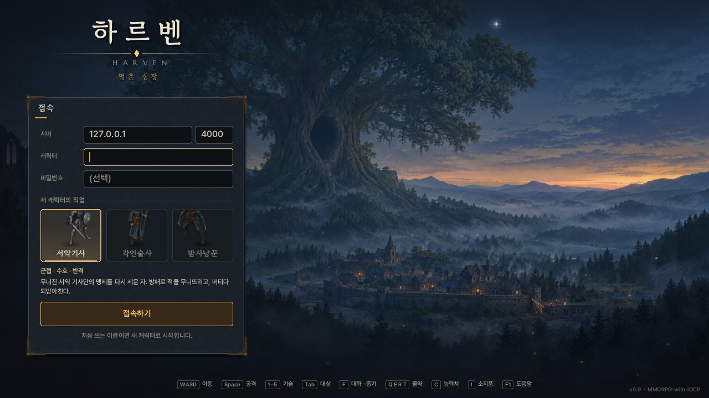 | 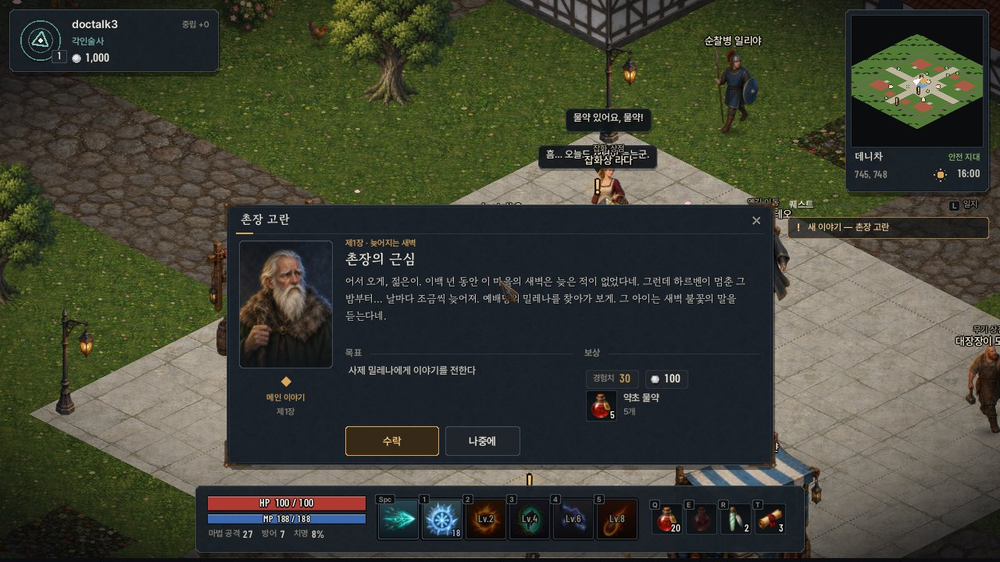 |
| **사냥 — 밤사냥꾼 · 타격 효과** | **서약기사 · 레벨 업** |
| 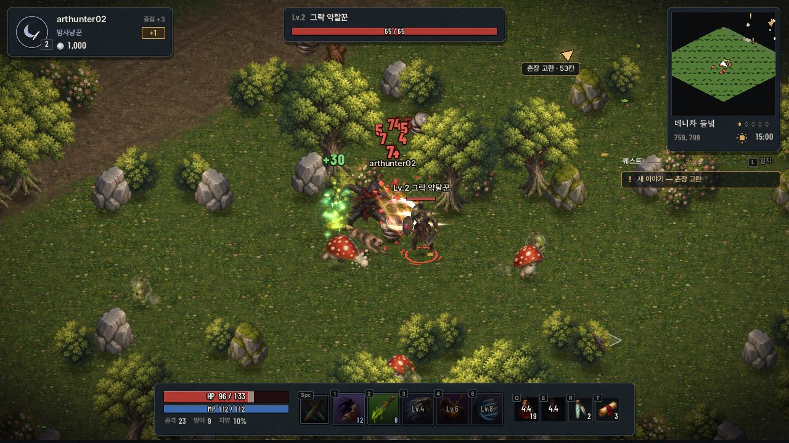 | 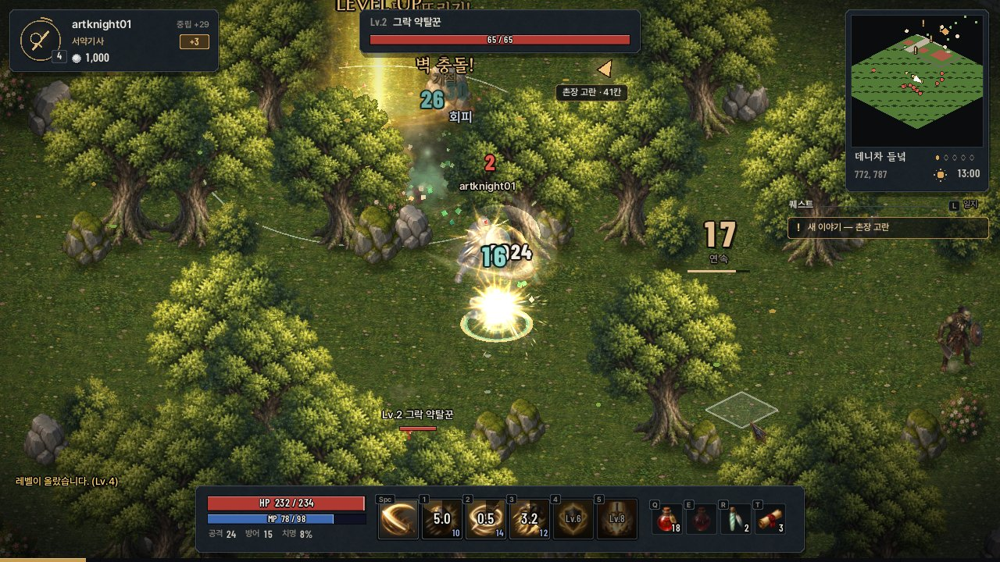 |
| **몬스터 도감(34종 · 보스 6종) · 마을 사람** | **밤의 데니차 광장** |
| 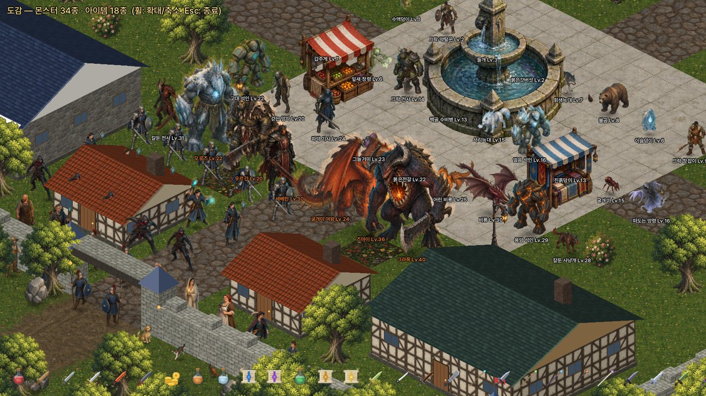 | 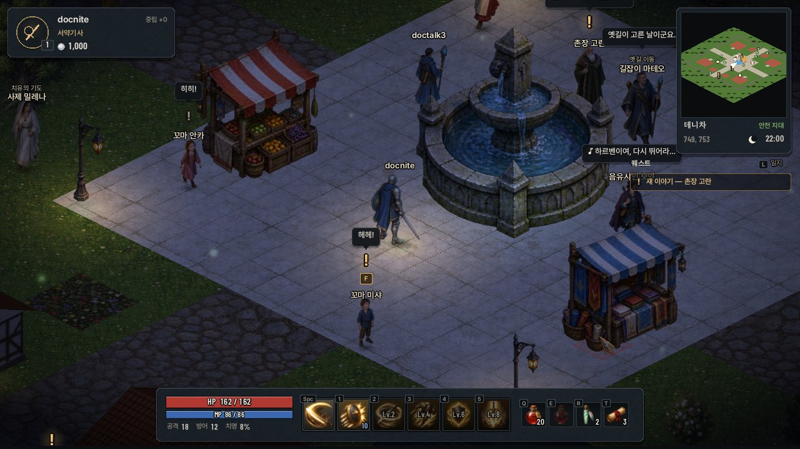 |
| **마을 상점** | **소지품 · 장비** |
| 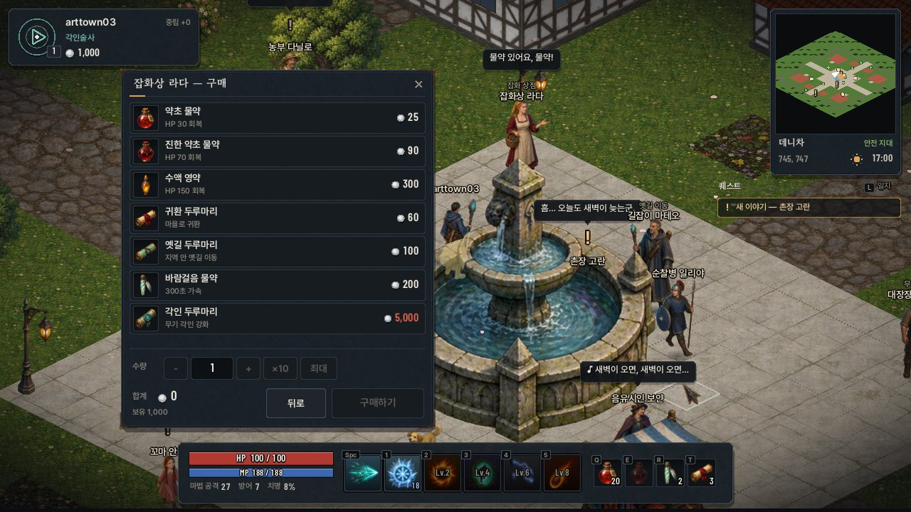 | 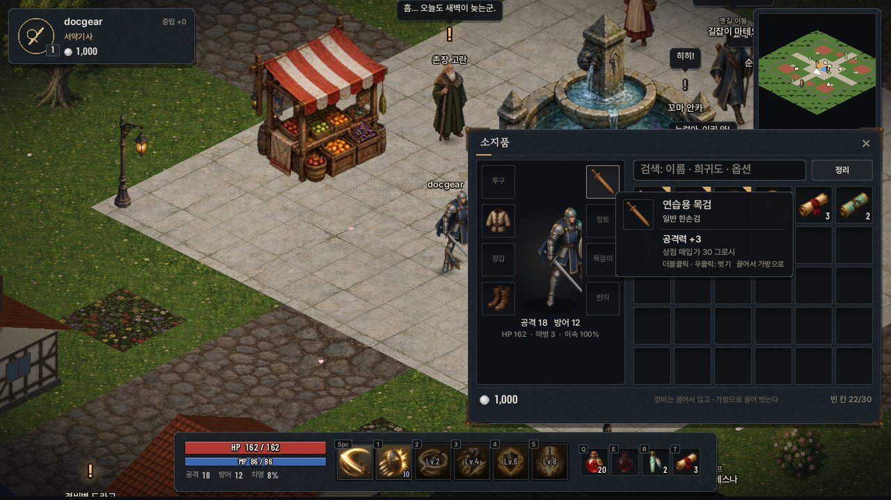 |
| **캐릭터** | **퀘스트 일지** |
| 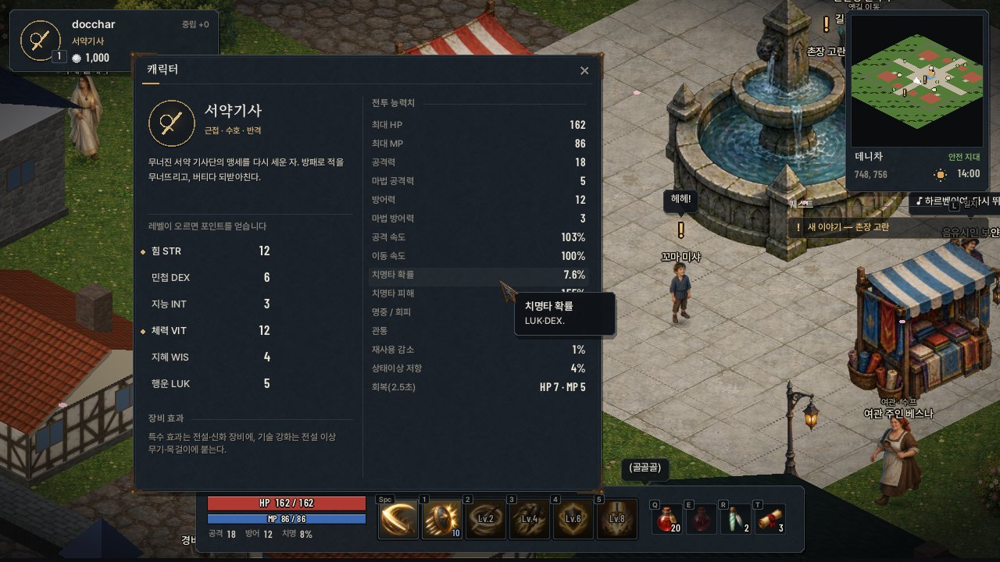 | 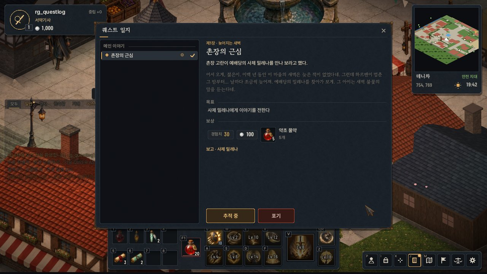 |
| **장 제목 카드** | **월드 지도** |
| 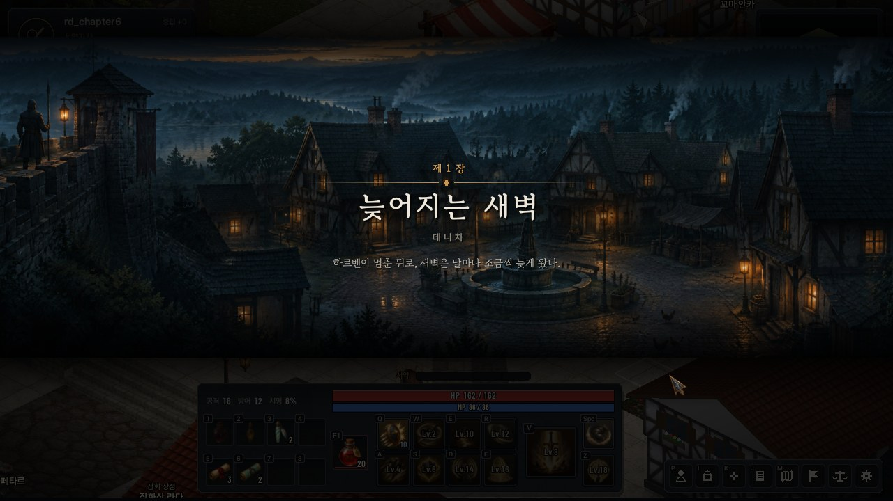 | 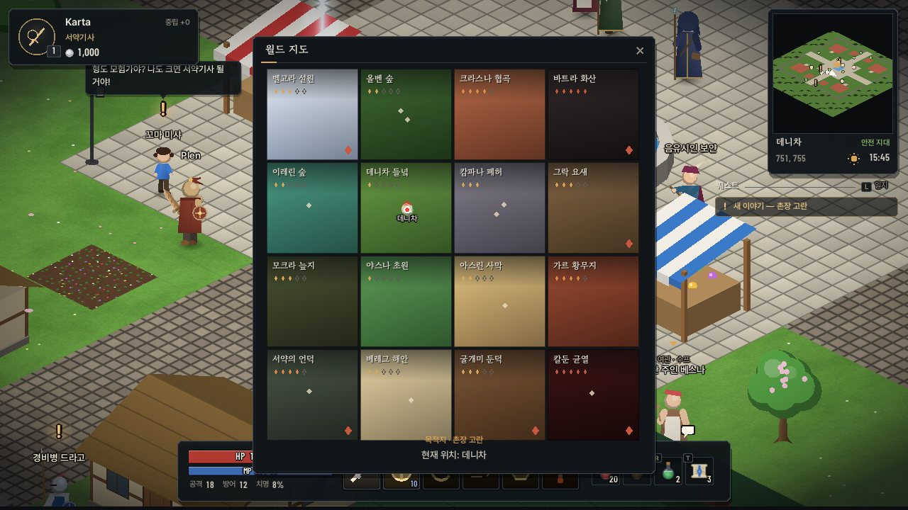 |

---

## 빌드 (Windows)

필요한 것: **Visual Studio 2022**(“C++를 사용한 데스크톱 개발” + “Windows용 C++ CMake 도구”),
처음 한 번 raylib 5.5를 내려받을 인터넷 연결.

**방법 A — VS에서 폴더 열기**

1. Visual Studio 2022 → `파일 > 열기 > 폴더` → 이 `Client2D` 폴더 선택 (`CMakePresets.json`을 자동으로 읽습니다)
2. 상단 구성 목록에서 `x64 Release`, 시작 항목 `Client2D.exe` 선택 → `F5`
   (`x64 Debug`는 콘솔 창에 raylib 로그가 함께 보입니다)

**방법 B — 명령줄**

```bat
cmake -S Client2D -B Client2D\build -G "Visual Studio 17 2022" -A x64
cmake --build Client2D\build --config Release
Client2D\build\Release\Client2D.exe
```

- 오프라인이면 raylib 소스 경로를 넘깁니다: `-DRAYLIB_SOURCE_DIR=C:\path\to\raylib-5.5`
- `Client2D` 폴더는 저장소 루트(`GameServer` 옆)에 있어야 합니다. 빌드가 끝나면 `assets/`(글꼴 · 그림 · 아이콘)가 실행 파일 옆으로 복사됩니다.
- 실행 파일 아이콘 · 버전 정보는 `res/app.rc`(`res/harven.ico`)에서 들어갑니다.

## 실행

1. **DB 갱신** — `Database/setup.sql`을 다시 실행합니다(그로시 · 성향 · PK 횟수 · 강화 수치 · 장비 · 퀘스트 저장 컬럼과 프로시저.
   `IF NOT EXISTS`로 되어 있어 기존 데이터는 그대로 남습니다. 그로시의 DB/패킷 이름은 예전 그대로 `Adena`입니다).
2. `GameServer` 실행(포트 4000).
3. `Client2D.exe` 실행 → 서버 주소 입력 → 캐릭터 이름(영문/숫자 2~12자)으로 접속.
   처음 쓰는 이름이면 고른 직업으로 새 캐릭터가 만들어지고 초보자 지원품(직업 무기 · 약초 물약 · 두루마리 · 그로시)을 받습니다.

| 실행 옵션 | 설명 |
|---|---|
| `--host 127.0.0.1 --port 4000` | 로그인 화면의 기본 서버 주소 |
| `--name 이름` | 자동 로그인 |
| `--class 0\|1\|2` | 새 캐릭터 직업(0 서약기사 · 1 각인술사 · 2 밤사냥꾼) |
| `--size 1600x900` | 창 크기 |
| `--mute` | 소리 끄기 |
| `--hour 22` | 게임 시각 고정(낮/밤 확인용) |
| `--gallery` | 서버 없이 몬스터 · NPC · 아이템 도감 보기 |
| `--screenshot out.png --after 8 [--count 3 --every 2]` | 지정 시간 뒤 스크린샷 저장 후 종료(자동 검증용, 실행 폴더에 저장) |
| `--script hunt\|combat\|boss\|gear\|talk\|talk:N\|chapterN\|quest\|questlog\|map\|charwin\|...` | 정해진 행동을 자동으로 수행(자동 검증용). `talk:N` = N번 NPC와 대화, `chapterN` = 제N장 카드 |

## 조작

전투는 **키보드로만** 합니다. 마우스는 창 · 상점 · 대화 같은 UI와, 바닥 클릭 이동 · NPC/아이템 클릭처럼 **전투가 아닌 상호작용**에 씁니다.

| 입력 | 동작 |
|---|---|
| W A S D / 방향키 | 8방향 이동 — 누른 쪽이 언제나 우선(경로 · 자동 공격을 즉시 취소) |
| Space | 기본 공격 — 대상(없으면 가까운 적)에게 다가가 계속 친다. 누르고 있으면 쓰러뜨린 뒤 다음 적으로 |
| 1 ~ 5 | 직업 기술 — 사거리 밖이면 다가가서 쓰고, 재사용 대기가 거의 끝났을 때 누르면 풀리는 순간 나간다(선입력) |
| Tab / Esc | 가까운 순서로 대상 바꾸기 / 대상 해제 |
| Ctrl + Space · 기술 | 다른 모험가 공격(PK) — 먼저 때리면 **적대**, 무고한 자를 쓰러뜨리면 **악명** |
| F | 가까운 NPC와 대화(동물은 쓰다듬기) · 없으면 발밑 아이템 줍기 |
| Q E R T / F5 ~ F8 | 물약 · 두루마리 칸(소지품에서 끌어다 등록, 캐릭터별 저장) |
| Z | 주변 아이템 줍기 |
| C | 캐릭터 — 직업 소개, 능력치 분배(Shift+클릭 5씩), 전투 능력치 |
| I | 소지품 — 장비 8부위 + 가방. 더블클릭 · 우클릭 착용/사용, 끌어서 입기 · 벗기 · 교환 · 버리기, 검색 · 정리 |
| L | 퀘스트 일지 |
| M | 월드 지도 |
| Enter | 채팅 (`&`로 시작하면 전체 채팅, 한글 IME 지원) |
| Alt / 휠 | 이름 모두 보기 / 확대 · 축소 |
| H / F1 | 도움말 |

## 직업(로그인 화면에서 선택)

| 직업 | 플레이 | 기술(1~5) · 연계 |
|---|---|---|
| 서약기사 | 근접 · 수호 · 반격 | 방패 강타(기절) → 검격 · 회전 베기 **무너뜨리기** → 단죄(기절 · 빈사 2배) · 돌진(벽으로 밀면 **벽 충돌**) · 철벽 태세(피해 절반 + **반격**) |
| 각인술사 | 원거리 · 제어 · 폭딜 | 서리 각인(빙결) → 화염 고리 **증발 폭발** / 낙성 **산산조각** · 벼락 사슬(표식 · 화상 · 빙결로 **전도**) · 옛길 도약 |
| 밤사냥꾼 | 근접 · 암살 · 기동 | 독 칼날(중독 5중첩) → 그믐 베기 **독 폭발** · 그늘 걸음(등 뒤 + **기습**) → 후방 습격 **급소** · 잔상 회피 |

몬스터의 강공격은 몸이 붉게 달아오르고 바닥에 예고가 깔린 뒤에 떨어집니다 — 피하거나, 기절 · 빙결로 **끊을** 수 있습니다.

## 이야기 — 「멈춘 심장」

메인 이야기 다섯 장. 장이 바뀔 때마다 장 그림이 화면을 가로지르는 **장 제목 카드**가 뜹니다.

| 장 | 제목 | 무대 |
|---|---|---|
| 1 | 늦어지는 새벽 | 데니차 |
| 2 | 속삭이는 숲 | 올벤 숲 |
| 3 | 세 번의 종소리 | 캄파나 폐허 |
| 4 | 깨어진 서약 | 서약의 언덕 |
| 5 | 심장의 불씨 | 칼둔 균열 |

부가 이야기 · 반복 의뢰 · 직업의 길 퀘스트, 퀘스트 추적 · 일지 · 나침반 · 발견 알림, 끝나면 엔딩(하르벤이 다시 뛴다)까지 이어집니다.

## 장비 · 성장

- **장비 부위 8개**: 무기 · 투구 · 갑옷 · 장갑 · 신발 · 망토 · 목걸이 · 반지. 입은 장비는 캐릭터에 그대로 보입니다(투구 모양, 갑옷 · 망토 색, 무기 희귀도 빛).
- **희귀도 6단계**: 일반 → 고급 → 희귀 → 영웅 → 전설 → 신화. 희귀도가 높을수록 옵션이 많고(최대 4줄), 전설부터 특수 효과(천둥의 일격 · 생명 흡수 · 처형자 · 서약의 방패 …)가,
  전설 이상 무기 · 목걸이에는 기술 강화(그 기술 피해 +%)가 붙습니다. 세트(서약의 갑주 · 이레린의 노래 · 은늑대)는 2부위 · 4부위 효과.
- **루팅**: 바닥의 장비는 희귀도 색으로 빛나고, 희귀부터는 빛기둥이 섭니다. 좋은 걸 오래 못 보면 반드시 한 번은 나옵니다(천장).
- **소지품 창(I)**: 마우스를 올리면 옵션과 함께 **입었을 때 능력치가 어떻게 바뀌는지**(▲/▼)와 지금 입은 장비가 나란히 보입니다.
- **각인 강화**: 각인 두루마리를 쓰고 소지품에서 무기를 고르면 “새김 → 결과 공개” 연출과 함께 강화됩니다. +6까지 안전, 그 위로는 확률 · 실패 시 사라짐(축성된 각인 두루마리는 안전 구간에서 +1~3). 강화 수치는 이름(`+7 기병 곡도`)과 무기 빛깔로 보입니다.

## 살아 있는 마을 — 데니차

마을 NPC 20명(촌장 고란 · 사제 밀레나 · 여관 주인 베스나 · 음유시인 보얀 · 아이들 · 마르파 할멈 · 농부 다닐로 · 경비병 · 개 · 고양이 · 닭)은
**서버가 배회시킵니다**(마을 Zone 스레드, 확장 세션에만 `NPC_*` 패킷). 가까이 가면 돌아보며 인사하고, 혼잣말을 하고(모두가 같은 말을 본다),
아이들은 서로 쫓아다니고 개는 사람을 따라다닙니다. **F**로 말을 걸면 NPC가 멈춰 서서 바라보고, 초상화와 함께 이야기를 들려주거나
상점 · 옛길 이동(길잡이 마테오) · 치유의 기도(사제) · 수프(여관)를 제공합니다.

## 콘텐츠

- **16개 지역**(서버 Zone 4×4 = 지역): 데니차 들녘(◆1)부터 칼둔 균열(◆5)까지, 지역마다 지형 색 · 소품 · 분위기 파티클 · 몬스터 구성이 다릅니다.
- **몬스터 28종 + 필드 보스 6종**: 벨고라의 혹한 모로즈 · 그락 대족장 우르간 · 몰락한 기사단장 세베린 · 둔덕의 어미 굴개미 여왕 · 바트라의 늙은 용 즈마이 · 삼키는 주인 그라목.
  보스는 내려찍기 전에 붉은 경고 장판을 깔고, 출현 · 처치가 월드 공지로 뜹니다.
- **데니차**(안전지대): 배회하는 주민 20명, 분수 광장, 성벽과 성문. 마을 안에서는 전투 불가, 자연 회복 2배.
- **그로시 · 상점 · 옛길 이동**: 물약 · 두루마리 · 무기 구매 · 판매, 지역별 요금 옛길 이동, 귀환 · 옛길 두루마리.
- **사망**: 몬스터에게 쓰러지면 경험치 5% 손실(레벨 다운 없음), 30초 뒤 자동 또는 버튼으로 마을에서 다시 시작.
- **PK · 성향**: 몬스터 사냥으로 성향 상승(명예 = 파란 이름), 먼저 공격하면 60초 동안 적대, 무고한 자를 쓰러뜨리면 성향 −1000(악명 = 붉은 이름), 악명 상태로 쓰러지면 40% 확률로 아이템을 떨어뜨립니다.

## 브랜드 · UI — 「새김」

- **로그인**: 대표 그림(심장나무 하르벤과 데니차 마을)이 화면을 채우고 아주 느리게 숨 쉬듯 움직입니다. 그림 속 샛별이 반짝이고, 마을 위로 반딧불이 떠오릅니다. 왼쪽 기둥에 로고와 접속 판.
- **창 · 부품**: 모서리를 깎은 판(새김판) + 가는 선 + 강조색 하나(새벽빛). 인벤토리 · 장비 · 캐릭터 · 기술 · 퀘스트 · 채팅 · 미니맵 · 시스템 메시지가 같은 부품으로 그려집니다.
- **글꼴 계열**: 본문 Pretendard · 제목과 이야기 고운바탕 · 숫자 Barlow Condensed(고정폭) · 영문 로고 Marcellus. 계열이 달라도 같은 크기면 한글 높이 · 기준선이 맞도록 보정합니다.
- **앱 아이콘**: 새김판 위의 지평선과 샛별 — 로고와 같은 표식.

## Game Feel · 손맛

- **그린 캐릭터의 움직임**: 한 캐릭터에 동작 그림이 13장(서기 · 걸음 둘 · 준비 · 휘두름 · 시전 · 막기 · 맞음 · 쓰러짐 · 뒷모습 넷)뿐이라
  그 사이를 코드가 연기한다 — 준비(뒤로 젖히며 웅크림) → 휘두름(앞으로 튀어 나가며 늘어나고, 앞 동작이 잔상으로 한 장 남음) → 되돌아옴(한 번 튐).
  맞으면 셰이더가 몸을 흰색으로 번쩍이고 뒤로 젖히며 밀려나고, 쓰러질 때는 넘어지다 바닥에 쿵 하고 튄다. 걸음은 두 그림을 발 위상에 맞춰 바꾸며
  위아래로 흔들린다. 회전 베기는 그림 한 장을 가로로 뒤집어 돌고, 힘 모으기는 떨림과 몸빛(더하기 혼합)이 차오른다. 나무는 바람에 윗부분만 흔들린다.
- **타격**: 맞는 순간 그린 섬광(치명타는 더 큰 폭발 + 충격 고리)이 튀어나오고 히트스톱 동안 그 한 장이 멈춰 보인다. 칼 궤적 · 짐승의 할퀸 자국 ·
  기술마다 다른 그린 효과(불 고리 · 서리 인장 · 벼락 구슬 · 독 튀김 · 금빛 기둥 · 낙성 불덩이). 히트스톱(치명타일수록 길게), 방향성 불꽃,
  치명타 피해 숫자(크게 튀어오름)와 화면 흔들림(trauma 방식).
- **처치**: 몬스터 색으로 터지는 사망 파편, 보스는 화면 번쩍임 + 줌 펀치, 그로시가 튀어 오르며 떨어짐, 희귀도별 빛기둥이 서는 드롭 아이템.
- **성장**: 레벨업 빛기둥 + 링 + 화면 번쩍임, 경험치 띠 채움 연출, 강화는 “충전 → 결과 공개” 2단 연출.
- **이동**: 서버 응답을 기다리지 않는 예측 이동(한 칸 선행, 서버 좌표와 어긋나면 부드럽게 보정), 걸음 먼지, 가속 잔상, 카메라가 진행 방향으로 살짝 앞서감.
- **세계**: 낮/밤 주기(24분 = 하루, 밤에는 가로등 · 횃불 · 캐릭터 주변 조명), 시야 밖 안개, 건물 · 나무 뒤에서도 보이는 내 캐릭터 실루엣, 지역별 날씨 파티클(눈 · 재 · 반딧불…), 미니맵.
- **소리**: 효과음 60여 종을 실행 시 합성(휘두르기 · 타격 · 치명타 · 직업 기술 · 연계 · 동전 · 레벨업 · 강화 · 보스 포효 · 마을 사람과 동물 · 희귀도별 획득음 · 장 종소리 · 지역 환경음). 같은 소리도 매번 음높이/좌우 위치가 조금씩 달라집니다.
  타격음은 네 겹(3ms 딸깍 · 낮은 몸통 쿵 · 살과 갑옷의 바삭함 · 칼날의 짧은 쇳소리), 강타는 여기에 땅울림과 금속 배음을 더합니다.
- **목소리(Higgsfield 음성 합성)**: 마을 사람은 대화창을 열면 인사말을 실제로 말하고, 궁극기(단죄 · 낙성 · 그믐 베기) · 레벨 업 · 쓰러짐에 직업별 대사,
  필드 보스는 나타날 때와 쓰러질 때 한마디(깊은 울림 · 낮춘 음높이). Higgsfield의 효과음 · 음악 모델은 Higgsfield 자체 게임 제작 기능 안에서만 쓸 수 있게 막혀 있어,
  효과음은 합성으로 만듭니다.

## 구조

```
src/
  main.cpp            창/옵션/메인 루프, 에셋 폴더 찾기, 창 아이콘
  net/                논블로킹 TCP 소켓(Winsock/BSD) + [size][type][body] 프레이밍, 요청 헬퍼
  game/               Game(상태 · 입력 · 예측 이동) / GameNet(패킷 처리) / GameDraw(월드) / GameUi(HUD · 창 · 로그인)
                      GameItems(소지품 · 장비 · 툴팁) / GameQuest(퀘스트 · 대화 · 장 카드 · 엔딩) / GameNpc · GameCombat
                      Path(A*) · Texts(한국어 조사 처리 문구) · Entity
  render/             Draw(깊이 버퍼 기반 2D 배치 · 스프라이트 메시) · Terrain(GLSL 지형 + 그린 바닥 아틀라스) · Props(그린 소품 · 텍스처 건물)
                      Sprites(아틀라스 · 알파 테스트/번쩍임 월드 셰이더) · ActorSprites(그린 동작 + 절차적 연기)
                      EnvArt(바닥 · 벽 · 지붕 텍스처) · FxArt(그린 효과) · Actors(예전 벡터 그림 — 그림이 없을 때) · Icons · Lighting
                      Art(일러스트: JPEG 지연 로딩 · cover 자르기 · 반짝임)
  fx/                 Effects(피해 숫자 · 히트스톱 · 장판 · 빛기둥 · 그린 섬광) · Particles(Shape::Tex = 그린 효과 한 장) · SkillFx
  audio/              Sfx(절차적 효과음 합성) · Voice(음성 대사 — 한 번에 하나, 우선순위)
  ui/                 Font(여러 글꼴 계열 + 동적 글리프 아틀라스, stb_truetype) · Ui(즉시 모드 위젯 · 디자인 토큰) · UiArt(돌결 · 모서리 장식 · 커서)
  platform/           ImeWin(Windows 한글 조합 입력)
  third_party/        stb_truetype.h · stb_image.h (공개 도메인)
assets/
  fonts/              Pretendard · 고운바탕 · Barlow Condensed · Marcellus · 나눔스퀘어라운드(+ OFL 사용 허가서)
  art/                key_art.jpg · chapter_1~5.jpg · portrait_<NPC id>.jpg · portrait_guard.jpg
  sprites/            actors_N.png + actors.txt(캐릭터 동작 239장) · props_0.png + props.txt(소품 40종) — 이름 · 자리 · 발 위치 · 기준 키
  terrain/            ground_atlas.jpg(바닥 20종, 칸마다 32px 감싸기) · wall_* · roof_* · wood_planks.jpg
  icons/              icons.png + icons.txt(item_<id> · skill_<id> · status_<id> · quest_<n> · ui_*)
  fx/                 효과 40장(검은 바탕 → 밝기 = 알파)        ui/  panel_tex · corner · divider · cursor_*
  voice/              대사 35줄(ogg, 모노 22kHz) + voice.txt
  icon/               harven.png(창 아이콘)
res/                  app.rc · harven.ico(실행 파일 아이콘 · 버전 정보)
```

- **네트워크**: 서버와 같은 `#pragma pack(1)` 구조체를 그대로 사용합니다. 접속은 `USER_LOGIN_EX_REQ`(확장 세션)로 하므로
  기존 봇(`STRESS_TEST`) · 레거시 클라이언트가 받는 패킷 구성은 바뀌지 않습니다.
- **예측 이동**: 이동 요청은 한 번에 하나만 보내고(가속 시 간격 단축), 서버의 `MOVE_NFY`로 확정합니다. 1초 안에 응답이 없거나
  서버가 다른 좌표를 보내면 서버 좌표로 되돌립니다. 옛길 이동 · 지역 이동처럼 요청하지 않은 이동은 즉시 스냅합니다.
- **그리기 순서**: 지형(셰이더) → 바닥 데칼 → 불투명 개체(깊이 쓰기) → 가려진 내 캐릭터 실루엣(깊이 GREATER) → 반투명 → 조명 → UI.
- **그린 스프라이트**: 발(anchor)을 바닥 칸에 두고 그 칸의 깊이를 쓰는 세로 판(여섯 줄 메시 — 윗부분만 기울이기 · 눌림 · 늘림 · 회전).
  불투명 패스는 알파 테스트(0.35)로 투명한 곳이 깊이를 차지하지 않게 하고, 번쩍임 양 · 색과 "알파 테스트 대상" 표시는
  텍스처 좌표의 정수부에 실어 월드 셰이더가 푼다(정점 수를 늘리지 않고 한 번에 그린다). 그림이 없으면 예전 벡터 그림으로 그린다.
- **일러스트**: 처음 쓸 때 stb_image로 풀어 밉맵 텍스처로 올립니다(raylib 기본 빌드는 JPEG를 읽지 않음). 파일이 없으면 코드로 그린 화면으로 대신합니다.

## 에셋 출처 · 사용 허가

| 에셋 | 출처 | 허가 |
|---|---|---|
| Pretendard | Kil Hyung-jin (orioncactus/pretendard) | SIL OFL 1.1 — `assets/fonts/OFL-Pretendard.txt` |
| 고운바탕(Gowun Batang) | 류양희(yangheeryu/Gowun-Batang), KS X 1001 + 게임 글자로 줄임 | SIL OFL 1.1 — `assets/fonts/OFL-GowunBatang.txt` |
| Barlow Condensed | Jeremy Tribby (jpt/barlow) | SIL OFL 1.1 — `assets/fonts/OFL-BarlowCondensed.txt` |
| Marcellus | Astigmatic (Brian J. Bonislawsky) | SIL OFL 1.1 — `assets/fonts/OFL-Marcellus.txt` |
| 나눔스퀘어라운드 | NAVER | SIL OFL 1.1 — `assets/fonts/OFL-NanumSquareRound.txt` |
| 일러스트(대표 그림 · 장 그림 · 초상화) | 이 프로젝트를 위해 Higgsfield(GPT Image 2.5)로 생성 | 생성 서비스 약관에 따름 |
| 캐릭터 · 몬스터 · NPC 동작 그림, 소품, 바닥 · 벽 · 지붕 텍스처, 아이콘, 효과, UI 장식 · 커서 | 이 프로젝트를 위해 Higgsfield(GPT Image 2.5)로 생성 — 주문서 `tools/assetgen/catalog.py` | 생성 서비스 약관에 따름 |
| 음성 대사 35줄 | 이 프로젝트를 위해 Higgsfield Text to Speech V2(ElevenLabs 엔진)로 생성 — 대본 `tools/assetgen/voices.py` | 생성 서비스 약관에 따름 |
| stb_truetype · stb_image | Sean Barrett | 공개 도메인(또는 MIT) |
