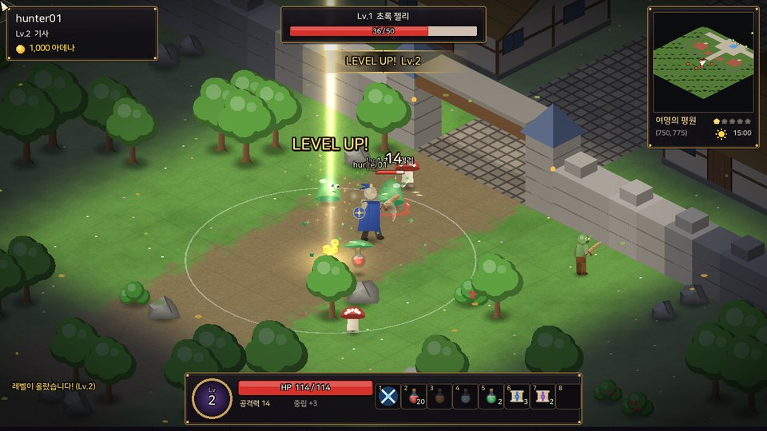
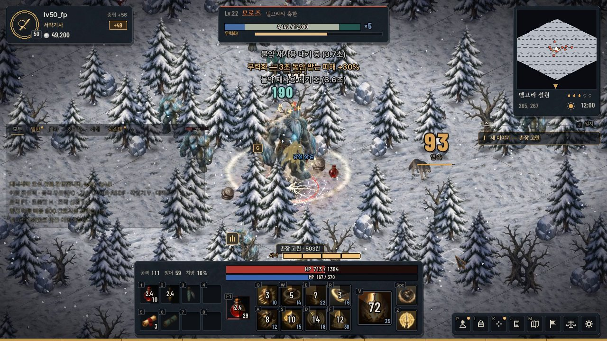
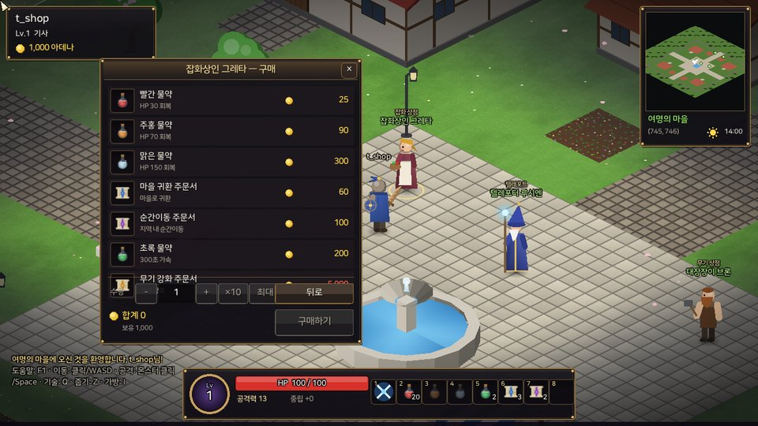
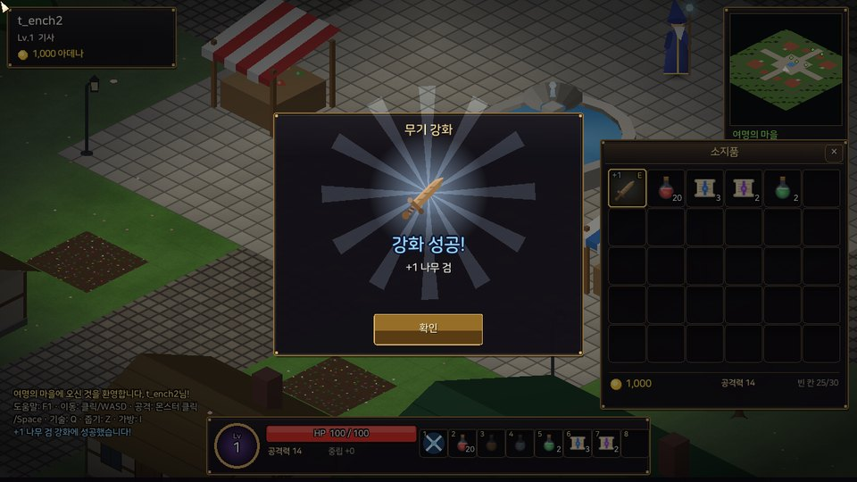
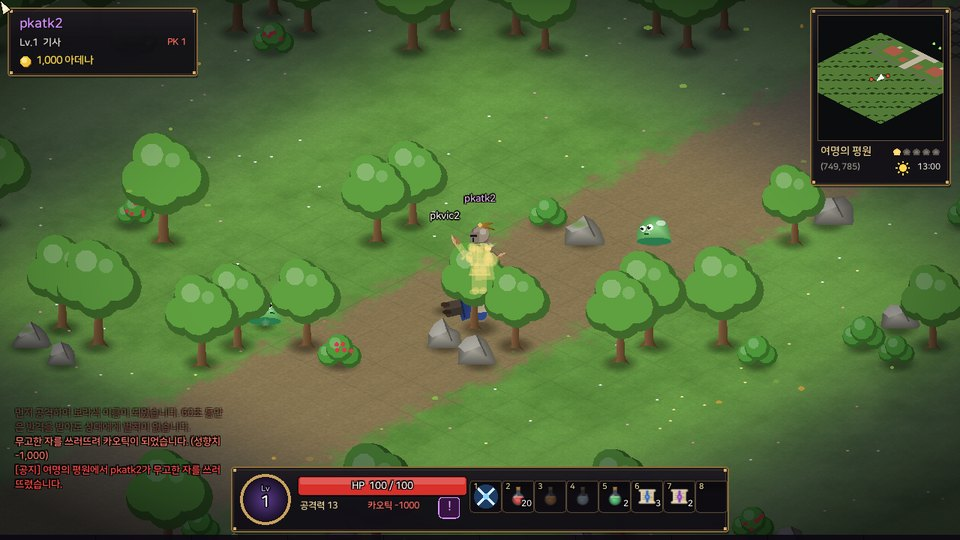

# Client2D — 리니지풍 2D 쿼터뷰 클라이언트

`GameServer`(IOCP)에 TCP 소켓으로 직접 붙는 C++20 + raylib 클라이언트입니다.
서버의 `Protocol.h`와 게임 데이터(`Data/*.h`, `Item/ItemTableData.h`)를 **그대로 include**하므로
패킷 정의·충돌 맵·몬스터/아이템 표가 서버와 어긋날 수 없습니다.

그래픽과 사운드는 전부 코드로 만듭니다(이미지·효과음 파일 없음, 폰트 1개만 포함).

| 사냥 · 레벨업 | 필드 보스 경고 장판 |
|---|---|
|  |  |
| **마을 · 상점** | **무기 강화** |
|  |  |
| **PK · 카오틱 · 월드 공지** | **밤 · 횃불 조명** |
|  |  |

---

## 빌드 (Windows)

필요한 것: **Visual Studio 2022**(“C++를 사용한 데스크톱 개발” + “Windows용 C++ CMake 도구”),
처음 한 번 raylib 5.5를 내려받을 인터넷 연결.

**방법 A — VS에서 폴더 열기**

1. Visual Studio 2022 → `파일 > 열기 > 폴더` → 이 `Client2D` 폴더 선택 (`CMakePresets.json`을 자동으로 읽습니다)
2. 상단 구성 목록에서 `x64 Release`, 시작 항목 `Client2D.exe` 선택 → `F5`
   (`x64 Debug`는 콘솔 창에 raylib 로그가 함께 보입니다)

**방법 B — 명령줄**

```bat
cmake -S Client2D -B Client2D\build -G "Visual Studio 17 2022" -A x64
cmake --build Client2D\build --config Release
Client2D\build\Release\Client2D.exe
```

- 오프라인이면 raylib 소스 경로를 넘깁니다: `-DRAYLIB_SOURCE_DIR=C:\path\to\raylib-5.5`
- `Client2D` 폴더는 저장소 루트(`GameServer` 옆)에 있어야 합니다. 빌드가 끝나면 `assets/`가 실행 파일 옆으로 복사됩니다.

## 실행

1. **DB 갱신** — `Database/setup.sql`을 다시 실행합니다(아데나/성향치/PK 횟수/강화 수치 컬럼과 저장 프로시저 추가.
   `IF NOT EXISTS`로 되어 있어 기존 데이터는 그대로 남습니다).
2. `GameServer` 실행(포트 4000).
3. `Client2D.exe` 실행 → 서버 주소 입력 → 캐릭터 이름(영문/숫자 2~12자)으로 접속.
   처음 쓰는 이름이면 새 캐릭터가 만들어지고 초보자 지원품(나무 검·물약·주문서·아데나)을 받습니다.

| 실행 옵션 | 설명 |
|---|---|
| `--host 127.0.0.1 --port 4000` | 로그인 화면의 기본 서버 주소 |
| `--name 이름` | 자동 로그인 |
| `--size 1600x900` | 창 크기 |
| `--mute` | 소리 끄기 |
| `--hour 22` | 게임 시각 고정(낮/밤 확인용) |
| `--gallery` | 서버 없이 몬스터·NPC·아이템 도감 보기 |
| `--screenshot out.png --after 8 [--count 3 --every 2]` | 지정 시간 뒤 스크린샷 저장 후 종료(자동 검증용) |
| `--class 0\|1\|2` | 새 캐릭터 직업(0 황혼의 기사 · 1 룬술사 · 2 그림자 사냥꾼) |
| `--script hunt\|combat\|plaza\|talk\|priest\|pet\|charwin\|...` | 정해진 행동을 자동으로 수행(자동 검증용) |

## 조작

전투는 **키보드로만** 합니다. 마우스는 창·상점·대화 같은 UI와, 바닥 클릭 이동·NPC/아이템 클릭처럼 **전투가 아닌 상호작용**에 씁니다.

| 입력 | 동작 |
|---|---|
| W A S D / 방향키 | 8방향 이동 — 누른 쪽이 언제나 우선(경로·자동 공격을 즉시 취소) |
| Space | 기본 공격 — 대상(없으면 가까운 적)에게 다가가 계속 친다. 누르고 있으면 쓰러뜨린 뒤 다음 적으로 |
| 1 ~ 5 | 직업 기술 — 사거리 밖이면 다가가서 쓰고, 쿨다운이 거의 끝났을 때 누르면 풀리는 순간 나간다(선입력) |
| Tab / Esc | 가까운 순서로 대상 바꾸기 / 대상 해제 |
| Ctrl + Space·기술 | 다른 모험가 공격(PK) — 먼저 때리면 보라색 이름, 무고한 자를 죽이면 카오틱 |
| F | 가까운 NPC와 대화(동물은 쓰다듬기) · 없으면 발밑 아이템 줍기 |
| Q E R T / F5 ~ F8 | 물약·주문서 칸(소지품에서 끌어다 등록, 캐릭터별 저장) |
| Z | 주변 아이템 줍기 |
| C | 캐릭터 — 직업 소개, 능력치 분배(Shift+클릭 5씩), 전투 능력치 |
| I | 소지품 — 더블클릭·우클릭 사용, 끌어서 교환·버리기 |
| M | 월드 지도 |
| 마우스 | 창·상점·대화 · NPC/아이템 클릭 · 바닥 클릭 이동(누르고 있으면 계속) |
| Enter | 채팅 (`&`로 시작하면 전체 채팅, 한글 IME 지원) |
| Alt / 휠 | 이름 모두 보기 / 확대·축소 |
| H / F1 | 도움말 |

## 직업(로그인 화면에서 선택)

| 직업 | 플레이 | 기술(1~5) · 연계 |
|---|---|---|
| 황혼의 기사 | 근접 · 버티고 반격 | 방패 강타(기절) → 검격/회전 베기 **무너뜨리기** → 황혼의 처형(기절·빈사 2배) · 돌진(벽에 박으면 **벽 충돌**) · 철벽 태세(피해 절반 + **반격**) |
| 룬술사 | 원거리 · 제어 · 폭딜 | 빙결 인장 → 화염 고리 **증발 폭발** / 혜성 낙하 **산산조각** · 번개 폭발(표식·화상·빙결로 **전도**) · 공간 도약 |
| 그림자 사냥꾼 | 파고들어 뒤를 잡는다 | 독 칼날(중독 5중첩) → 월영 난무 **독 폭발** · 그림자 돌진(등 뒤 + **기습**) → 후방 습격 **급소** · 잔상 회피 |

몬스터의 강공격은 몸이 붉게 달아오르고 바닥에 예고가 깔린 뒤에 떨어집니다 — 피하거나, 기절·빙결로 **끊을** 수 있습니다.

## 살아 있는 마을

마을 NPC 20명(촌장·사제·여관 주인·음유시인·아이들·할멈·농부·경비병·개·고양이·닭)은 **서버가 배회시킵니다**(마을 Zone 스레드, 확장 세션에만 `NPC_*` 패킷). 가까이 가면 돌아보며 인사하고, 혼잣말을 하고(모두가 같은 말을 본다), 아이들은 서로 쫓아다니고 개는 사람을 따라다닙니다. **F**로 말을 걸면 NPC가 멈춰 서서 바라보고, 이야기를 들려주거나 상점·텔레포트·치유의 기도(사제)·수프(여관)를 제공합니다.

## 콘텐츠

- **16개 지역**(서버 Zone 4×4 = 지역): 여명의 평원(★1)부터 심연의 문(★5)까지, 지역마다 지형 색·소품·분위기 파티클·몬스터 구성이 다릅니다.
- **몬스터 28종 + 필드 보스 6종**(서리 거인, 오크 대족장, 데스나이트, 여왕 개미, 화염 드레이크, 바포메트). 보스는 내려찍기 전에 붉은 경고 장판을 깔고, 출현/처치가 월드 공지로 뜹니다.
- **여명의 마을**(안전지대): 배회하는 주민 20명, 분수 광장, 성벽과 성문. 마을 안에서는 전투 불가, 회복 4배.
- **아데나 · 상점 · 텔레포트**: 물약/주문서/무기 구매·판매, 지역별 요금 텔레포트, 마을 귀환·순간이동 주문서.
- **무기 강화**: +6까지 안전, 그 위로는 확률·실패 시 증발. +9 이상 성공은 월드 공지. 강화 수치는 이름(`+7 일본도`)과 무기 빛깔로 보입니다.
- **사망**: 몬스터에게 죽으면 경험치 5% 손실(레벨 다운 없음), 30초 뒤 자동 또는 버튼으로 마을에서 다시 시작.
- **PK · 성향치**: 몬스터 사냥으로 성향치 상승(파란 이름 = 라우풀), 먼저 공격하면 60초 보라색 이름, 무고한 자를 죽이면 성향치 −1000(빨간 이름), 카오틱은 죽을 때 40% 확률로 아이템을 떨어뜨립니다.

## Game Feel · 손맛

- **타격**: 히트스톱(치명타일수록 길게), 피격 흰색 번쩍임, 공격 시 몸 앞으로 내미는 동작, 칼 궤적, 방향성 불꽃, 치명타 데미지 숫자(크게 튀어오름)와 화면 흔들림(trauma 방식).
- **처치**: 몬스터 색으로 터지는 사망 파편, 보스는 화면 번쩍임 + 줌 펀치, 아데나가 튀어 오르며 떨어짐, 등급별 빛기둥이 서는 드롭 아이템.
- **성장**: 레벨업 빛기둥 + 링 + 화면 번쩍임, 경험치 바 채움 연출, 강화는 “충전 → 결과 공개” 2단 연출.
- **이동**: 서버 응답을 기다리지 않는 예측 이동(한 칸 선행, 서버 좌표와 어긋나면 부드럽게 보정), 걸음 먼지, 가속 잔상, 카메라가 진행 방향으로 살짝 앞서감.
- **세계**: 낮/밤 주기(24분 = 하루, 밤에는 가로등·횃불·캐릭터 주변 조명), 시야 밖 안개, 건물·나무 뒤에서도 보이는 내 캐릭터 실루엣, 지역별 날씨 파티클(눈·재·반딧불…), 미니맵.
- **소리**: 효과음 39종을 실행 시 합성(휘두르기·타격·치명타·동전·레벨업·강화·보스 포효·지역 환경음). 같은 소리도 매번 음높이/좌우 위치가 조금씩 달라집니다.

## 구조

```
src/
  main.cpp            창/옵션/메인 루프
  net/                논블로킹 TCP 소켓(Winsock/BSD) + [size][type][body] 프레이밍, 요청 헬퍼
  game/               Game(상태·입력·예측 이동) / GameNet(패킷 처리) / GameDraw(월드) / GameUi(HUD·창)
                      Path(A*) · Texts(한국어 조사 처리 문구) · Entity
  render/             Draw(깊이 버퍼 기반 2D 배치) · Terrain(GLSL 지형) · Props · Actors · Icons · Lighting
  fx/                 Effects(데미지 숫자·히트스톱·장판·빛기둥) · Particles
  audio/              Sfx(절차적 효과음 합성)
  ui/                 Font(한글 글리프 동적 로딩) · Ui(즉시 모드 위젯)
  platform/           ImeWin(Windows 한글 조합 입력)
```

- **네트워크**: 서버와 같은 `#pragma pack(1)` 구조체를 그대로 사용합니다. 접속은 `USER_LOGIN_EX_REQ`(확장 세션)로 하므로
  기존 봇(`STRESS_TEST`)·레거시 클라이언트가 받는 패킷 구성은 바뀌지 않습니다.
- **예측 이동**: 이동 요청은 한 번에 하나만 보내고(가속 시 간격 단축), 서버의 `MOVE_NFY`로 확정합니다. 1초 안에 응답이 없거나
  서버가 다른 좌표를 보내면 서버 좌표로 되돌립니다. 텔레포트·지역 이동처럼 요청하지 않은 이동은 즉시 스냅합니다.
- **그리기 순서**: 지형(셰이더) → 바닥 데칼 → 불투명 개체(깊이 쓰기) → 가려진 내 캐릭터 실루엣(깊이 GREATER) → 반투명 → 조명 → UI.
