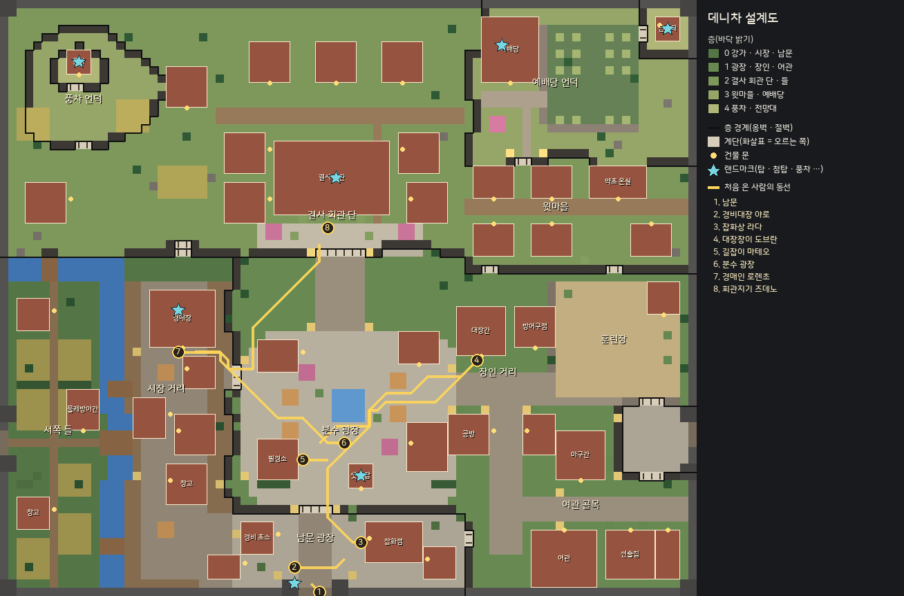
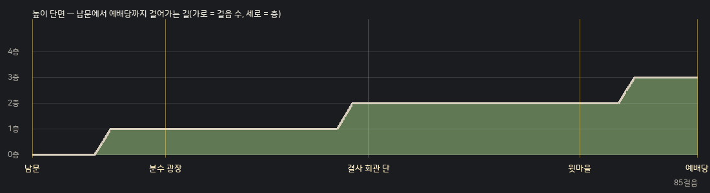

# 데니차 레벨디자인 — 변경의 마지막 마을

> Phase 4-B 설계도. 원본은 `tools/mapgen/denica/*.txt`(사람이 고친다) → `tools/mapgen/gen_town.py`(검사 · 공유 헤더 `Data/TownMap.h`) →
> `tools/mapgen/level_report.py`(달리기 시간 · 층 쓰임 · 랜드마크 시선 · 이 문서의 그림 두 장). 숫자는 모두 이 도구가 센 값이다 — 원본을 고치면 다시 돌린다.
> 이름은 [`WORLD.md`](WORLD.md) "데니차의 구획 · 장소", 색 · 재질은 [`DESIGN_SYSTEM.md`](DESIGN_SYSTEM.md).

## 1. 한눈에

| 항목 | 전(Phase 3) | 지금 |
|---|---|---|
| 크기 | 44×44칸(1,936) | **84×72칸(6,048) — 3.1배**. 원점 (708, 714) |
| 걷는 칸 | 1,424 · 평지 | 3,826 · **층 0~4**(0: 845 · 1: 1,319 · 2: 1,205 · 3: 433 · 4: 24) |
| 건물 · 소품 | 8채 · 5종 | 45채 · 19종(주택 변형 10 · 랜드마크 · 큰 가게 7채는 그린 건물) · 소품 46개(15종) |
| 주민 | NPC 20 | NPC 33(배회) + 새 · 물고기 같은 클라 전용 생명 |
| 성문 | 북 · 남 | 남(들녘 · 사냥터) · 서(개울 다리 · 밭) · 동(훈련장 · 여관 골목) |



그림: 바닥 밝기 = 층, 굵은 검은 선 = 층 경계(옹벽 · 절벽 — 서버 충돌 칸), 옅은 칸 = 계단(짧은 선이 오르는 쪽), 노란 점 = 건물 문,
하늘색 별 = 랜드마크, 노란 선 = 처음 온 사람의 동선(번호 순서).

## 2. 크기 — 달리기 시간

기본 달리기(곧은 한 칸 0.5초, 대각 √2배), 클라 길찾기와 같은 모서리 규칙(대각은 두 옆이 모두 열려야)으로 잰다.

| 구간 | 시간 | 지시서 목표 |
|---|---|---|
| 서문 → 동문 | 45.4초 | 끝에서 끝 35~45초 |
| 남문 → 예배당 문 | 37.8초 | 〃 |
| 가장 먼 두 걷는 칸(북동 전망대 옆 ↔ 서쪽 들) | 70.5초 | (구석끼리 — 참고) |

광장(분수 앞 판석)에서 NPC와 말하는 거리(3칸)까지:

| 시설 | 시간 | 층 | | 시설 | 시간 | 층 |
|---|---|---|---|---|---|---|
| 길잡이 마테오 | 1.0초 | 1 | | 경매장 · 로렌초 | 11.1초 | 0 |
| 촌장 고란 | 2.0초 | 1 | | 결사 회관 · 즈데노 | 11.9초 | 2 |
| 잡화점 · 라다 | 5.4초 | 0 | | 방어구점 · 체도 | 11.9초 | 1 |
| 남문 · 경비대장 야로 | 6.6초 | 0 | | 여관 · 베스나 | 13.4초 | 1 |
| 대장간 · 도브란 | 8.2초 | 1 | | 훈련장 · 교관 두샨 | 16.5초 | 1 |
| | | | | 선술집 · 네다 | 16.9초 | 1 |
| | | | | 예배당 · 사제 밀레나 | 26.7초 | 3 |

**주요 시설(상점 · 대장간 · 방어구 · 길잡이 · 경매장 · 결사 회관 · 여관)은 모두 15초 안.** 선술집 · 훈련장은 동쪽 끝(동문 옆)이라 16~17초,
예배당은 일부러 가장 높고 먼 곳(엄숙 · 위신 — 4장)에 두었다.

## 3. 구획 — 정체성

| 구획 | 층 | 지붕 | 벽 | 소품 | 소리 | 밤 조명 |
|---|---|---|---|---|---|---|
| 남문 광장 | 0 | 짙은 붉은 기와 | 성벽과 같은 회색 돌 | 경비 초소 · 게시판 · 통 · 창 거치대 | 오가는 사람 | 횃불 주황 |
| 분수 광장 | 1 | 붉은 기와 | 흰 회벽 + 나무 뼈대 | 노점 차양 · 꽃 상자 · 벤치 | **분수** · 음유시인 류트 | 따뜻한 금빛 가로등 · **샛별 탑 등불** |
| 시장 거리 · 강가 | 0 | 주황 기와 | 나무 판자 | 노점 줄 · 수레 · 통 · 상자 · 빨래터 | **시장 웅성임** · **강물** · 물레방아 | 붉은 등불 |
| 서쪽 들 | 0 | 짚 | 흙벽 | 밭 · 산울타리 · 닭 | 강물 · 닭 | (어둡다) |
| 장인 거리 | 1 | 검은 슬레이트 | 거친 돌 · 그을린 나무 | 모루 · 장작 · 무기 거치대 · 굴뚝 연기 | **망치** · **불길** | 붉은 화덕 빛 |
| 훈련장 | 1 | — | 나무 울타리 | 허수아비 · 과녁 · 깃대 | 교관 | 횃불 |
| 여관 골목 | 1 | 갈색 너와 | 회벽 · 나무 | 술통 · 벤치 · 여물통 · 건초 | 선술집 떠들썩함 | 노란 창 빛 |
| 결사 회관 단 | 2 | 청회 슬레이트 | 다듬은 돌 | **깃발 뜰**(문장 깃발 · 방패) | 바람 · 깃발 | 차가운 흰 등 |
| 윗마을 | 2 | 밝은 붉은 기와 | 회벽 | 텃밭 · 빨랫줄 · 꽃 상자 · **약초 온실** | 새 | 창 빛 |
| 예배당 언덕 | 3 | 청회 슬레이트 + 첨탑 | 흰 돌 | 묘지 · 낮은 돌담 | **종**(낮의 정시) · 까마귀 | 푸르스름한 등 |
| 풍차 언덕 | 3~4 | 짚 | 나무 · 흙벽 | 비탈 밭 · 건초 · 풍차 | **바람** · 풍차 날개 | 드문 등 |

지붕 · 벽 · 소품 · 조명은 4-C 건물 키트가 구획 규칙으로 고른다(같은 종류라도 구획이 다르면 색이 다르다).

## 4. 높이 — 의미와 단면

- **낮은 곳(0층) = 북적임**: 남문 광장 · 시장 거리 · 강가 · 서쪽 들. 들녘에서 들어오면 먼저 닿는다.
- **가운데(1층) = 생활**: 분수 광장 · 장인 거리 · 여관 골목 · 훈련장.
- **높은 곳(2~4층) = 엄숙 · 위신**: 결사 회관 단(2) · 윗마을(2) · 예배당 언덕(3) · 북쪽 전망대 · 풍차(4).
- 층 사이는 계단 · 경사로뿐(가장자리 칸이 막는다 — `Data/TownRules.h` 전수 검사로 절벽 통과 · 허공 걷기 0).
  주 동선은 0 → 1 → 2 → 3을 모두 밟는다.



## 5. 길의 위계 · 동선

- **큰길(포석 `=`, 4칸)**: 남문 → 광장 → 결사 회관 계단(남북 축), 장인 거리 → 여관 골목(동서). **광장 판석(`,`)**은 분수 광장 · 남문 광장 · 여관 골목 앞.
- **골목(흙길 `:`, 1~2칸)**: 시장 거리 안쪽 · 서쪽 들 · 윗마을 · 풍차 언덕. 막다른 곳에는 볼거리(빨래터 · 전망대 · 묘지 · 풍차)를 둔다.
- 처음 온 사람의 동선(퀘스트 순서) — 지시서의 "성문 → 경비 → 잡화 · 대장간 → 옛길 길잡이 → 광장 → 경매장 · 결사 회관":

| 구간 | 시간 | 지나는 층 |
|---|---|---|
| 남문 → 경비대장 야로 | 0.7초 | 0 |
| 야로 → 잡화상 라다 | 3.2초 | 0 |
| 라다 → 대장장이 도브란 | 16.2초 | 0 → 1 |
| 도브란 → 길잡이 마테오 | 11.9초 | 1 |
| 마테오 → 분수 광장 | 1.5초 | 1 |
| 광장 → 경매인 로렌초 | 11.6초 | 1 → 0 |
| 로렌초 → 회관지기 즈데노 | 14.4초 | 0 → 1 → 2 |
| **합계** | **59.4초** | |

## 6. 랜드마크 · 시선

| 랜드마크 | 자리(마을 기준) | 층 | 높이(바닥에서, z) | 밤 |
|---|---|---|---|---|
| **샛별 탑** | 분수 광장 남쪽 (42~44, 56~58) | 1 | 7.1 | 꼭대기 등불이 빛난다 |
| **예배당 첨탑** | 예배당 언덕 (60, 5) | 3 | 6.4 | |
| **풍차** | 풍차 언덕 (9, 7) | 4 | 6.6 | 날개가 바람 세기로 돈다 |
| **북쪽 전망대** | 북동 모서리 (80, 3) | 4 | 4.6 | 횃불 |
| 결사 회관 깃발 | 결사 회관 (40, 21) | 2 | 4.4 | |
| 경매장 종루 | 시장 거리 (21, 37) | 0 | 5.0 | (교회가 남긴 옛 회관의 빈 종루) |
| 남문 망루 | 남문 양옆 | 0 | 3.2 | 횃불 |

걷는 칸 가운데 랜드마크의 위쪽 절반이 한 화면(1600×900)에 걸리는 칸 — 기본 줌 1.45 · 가장 넓은 줌 0.9:

| 줌 | 하나 이상 보임 |
|---|---|
| 1.45(기본) | 52% |
| 0.9(가장 넓게) | 78% |

쿼터뷰에서는 높은 것이 **내 남쪽(화면 아래)에 있을 때** 꼭대기가 화면 안으로 들어오고, 북쪽에 있으면 꼭대기가 화면 위로 잘린다.
그래서 랜드마크를 마을의 남 · 중 · 북에 고루 두었다. 4-C에서 높이를 확정한 뒤 이 표를 다시 잰다.

**첫인상 구도**: 쿼터뷰에서 북쪽은 화면 오른쪽 위라, 남문 칸(37, 69)에서 기본 줌으로 곧장 보면 광장 · 샛별 탑이 화면 오른쪽 밖이다.
그래서 남문 밖에서 **남문으로 들어서는 순간 카메라가 3.4초 동안 샛별 탑 쪽으로 옮겨 가 조금 넓게 보여 준다**(도착 연출 — `Game.cpp`, PHASE_4.md 4-C 그림).
탑 · 광장 · 경비 초소 · 성문 망루가 한 화면에 들어온 뒤 다시 캐릭터를 따른다.
**액자**: 남문 아치 → 샛별 탑, 결사 회관 계단 → 회관 정면과 깃발, 시장의 다리 → 물레방아, 윗마을 계단 → 예배당 첨탑.

## 7. 소리 구역 · 바람

`ambient.txt` → `TownMap::kAmbient` → 클라 `audio/Ambience`. 끊김 없는 고리 소리 다섯(합성)을 오디오 스레드가 섞는다(프레임이 느려도 끊기지 않는다).
구역 안쪽 25%는 온전히, 바깥으로 갈수록 부드럽게 작아진다. 소리가 오는 쪽으로 좌우가 기운다.

| 종류 | 자리 | 소리 | 밤 |
|---|---|---|---|
| 분수 | 분수 광장(반경 11) | 떨어지는 물줄기 · 물방울 알갱이 · 거품 | 그대로 |
| 사람 소리 | 시장 거리(13) · 남문 광장(8) · 선술집 앞(8) | 알아들을 수 없는 여러 목소리(모음 공명) · 상자 달그락 | 거의 조용 |
| 대장간 | 장인 거리(10) | 풀무가 숨 쉬는 불길 + **망치**(3~6번 두드리고 숨 고르기) | 불씨만, 망치 쉼 |
| 예배당 종 | 예배당 언덕(22) | 낮(6~19시)의 정시마다 세 번 | 울리지 않는다 |
| 강물 | 비스트라 개울 넷 | 낮게 흐르는 물살 · 찰랑임 · 꼴깍 | 그대로 |
| 바람 | 풍차 언덕 · 전망대 · 결사 회관 뒤 들 | 떠도는 대역 노이즈 — **바람 세기**로 커진다 | 그대로 |

**바람 하나**(`render/Wind`): 방향(서남서 → 동북동, 97초 주기로 ±10°) · 세기(느린 부풂 + 가끔 큰 돌풍) · 바람 방향으로 흘러가는 돌풍 결.
나무 · 산울타리가 바람 쪽으로 기울고 결이 지나가면 차례로 크게 흔들리며, 풀밭 위로 밝은 물결이 지나간다(지형 셰이더 `uWind`).
꽃잎 · 잎은 바람을 타고, 깃발 · 빨래 · 굴뚝 연기 · 풍차 날개(4-C)와 바람 소리가 같은 세기를 쓴다. 시간만의 함수라 녹화 · 회귀가 늘 같은 바람을 본다.

## 8. 안전지대 · 부활 · 옛길

- **안전지대** = 마을 사각형 전체(`IsSafeZone = IsInTown`) — 성벽 안. 훈련장(`yard`)만 예외(허수아비).
- **부활 · 귀환 · 첫 접속**: `anchors.txt`의 `spawn` 열 곳(남문 광장 여섯 · 분수 광장 넷) — 무작위. 모두 걷는 칸(`static_assert`).
- **옛길 도착점**: 다른 지역에서 데니차로 오는 옛길은 없다(데니차 들녘의 길잡이 요금 0 — 귀환은 부활 자리로). 지역표의 데니차 `landX/Y`
  (749, 754)는 그대로 두어도 새 마을 기준 (41, 40) — 광장 북쪽 큰길의 걷는 칸이다(`ValidateRegions`가 막힌 칸이면 빌드를 멈춘다). 퀘스트 길 안내의 "데니차 들녘"은 `quest_field`(남문 밖).
- **들길**: 성문마다 그 가운데 줄로 바깥 들길이 뻗는다(지형 셰이더 `uGates` — 예전에는 마을 한가운데 열/행으로 그려 새 성문과 어긋났다).

## 9. 점검

```
python3 tools/mapgen/gen_town.py tools/mapgen/denica   # 규칙 검사 → TownMap.h · preview.png
python3 tools/mapgen/level_report.py                   # 이 문서의 표 · 그림
Client2D --script terraincheck                          # 절벽 통과 · 허공 걷기 · 보이지 않는 벽 · 탐침(PASS/FAIL)
Client2D --script tour                                  # 구획 카메라 투어([amb] 줄 — 자리마다 소리 구역 음량)
```
