# 기술 시연 — 직업별 12칸

> `Client2D --script skills:<직업> --record <폴더>`로 훈련장 허수아비에 모든 기술을 차례로 쓰며 녹화하고, `tools/record/split_skills.py`가 기술마다 한 장씩 자른 움직이는 WebP(12fps · 폭 340 · 화면 가운데 56%)다.
> 레벨 50 시험 캐릭터 · 공유 시계(프레임이 밀려도 연출 시각이 같다) · Phase 2 마지막 빌드(`8eedd33`). 갈래(변형)는 끈 기본 모양.
> 각성기(V)는 시전자 화면 기준 — 암전 · 컷인 · 절정 · 여운. 다른 모험가에게는 월드 효과만 50%로 보인다.

## 서약기사

근접 · 수호 · 반격 — 새벽빛 금 · 강철 불꽃 · 종소리

| 칸 | 기술 | 시연 | 길이 |
|---|---|---|---|
| C | 검격 | 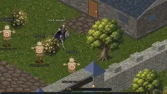 | 2.0초 |
| Q | 방패 강타 | 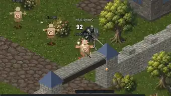 | 2.0초 |
| W | 회전 베기 | 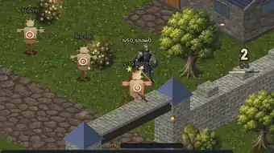 | 3.1초 |
| E | 땅 가르기 | 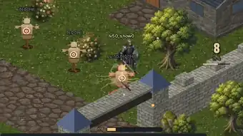 | 3.4초 |
| R | 방패 투척 | 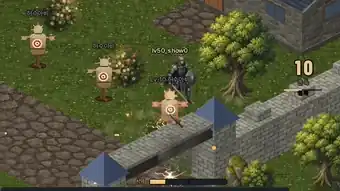 | 2.7초 |
| A | 돌진 | 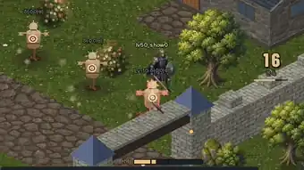 | 2.0초 |
| S | 철벽 태세 | 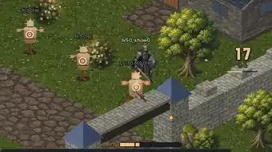 | 3.1초 |
| D | 맹세 함성 | 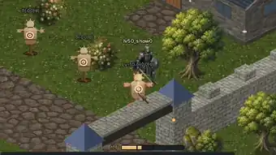 | 2.0초 |
| F | 심판의 종 | 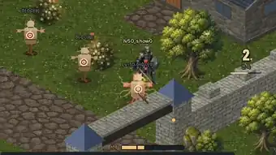 | 2.9초 |
| V | 단죄 | 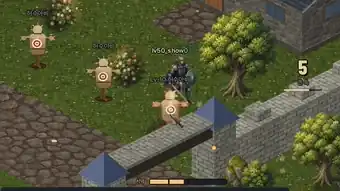 | 5.2초 |
| Space | 몸 굴리기 | 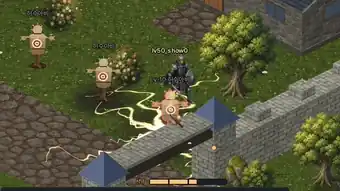 | 3.8초 |
| Z | 서약 해방 | 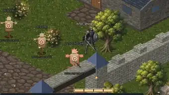 | 2.0초 |

## 각인술사

원거리 · 제어 · 폭딜 — 허공에 각인을 쓰는 것으로 시작하는 주문

| 칸 | 기술 | 시연 | 길이 |
|---|---|---|---|
| C | 각인탄 | 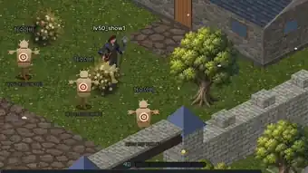 | 2.3초 |
| Q | 서리 각인 | 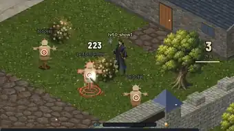 | 2.2초 |
| W | 화염 고리 | 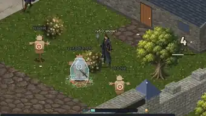 | 2.0초 |
| E | 벼락 사슬 | 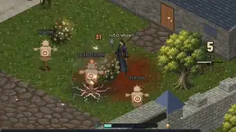 | 2.0초 |
| R | 얼음 창 | 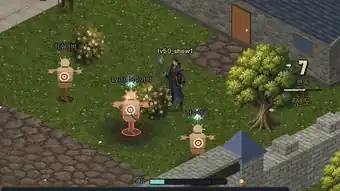 | 3.3초 |
| A | 불꽃 각인 | 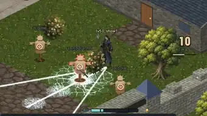 | 3.3초 |
| S | 결계 고리 | 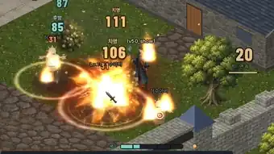 | 2.0초 |
| D | 낙뢰 각인 | 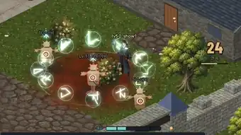 | 2.0초 |
| F | 눈보라 | 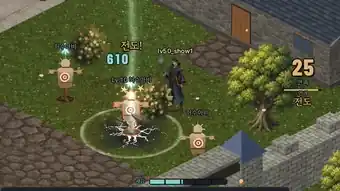 | 3.5초 |
| V | 낙성 | 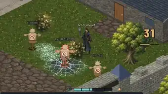 | 5.5초 |
| Space | 옛길 도약 | 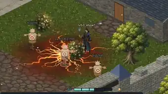 | 3.9초 |
| Z | 새김 울림 | 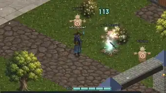 | 2.1초 |

## 밤사냥꾼

근접 · 암살 · 기동 — 먹빛 연기 · 달빛 은백 · 독 녹색

| 칸 | 기술 | 시연 | 길이 |
|---|---|---|---|
| C | 연속 찌르기 | 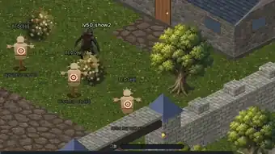 | 1.7초 |
| Q | 독 칼날 | 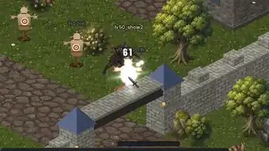 | 2.0초 |
| W | 그늘 걸음 | 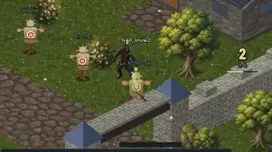 | 2.0초 |
| E | 후방 습격 | 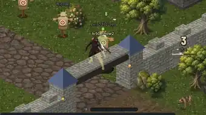 | 2.0초 |
| R | 칼날 폭풍 | 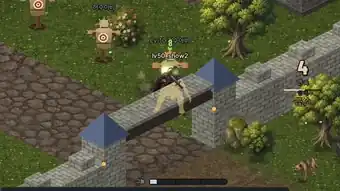 | 3.2초 |
| A | 먹물 분신 | 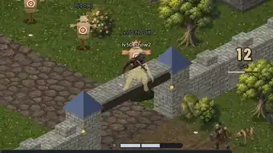 | 2.0초 |
| S | 비수 투척 | 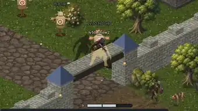 | 3.4초 |
| D | 맹독 안개 | 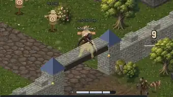 | 2.0초 |
| F | 달 가르기 | 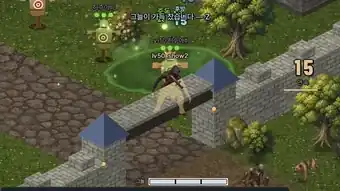 | 3.2초 |
| V | 그믐 베기 | 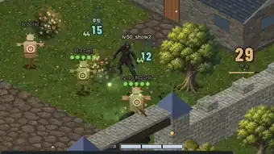 | 5.3초 |
| Space | 잔상 회피 | 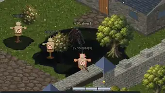 | 2.0초 |
| Z | 밤 장막 | 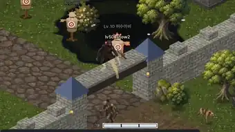 | 2.0초 |

다시 만들기: `tools/sandbox/run.sh`로 샌드박스 서버를 띄우고(공유 시계), 직업마다 `Client2D --script skills:<0|1|2> --record out --seconds 80` → `python3 tools/record/split_skills.py out/client.log out/capture.mp4 docs/skills/<직업>`.
