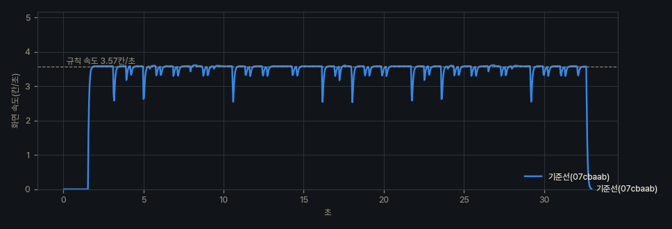
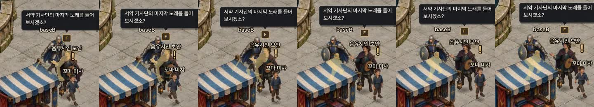
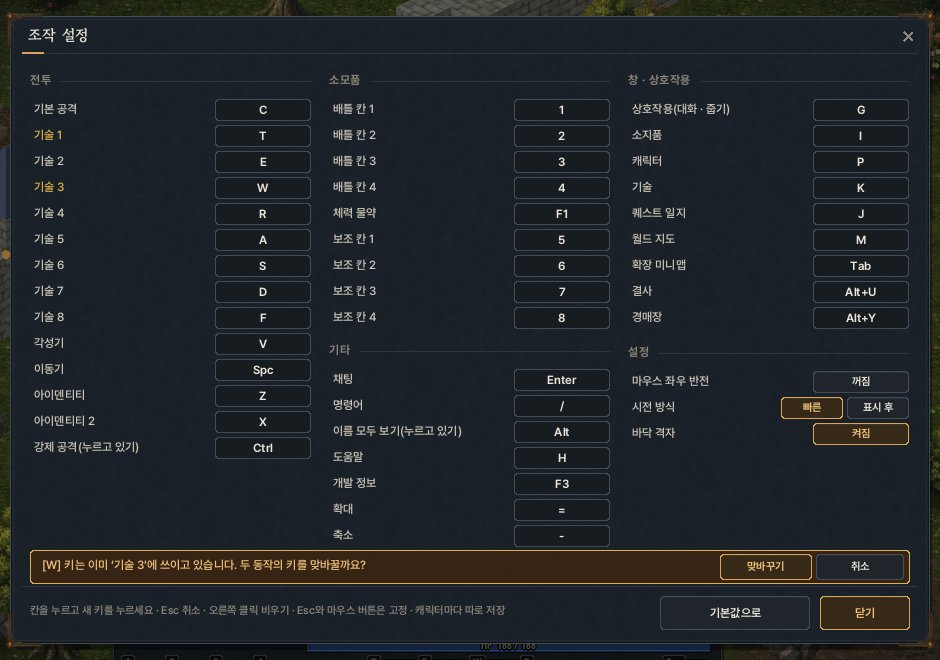
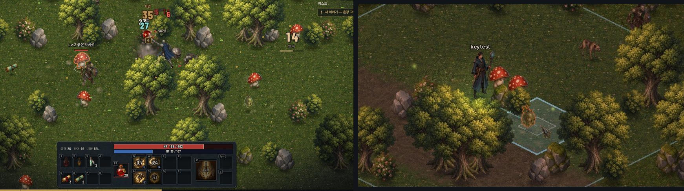
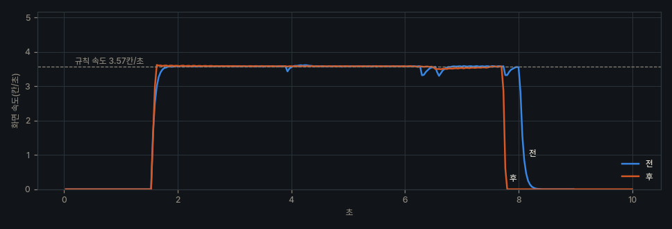
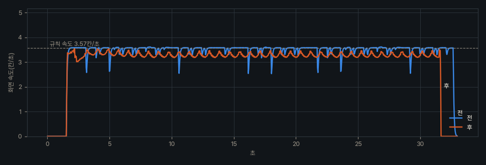
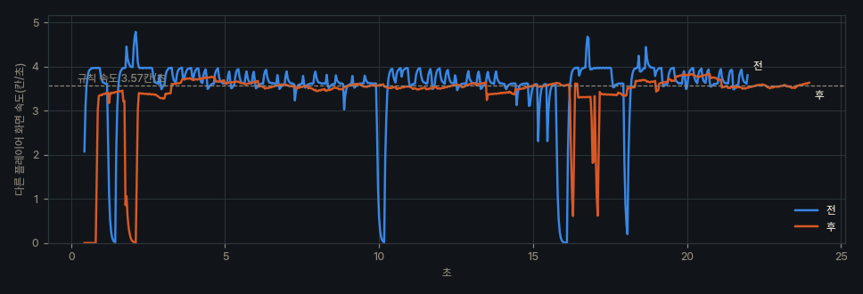
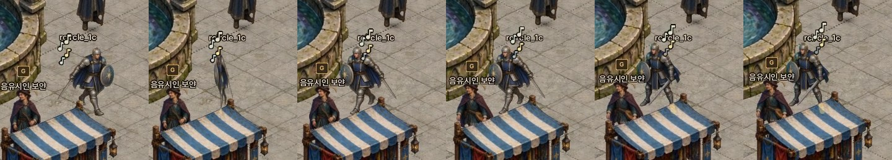

# Phase 1 — 로스트아크식 조작 + 자연스러운 이동 · 애니메이션

> 작업 지시: `claude/UPGRADE_PROMPT.md` [Phase 1]. 이 문서는 진단 · 설계 메모(원인 · 설계안 · 대안 · 선택 이유)이며,
> 하위 단계를 끝낼 때마다 결과를 덧붙인다. 코드 기준은 `newclient` 브랜치(시작 `07cbaab`).

## 0. 기준 수치 — 코드가 문서와 다른 곳

| 항목 | 지시서 | 코드(기준) | 이 Phase에서 |
|---|---|---|---|
| 기본 걸음 | 한 칸 500ms, 바람걸음 330ms | `MoveRule::kBaseStepMs = 280`, 바람걸음 +35% → 207ms | 코드 값을 쓴다 |
| 대각선 | 직선과 같은 시간(가설 3) | 이미 `kDiagPermille = 1414`(√2) — 서버 · 클라 공용 | 유지 |
| 몬스터 대각선 | 검토(선택) | 몬스터 A*는 4방향(`Area/AStar.cpp`) | 해당 없음 |
| 전투 조작 | WASD + Space · 1~5 · QERT | 같음 | 1-A에서 교체 |
| `PacketType` | 개수를 적을 것 | **80개(0~79)**, 헤더 `type`은 `char` → 127까지 **48개** 여유 | Phase 1 새 패킷 **0** |

## 1. 도구(1-0) — 먼저 재는 법

| 도구 | 쓰임 |
|---|---|
| `--record <폴더> --seconds N --fps 30` | 화면 그대로(HUD · F3 포함) 1/fps마다 한 장 → ffmpeg 파이프로 `capture.mp4`. GIF는 `tools/sandbox/run.sh gif` |
| `--netsim latency=150,jitter=40,spike=2` | 양방향 지연 · 지터 · 패킷 100개당 2개를 200~450ms 늦춤(TCP 재전송 흉내, 순서는 지킴 → 뒤따르는 패킷이 몰려 옴) |
| F3 | 프레임 시간 그래프 · CPU 시간 · 드로우콜 · 입자 · 네트워크 처리량 · 이동 왕복 시간 · 예측/서버 칸 · 보정 횟수 |
| `--trace-move out.csv` | 프레임마다 논리/화면 위치 · 원격 위치 · 카메라 · 방향. `tools/record/analyze_trace.py`로 멈칫 · 방향 전환 · 원격 끊김을 센다 |
| `--script runline · runcircle · follow:이름` | 녹화 시나리오 — 사람처럼 **좌클릭을 누른 채** 마우스로 조작(`game/Input`) |

**샌드박스 녹화 — 공유 시계.** 이 작업 공간은 GPU가 없어 llvmpipe로 그린다. 1600×900 한 장에 약 190ms(이 중 140ms가 바닥 셰이더)라
실시간으로 뜨면 5fps 영상이 된다. 그래서 녹화할 때는 세상을 한 시계로 묶었다(`tools/sandbox/README.md`):
녹화 클라이언트가 프레임마다 `/dev/shm/harven_clock`을 정확히 1/fps초씩 올리고, 서버(샌드박스 빌드에서 `steady_clock` → 공유 시계)와 봇이 그 시계를 읽는다.
그리기가 느려도 영상 한 장 = 게임 시간 1/30초라 **움직임의 시간 간격은 실제와 같다**. 실제 GPU의 프레임 시간은 "실기 확인 필요"로 남긴다.

## 2. 기준선(바꾸기 전, `07cbaab` + 도구)

모두 공유 시계 30fps, 1600×900, 데니차 광장. 속도 단위 = 칸/초(규칙 속도 3.57).

| 시나리오 | 화면 속도 중앙값 | 멈칫(85% 밑) | 그 밖 |
|---|---|---|---|
| 직선 — 대각선 칸(화면 가로) 6초 | 3.580 | 0 | |
| 직선 — 직선 칸(화면 오른쪽 위) 6초 | 3.562 | 0 | 대각 대비 0.5% — 가설 3은 이미 해결 |
| 원 그리기 30초(분수 둘레, 누른 채) | 3.574 | **23**(프레임) · 논리 7 | 90° 꺾임마다 72%까지 떨어짐 |
| 원 그리기 20초, 60fps · 프레임 ±30% · 2% 3배 끊김 | 3.520 | **27** | p5 3.16 · p95 3.69 |
| 따라가기 20초, `--netsim 150/40/2` — 내 캐릭터 | 3.563 | 27 | 거절 1 · 보정 1(1.41칸 미끄러짐) |
| 따라가기 — **원격 캐릭터** | 평균 3.68 | — | 표준편차 11.5% · 15% 넘게 벗어난 프레임 5.3% · **멈춘 프레임 15** |



## 3. 1-B 원인 진단

| # | 가설 | 증거 | 판정 | 해결(1-C) |
|---|---|---|---|---|
| 1 | 칸마다 따로 보간 → 칸 경계에서 속도 출렁임 | 직선 달리기 멈칫 0(`kChain` — 늦은 프레임은 직전 걸음 끝으로 거슬러 시작). 원 그리기에서만 90° 꺾임마다 72%(위 그래프) — 논리 경로가 칸 중심에서 꺾이고 화면 위치는 지수 추종(τ 55ms)으로 모서리를 깎으며 **느려진다** | 칸 경계 자체가 아니라 **꺾이는 경로 + 속도를 정하지 않는 지수 추종** | 화면 위치를 "속도를 가진 추종자"로 — 속도는 명시적으로 정하고(가감속 곡선), 방향만 앞쪽 경로를 본다 |
| 2 | 서버 응답을 기다려 선행 예측이 바닥 | 이미 응답을 기다리지 않는다(순번 예측, 최대 3걸음). `--netsim`(왕복 420ms)에서도 기다림 멈칫 0. 대신 지연 뭉침으로 **거절(TooFast) 1회 → 1.41칸 미끄러짐** | 기다림은 원인 아님. 뭉침 거절이 끊김을 만든다 | 다음 걸음을 진행 약 60%에서 미리 확정 · 전송(경로가 늘 0.11초 앞까지 정해져 있다). 보정은 화면 추종자가 흡수(튀지 않게) |
| 3 | 대각선 = 직선 시간 → √2배 빠름 | 직선 칸 3.562 · 대각 칸 3.580(0.5%) | **이미 해결**(`MoveRule` √2) | 유지 |
| 4 | 걸음 그림 2장을 시간으로 → 미끄러짐 · 끊김 | 위상은 이미 이동 거리 기준(칸당 반 주기). 하지만 그림이 서기/걸음1/걸음2뿐이라 초당 약 7번 뚝뚝 바뀐다 | 미끄러짐은 아님, **장수 부족으로 끊김** | 보폭 기준 위상 + 달리기 프레임(1-D) + 발 닿는 순간 발소리 · 먼지 |
| 5 | 방향 그림 2장 + 좌우 반전 → 방향 튐, 한 프레임에 뒤집힘 | 매 프레임 화면 속도 부호로 좌우 · 앞뒤를 정하고(문턱 0.002) 히스테리시스가 없다. 녹화에서 좌우 반전이 **한 프레임**(아래 그림 3→4번째) | **맞음** | 연속 진행 각(초당 1080°) → 8구역 + 15° 히스테리시스, 좌우 반전은 가로 배율 1→0→−1(60ms) |
| 6 | 출발 · 정지 가감속 · 자세 없음 | 논리 위치는 첫 프레임부터 최고 속도, 화면은 지수 추종이 우연히 만든 완만함뿐. 기울기 · 멈춤 흔들림 없음 | **맞음** | 출발 80ms · 정지 100ms 곡선, 출발 때 5° 앞기울기, 멈출 때 한 번 흔들림, 도는 쪽으로 기울기 |
| 7 | 원격 개체가 `MOVE_NFY` 도착 시각대로 → 흔들림이 보임 | 도착하면 곧바로 재생하고, 밀리면 1.1 · 1.35 · 1.8배로 따라잡는다 → 속도 표준편차 11.5%, 멈춘 프레임 15(20초) | **맞음** | 100ms 뒤를 그리는 재생 시간표(걸음 시간 = `move_time`), 끊기면 1칸까지 외삽, 어긋나면 150ms 합류, 늦은 만큼은 최대 +12%로 천천히 따라잡기 |
| 8 | 카메라가 칸 단위 · 소수점 떨림 | 카메라는 연속 위치를 1차 감쇠(초당 9)로 따라간다. 프레임 사이 카메라 속도 변화 중앙값 2.6px/s(꺾일 때 p95 34px/s) | 떨림 원인 아님(부드럽지만 "끌려가는" 1차 지연) | 임계 감쇠 스프링(τ 0.15초) + 진행 방향 앞보기 + 커서 치우침, 마지막 화면 오프셋만 픽셀에 맞춤 |

그 밖에 찾은 것
- **누른 채 이동**이 0.2초마다 커서 칸으로 A*를 다시 찾는다. 옥타일 경로라 30° 쪽으로 가면 "대각선 먼저, 직선 나중"의 ㄱ자로 달린다 — 임의 각도로 보이지 않는 가장 큰 원인.
- 누른 순간 커서 밑에 NPC가 있으면 대화로 바뀐다(원 그리기 기준선 한 번이 이 때문에 멈췄다).



## 4. 1-C 설계 — "서버는 칸, 화면은 길"

### 4.1 세 층

```
의도(입력) ──▶ 걸음 계획(칸) ──▶ 논리 궤적 Lg(t) ──▶ 화면 추종자 P(t) ──▶ 그리기(방향 · 걸음 · 자세)
 커서 방향       DDA/경로를          서버와 같은 칸,        속도 곡선 + 앞쪽        연속 각 · 보폭 위상
 목적지 · 대상    8방향 걸음으로       걸음 시간대로 직선      0.5칸을 보는 조향
```

- **의도**: 방향(누른 채 커서 쪽) · 목적지(클릭, A* 경로를 시야선으로 줄인 꺾은선) · 따라가기(대상) · 다가가기(공격 · 대화 · 줍기 사거리).
- **걸음 계획**: 의도의 연속 경로(광선 · 꺾은선)를 8방향 칸 걸음으로 바꾼다(DDA — 칸 중심이 연속 경로에서 0.5칸 안). 대각선은 두 직교 칸이 모두 비어 있을 때만(서버 축별 미끄러짐과 결과가 같게).
- **논리 궤적**: 확정한 걸음들을 이어 붙인 시간 함수. 다음 걸음은 **남은 시간이 0.11초가 되면** 확정 · 전송한다(직선 칸 61%, 대각 칸 72% 지점). 응답 없이 앞선 걸음은 최대 3개(`kMaxPending`) — 걸음 끝 0.11초 전에야 다음 걸음을 보내므로 왕복이 한 걸음보다 짧으면 2개를 넘지 않고, 지연이 크면 3개까지 가서 멈추지 않는다.
- **화면 추종자**: 위치 P와 속도 V를 가진다.
  - 방향: 의도의 연속 경로 위, 논리 진행 지점보다 0.55칸 앞을 향한다(앞보기 — 지그재그와 모서리를 지운다).
  - 속도: 규칙 속도 × (1 + 논리와의 진행 차이 보정, ±25%) — 멈칫이 생길 구조가 없다. 출발 80ms에 최고 속도, 목적지 앞에서는 정지 곡선(100ms).
  - 제약: |P − Lg| < 0.45칸(벽 파고들기 없음). 넘으면 원 안으로 당긴다.
- **원격 개체**: 의도를 모르니 "100ms 뒤" 재생 시간표(걸음마다 시작 = 이전 걸음 끝, 처음 걸음은 도착 + 100ms)로 논리 궤적을 만들고 같은 추종자를 쓴다.

### 4.2 대안과 선택

| 대안 | 버린 이유 |
|---|---|
| 지금처럼 논리 위치를 지수 추종 | 속도를 정하지 않아 꺾일 때마다 느려진다(기준선 23회) |
| 논리 궤적을 시간 창으로 평균(가운데 상자 필터) | 창의 절반만큼 미래가 필요하고, 90° 꺾임에서 29% 느려진다. 지그재그 주기(0.68초)를 지우려면 창이 너무 길다(입력 지연) |
| 스플라인(캣멀-롬)으로 칸 중심 연결 | 칸 중심을 지나야 해서 지그재그가 그대로 남는다 |
| **의도 경로 조향 + 명시 속도 + 진행 동기화(선택)** | 지그재그를 의도 경로가 지우고, 속도는 곡선으로 정하며, 논리와의 차이는 0.45칸 안으로 묶인다 |

### 4.3 방향 · 걸음 · 자세 · 카메라

- **진행 각**: 화면 속도 방향으로 초당 1080° 회전(0.1칸/초 밑이면 유지). 그림 방향 8구역(45°) + 경계 15° 히스테리시스.
  좌우 반전은 가로 배율을 1 → 0 → −1로 60ms(휙 돌아서기). 지금 그림은 오른쪽 아래 · 오른쪽 위 두 방향이라 8구역을 그 둘(+ 반전)로 대응시키고, 1-D의 다섯 방향이 오면 그대로 끼운다.
- **걸음**: 위상 = 이동 거리 ÷ 보폭(직업별, 달리기 한 주기 약 1.9칸). 속도가 바뀌어도(바람걸음 207ms) 발이 미끄러지지 않는다.
  발이 닿는 위상에서 발소리 · 먼지 — 바닥 종류별(풀 · 돌 · 나무 · 눈 · 모래).
- **자세**: 출발 가속도 → 앞으로 5°, 멈출 때 감쇠 스프링으로 한 번 흔들림, 회전 각속도 × 속도 → 도는 쪽으로 기울기, 서 있으면 숨.
- **카메라**: 임계 감쇠 스프링(τ 0.15초), 진행 방향으로 속도 비례 최대 1칸 앞서기 + 커서 쪽으로 최대 1.5칸. 카메라 목표는 실수로 계산하고 화면 오프셋만 픽셀에 맞춘다.
- **그림자**: 부드러운 타원(가장자리까지 매끈한 감쇠) — 몸이 뜨면(도약 · 띄우기) 그림자는 땅에 남아 작고 옅어진다.

## 5. 1-A 설계 — 조작

- **동작 → 키** 표(`game/KeyBinds`): 모든 조작은 동작 이름으로만 읽는다. 기본값 = 지시서 표. 키 설정 창(Esc 메뉴)에서 다시 지정 · 충돌 경고 · 기본값 되돌리기, 캐릭터별 저장(`controls_<이름>.txt`).
- **기술 칸**: 서버의 기술 슬롯(0~5, 쿨타임 판정)은 그대로 두고, 화면의 칸(C · QWERASDF · V · Space · Z)에 기술 id를 얹는다.
  지금 있는 18기술은 Phase 2 표의 자리로: 서약기사 Q 방패 강타 · W 회전 베기 · A 돌진 · S 철벽 태세 · V 단죄 / 각인술사 Q 서리 각인 · W 화염 고리 · E 벼락 사슬 · V 낙성 · Space 옛길 도약 /
  밤사냥꾼 Q 독 칼날 · W 그늘 걸음 · E 후방 습격 · V 그믐 베기 · Space 잔상 회피. 빈 칸은 키 표시만(Phase 2에서 채운다).
- **PK 규칙**: 지금 규칙을 따른다 — 다른 플레이어는 대상 지정 기술(`SkillTarget::Enemy`)로만, Ctrl을 누른 채로만 맞힌다. 범위 기술은 서버가 몬스터만 맞힌다.
- **도움말 키**: F1이 물약 칸이 되어 H로만 둔다(Esc 메뉴에도 있다). 예전 G(바닥 격자)는 설정으로, Z(줍기)는 G(상호작용)로 옮긴다.
- **소모품 칸 마이그레이션**: `quickslots2_<이름>.txt`(Q E R T 네 칸) → `quickslots3_<이름>.txt`의 1~4. 물약 전용 칸 F1 기본 = 약초 물약.

### 5.1 1-A 결과(구현)

| 입력 | 동작(구현) | 코드 |
|---|---|---|
| 좌클릭 | 바닥 = 그 칸까지(막힌 칸이면 가까운 열린 칸, 0.3초 클릭 고리) · 0.16초 넘게 누르면 커서 쪽으로 계속(떼면 지금 걸음에서 멈춤) · 몬스터 = 다가가 기본 공격 반복 · NPC = 대화 · 물건 = 줍기 · 모험가 = 따라가기(Ctrl = 공격). NPC · 물건 · 모험가 위에서 누른 채 커서를 밖으로 끌면 그쪽으로 달린다(1-C 녹화에서 찾음: 누른 순간 NPC가 커서 밑에 있으면 대화로 멈춰 섰다) | `GameInput.cpp` HandleWorldInput |
| 우클릭 · C | 커서에 가까운 적에게 기본 공격(없으면 커서 쪽으로 헛휘두름 — 보이기만, 패킷 없음). 누르고 있으면 가까운 적(9칸)을 이어서 | BasicAttackAtAim |
| Q W E R · A S D F · V · Space · Z | 기술 칸 12개(C 포함) — 직업 기본 배치(Phase 2 표의 자리), 기술 창(K)에서 끌어다 바꾸기, `hotbar_<이름>.txt` | InitHotbar · CastHot |
| 1~4 · F1 · 5~8 | 전투 · 물약 · 보조 칸(소지품에서 끌어 등록, 우클릭 비우기) — `quickslots3_<이름>.txt`, 예전 `quickslots2`(Q E R T)는 1~4로 옮기고 원본은 남긴다 | LoadQuickSlots |
| G | 상호작용 — 발밑 · 옆 물건 > 가까운 NPC > 가까운 물건. 머리 위 G 표시가 같은 답(`InteractTarget`) | Interact |
| Ctrl | 강제 공격(누르고 있기) — 모험가는 이때만 적(마을 밖 · 상대도 마을 밖). 서버 PK 규칙 그대로(대상형 기술만 사람을 맞힌다) | IsEnemy |
| I P K J M Tab · Alt+U · Alt+Y | 소지품 · 캐릭터 · 기술 창(새) · 퀘스트 일지 · 월드 지도 · 확장 미니맵(새, 창이 아니라 달리면서 본다) · 결사 · 경매장(안내 한 줄 — Phase 5) | HandleHotkeys |
| Enter · / | 채팅 · 명령어(입력칸이 `/`로 시작) | |
| Alt · 휠 · Esc · H · F3 | 이름 모두 보기 · 확대/축소(0.9~2.2) · 맨 위 창부터 닫기 → 시스템 메뉴 · 도움말 · 계측 | CloseTopWindow |

- **커서 조준 계층**(`Game::m_aim`, 매 프레임): 커서 아래 바닥(연속 칸) · 칸 · 방향(단위 벡터) · 화면 기준 각 0~255 · 커서에 가장 가까운 적
  (몸통 위 → 없으면 커서에서 2.5칸 안). 그 적은 **외곽선**으로 표시한다 — 같은 그림을 네 방향으로 1.5px 밀어 단색으로 조금 뒤 깊이에 먼저 그림(셰이더 없음, 한 마리만).
- **기술 조준**(`ResolveSkillAim` — 시전과 미리보기가 같은 계산): 대상형 = 커서 적 → 지금 대상 → 커서 쪽 반평면의 가까운 적 /
  지점형 = 커서 칸(사거리 끝에서 멈춤, 옛길 도약은 서버와 같은 도착 계산) / 방향형 = 커서 쪽 8방향(돌진 · 잔상 회피). Tab 대상 전환은 없앴다.
  기술 설명 3개(돌진 · 옛길 도약 · 잔상 회피)를 "커서 쪽으로"로 고쳤다(공유 `CombatData.h`, 표시 문구만).
- **시전 방식**: 빠른 시전(기본) / 표시 후 시전(누르는 동안 사거리 · 떨어질 곳, 떼면 시전, 우클릭 취소). 선입력(쿨다운 0.45초 전)은 그대로.
- **키 설정 창**(Esc → 조작 설정): 39개 동작 · 세 칸, 칸을 누르고 새 키(보조키만 눌렀다 떼면 그 키, Alt+U 같은 조합), Esc 취소 · 우클릭 비우기,
  이미 쓰는 키면 **맞바꿀지 묻는 막대**, 겹친 키는 붉은 테, 기본값으로, 설정 3개(마우스 좌우 반전 · 시전 방식 · 바닥 격자). 바뀔 때마다 `controls_<이름>.txt`.
  보조키 규칙: 요구하지 않은 보조키가 눌려 있으면 **같은 키에 그 보조키를 붙인 동작이 따로 있을 때만** 막는다(Alt+U와 U가 공존, Ctrl+기술 = 강제 공격).
- **채팅 중 차단**: 프레임 맨 앞에서 `ui::TextFocused()` · 한글 조합 중 · 키 지정 중이면 모든 동작 키가 false(`kb::BeginFrame`). 메뉴 · 조작 설정은 모달(월드 입력도 막음).
- **전투 HUD 뼈대**(`GameHud.cpp`): 아래 가운데 판 — 보조 5~8 / 전투 1~4 · 물약 F1 · 기술 QWER/ASDF · V 큰 칸 · Space · Z, 위에 HP · MP 막대와 능력치 한 줄.
  칸마다 지금 키 글자(재지정 반영), 재사용 대기 부채꼴 · 초, 끝나는 순간 반짝, 자원 부족 · 잠김 표시, V는 쓸 수 있으면 숨 쉰다. NPC 대화 · 퀘스트 창과 채팅은 판을 피한다(`HudTop` · `HudLeft`).
- **자동 시나리오**: `kb::ScriptPress/ScriptHold`(키) · `in::SetScriptMouse`(마우스)로 사람과 같은 경로. 새 시나리오 `aimcombat` `castpreview` `bigmap` `keysui` `keysconflict` `menu` `skillwin`.

검증
- **실제 키보드 · 마우스**(`tools/sandbox/input_test.py` — Xvfb 창에 xdotool): Esc → 메뉴 → 조작 설정 → 기술 1 = T → 기술 2 칸에 E(기술 3과 겹침 경고) → 맞바꾸기 → 종료 →
  다시 접속해 T · E · W가 복원됨, Enter 채팅에 `qwer asdf`를 쳐도 기술이 나가지 않고 채팅으로 감, I · K · Tab 창. 저장 파일: `bind Skill1 84 0` · `Skill2 69 0` · `Skill3 87 0`.
- 마이그레이션: `quickslots2`(8 · 1 · 빈칸 · 10) → `quickslots3` 1~4에 그대로 + F1 약초 물약 · 5 귀환 · 6 옛길 두루마리, 원본 파일 유지.
- 회귀: 기존 · 새 `--script` 43개 중 42개 스크린샷 통과(`tools/sandbox/regress.py`), `quest`는 소프트웨어 렌더링에서 60초 시각이 제한 시간을 넘겨 따로 다시 돌린다(1-C 뒤 회귀에서).




알려진 한계 · 다음으로
- 마우스 버튼 · 휠은 다시 지정하지 않는다(좌우 반전만). Esc도 고정.
- X(고유 기술 2)는 동작만 있고 HUD 칸은 없다. Space "넘어진 상태면 즉시 기상"은 넘어짐 상태가 생기는 Phase 2에서.
- 한글 IME 조합 중 차단은 Windows(`platform/ImeWin`)에서만 의미가 있다 — **실기 확인 필요**.
- 확장 미니맵은 보기 전용(클릭 이동 없음). 결사 · 경매장 키는 안내 한 줄(Phase 5).


## 6. 1-C 결과 — 연속 경로 이동

녹화 · 측정 방법은 1장(공유 시계 30fps, 1600×900, 데니차 광장, `--hour 12`로 낮 조명 고정). 기준선(2장)과 같은 시나리오 ·
같은 도구(`tools/record/analyze_trace.py`)로 쟀다. 속도 단위는 칸/초(규칙 속도 3.57).

| 시나리오 | 전(`07cbaab`) | 후(1-C) |
|---|---|---|
| 직선 — 대각 칸(화면 가로) 6초, 같은 출발 칸(광장 남쪽 20,28) | 3.584 · 멈칫 1 · 흔들림 1.27% | 3.584 · **멈칫 0** · 0.66%(나무 모서리를 도는 곳 포함) |
| 직선 — 직선 칸(화면 오른쪽 위) 6초 | 3.562 | 3.575 · 멈칫 0 · 0.17% |
| **대각 ↔ 직선 화면 속도 차이** | 0.5% | **0.25%** |
| 원 그리기 30초(누른 채, 분수 둘레) | 멈칫 **23** · 흔들림 5.7% · 90° 꺾일 때마다 72% | **멈칫 0** · 3.4% · 방향 그림 바뀜 19번, 되돌아오는 깜빡임 0 |
| 원 그리기 — 모의(`motion_sim`), 부활 칸 10곳 각각 30초 | — | 10곳 모두 멈칫 0(최저 3.07 · 흔들림 2.5~3.3%) |
| 따라가기 20초 `--netsim 150/40/2` — 내 캐릭터 | 멈칫 27 · 거절 1 → 1.41칸 되돌림 | 멈칫 4(따라붙기 시작한 0.2초) · 거절 0 · 방향 깜빡임 0 |
| 따라가기 — **원격 캐릭터**(시야 안 구간) | 흔들림 12.4% · 15% 벗어남 5.7% · **칸에서 멈춘 프레임 14** | 10.1% · 2.5% · **멈춘 프레임 0**(처음 출발 3프레임 제외) · 방향 깜빡임 0 |
| 모의 원 그리기 6분 `--netsim 150/40/2` — 서버 거절(TooFast) | 11번(`kCatchupMs` 200) | **0번**(500) |






원 그리기의 화면 속도 중앙값(3.28)이 규칙 속도보다 낮은 것은 **정상**이다. 논리(서버 칸)는 3.57로 걷지만 화면은 칸 중심을 잇는
지그재그 대신 매끈한 곡선을 따라가서 같은 시간에 더 짧은 길을 간다. 같은 이유로 임의 각도의 곧은 달리기는 방향에 따라 규칙 속도의
92~100%다(26.6°에서 93%) — 8방향 칸 걸음(대각 = 직선 × √2 시간)으로 그 방향을 가는 평균 속도이고, 서버 규칙을 바꾸지 않고는 줄일 수 없다.
직선 · 대각 방향(지시서의 비교 대상)은 둘 다 100%다.

### 6.1 구현 — 설계(4장)에서 바뀐 것

| 무엇 | 어떻게 | 왜(녹화 · 모의에서 찾은 것) |
|---|---|---|
| **곧은 선 하나**(`Game::RunLine`) | 걸음 계획(DDA)과 화면 안내선이 같은 선(원점 · 방향)을 쓴다. 가려는 방향이 5° 넘게 바뀌거나 칸 · 화면이 선에서 벗어날 때만 지금 화면 위치에서 다시 긋는다 | 매 걸음 화면 위치를 원점으로 새로 그으면 화면 ↔ 논리 차이가 선을 흔들어 걸음이 좌우로 흔들렸다(곧은 달리기에서 진행 각 ±18°) |
| 걸음 계획의 앞당김(`PlanU`, 누른 채 달리기만) | 가려는 방향이 도는 속도를 재서 0.1초 뒤의 방향(최대 ±20°)으로 다음 칸을 고른다 | 원을 그릴 때 가끔 "위 → 오른쪽" ㄱ자 두 걸음(대각 한 걸음 대신)이 나와 논리가 늦어지고 화면이 끌려갔다(부활 칸 2곳에서 멈칫 1~4) |
| 안내선 ↔ 궤적 전환 | 확정한 궤적 끝이 선에서 0.6칸 넘게 벗어나면(나무 · 벽 모서리를 도는 중) 궤적을 앞보기로 따라간다. 격자 지그재그(≤ 0.5칸)는 선을 지킨다 | 선을 고집하면 모서리를 도는 동안 느려지거나 최대 차이(0.5칸)에 걸려 끌려갔다 |
| 화면 ↔ 논리 최대 차이 | 안내선을 따를 때 0.45칸부터 당기고 0.5칸에서 막는다(궤적을 따를 때는 0.38 · 0.48 그대로). 지시서 "늘 0.5칸 미만" | DDA 지그재그 자체가 선에서 최대 0.5칸 — 0.48에서 막으면 곧게 가는 중에도 당겨졌다 |
| 진행 동기화 | 이동 뒤 기준으로 재고(프레임 길이와 무관), −0.03 ~ +0.06칸 차이는 그대로 둔다. 이득 0.45 → 0.30 | 출발 가속(80ms)이 남긴 0.14칸 뒤처짐을 급히 메우느라 출발 직후 1초 동안 9% 빨라졌다가 느려졌다 |
| 움직이는 대상(따라가기 · 쫓아가 공격) | 안내선 없이 궤적 앞보기. 대상이 걷는 중이면 그 칸까지 쫓아가며 멈추지 않는다(서 있으면 한 칸 옆) | 대상이 움직이면 선이 계속 돌아 화면이 흔들렸고, "한 칸 앞에서 섰다 떠나기"가 멈칫 27번의 원인이었다 |
| 길 고수(`Waypoint`) | 다시 찾은 A* 길이 지금 길(남은 길 + 그 끝에서 새 목표)보다 3칸 넘게 짧을 때만 바꾼다 | 분수 건너편을 도는 대상을 따라갈 때 위로 도는 길 · 아래로 도는 길이 번갈아 조금씩 짧아져 제자리에서 오르내렸다 |
| 원격 재생 버퍼 | 걸음이 도착할 때 남은 재생 시간(버퍼)을 100ms 근처로 지키도록 재생 속도를 −8% ~ +12%로 조절. 늦게 온 만큼 버퍼를 늘린다(최대 +250ms, 초당 20ms씩 원래대로) | 예전의 "쌓인 재생 시간 전체로 따라잡기"는 걸음이 막 도착할 때마다 5~10% 빨라져 버퍼를 스스로 갉아먹었다 → 칸마다 섰다 떠남 |
| 원격 부드러운 착지 | 쌓인 걸음 없이 지금 걸음이 60ms 남으면 재생을 50%까지 늦춘다 | 다음 걸음이 조금 늦으면 칸에서 뚝 섰다가 다시 출발했다 |
| 원격 외삽(플레이어만) | 걸음이 바닥나면 착지 속도로 0.1칸까지 이어 가고, 아무 패킷도 70ms 넘게 안 오면(TCP 재전송 — 통신 전체가 멈춤) 걷던 속도의 90%로 0.4칸까지. 다른 패킷이 다시 오면 그 자리에서 짧게(60ms) 줄어들며 선다 — 되돌아가지 않는다. 0.5초가 지나도 걸음이 없으면 멈춘 것 — 제 칸으로 0.4초에 걸쳐 돌아가고, 그동안 몸 방향은 그대로 | "통신이 조용할 때만 외삽 · 아니면 150ms 합류"는 게임 안에서 다른 패킷이 드문드문 와서 외삽 ↔ 되돌림이 번갈아 흔들렸다. 몬스터 · NPC는 AI가 자주 멈춰 서서 외삽하지 않는다 |
| 몸 방향 입력 거르기 | 80 → 100ms | 계단식 걸음(직선 · 대각이 섞임)에서 진행 각 흔들림을 줄였다 |
| 좌우 반전 폭 | 그릴 때 가로 배율 0.32 밑으로 좁히지 않는다(`actors::kTurnMinWidth`) | 30fps에서 가운데 한 프레임이 종잇장처럼 보였다 |
| 누른 채 달리기 시작 | NPC · 물건 · 모험가 위에서 누른 채 커서를 밖으로 끌면 달리기로 | 녹화 첫 시도에서 커서 밑에 NPC가 있어 대화로 멈춰 섰다 |
| **서버**: `MoveRule::kCatchupMs` 200 → **500** | 확장 세션 이동 검증(`HandleMoveEx`)의 토큰 버킷 되찾기 창 | TCP 재전송 한 번(200~450ms) 뒤 몰려 온 대각 걸음(395ms)이 TooFast로 거절돼 1~1.4칸 되돌림이 생겼다(모의 6분에 11번 → 0번). 오래 쉬었다 한꺼번에 보낼 수 있는 양이 350 → 650ms어치로 늘 뿐 평균 속도 상한은 그대로 |

서버 변경은 상수 하나(`Data/MoveRule.h`)이고 확장 세션 전용 경로(`USER_MOVE_EX_REQ` → `UserHelper::HandleMoveEx`)에서만 읽는다.
레거시 `USER_MOVE_REQ`(STRESS_TEST 봇 · 예전 클라이언트)는 `Route.cpp`의 쿨타임 검사를 따로 쓰므로 부하 조건 · 패킷이 바뀌지 않는다.
STRESS_TEST 봇은 Windows 프로그램이라 이 샌드박스에서 돌리지 않았다 — **실기 확인 필요**(전/후 같은 조건 권장, 영향 경로 없음).

### 6.2 도구

| 도구 | 추가 · 바뀐 것 |
|---|---|
| `tools/sandbox/motion_sim` | 게임 · 서버 없이 `game/Motion` · 걸음 계획(`RunLine` · `PlanU` · DDA)을 30fps로 — `ray <각> [초] --at x,y` · `circle [초] --at x,y` · `remote [초] [지연] [지터] [스파이크%]`, `--noguide`(따라가기처럼 궤적 앞보기) · `--botpace`(원격을 샌드박스 봇 박자로) · `--bg <Hz> --bgpoisson`(배경 패킷) · `--catchup <ms>`(서버 되찾기 창 실험) · `--seed` |
| `tools/record/analyze_trace.py` | 구간별 안정 구간 통계(출발 · 정지 0.4초 제외) · 진행 각 흔들림 · 최대 차이, 방향 **깜빡임**(A → B → A) 따로 세기, 원격은 시야 안 구간만 · 칸에서 멈춘 프레임 |
| `tools/record/compare.sh` | 전/후 녹화를 나란히(가운데 자르기 · 이름표) — `compare.sh 전.mp4 후.mp4 out.mp4 전시작 후시작 길이 "전" "후"` |
| `--trace-move` 열 | `aimx,aimy`(커서 아래 바닥) · `lineox,lineoy,lineux,lineuy`(곧은 선) 추가, `face` · `rface`는 그려지는 몸의 값 |
| `HARVEN_REMOTE_DEBUG=1` | 원격 걸음 도착 · 재생 상태(버퍼 · 외삽 · 늘린 버퍼)를 stderr로 |
| 샌드박스 봇 | 서버가 알려 준 이동 속도(`SERVER_CONFIG_INF.moveSpeedPercent` — 민첩 · 장비)대로 걷는다(예전: 100% 고정 → 알림 걸음 시간보다 1% 느려 원격 버퍼가 줄었다) |
| `--script runline:dx,dy,초,x,y` | 먼저 마을 기준 (x,y) 칸으로 걸어가 선 뒤 달린다(부활 칸이 무작위라 같은 출발 칸에서 비교) |

회귀(1-C 뒤, 최종 바이너리): 기존 · 새 `--script` **43개 모두 종료 코드 0 · 스크린샷 통과**(`tools/sandbox/regress.py` — `quest`는 제한 시간을
"스크린샷 시각 × 5 + 120초"로 늘려 소프트웨어 렌더링에서도 끝까지 돈다). 좌우 반전 그림(위)은 `kTurnMinWidth` 적용 뒤 원 그리기 30초를 다시 녹화해 뽑았다
(같은 녹화: 멈칫 0 · 방향 그림 바뀜 17번 · 깜빡임 0).

### 6.3 알려진 한계 · 실기 확인 필요

- **60fps 실기 확인 필요** — 조율은 샌드박스 공유 시계 30fps에서 했다. 동기화 · 제동 · 버퍼는 프레임 길이와 무관하게 짰지만 실제 GPU 60fps 녹화로 다시 보는 것이 좋다.
- 원격 캐릭터는 네트워크 스파이크(200~450ms) 순간 2~4프레임 동안 착지 속도(50%) 안팎으로 느려진다 — 멈추지는 않는다(0.3칸/초 밑 0프레임).
  완전히 없애려면 버퍼를 스파이크만큼(0.45초) 늘려야 해서 대신 늦었던 만큼만 늘렸다가 줄인다.
- 원격 플레이어가 정말 멈추면 0.1칸 안에서 넘어갔다가 0.5초 뒤 제 칸으로 천천히 돌아간다(몸 방향 고정).
- 따라가기 · 쫓아가기처럼 계단식 걸음이 이어지면 8구역 진행 각이 0.25초 안에 오간다(모의 원 · 녹화에서 방향 **그림**은 깜빡임 0 — 지금 그림이 두 방향 + 반전이라 보이지 않는다).
  1-D의 다섯 방향 그림이 들어오면 몸 방향 거르기(100ms)를 다시 볼 것.
- 누른 채 달리다 떼면 마지막 칸(선에서 최대 0.45칸 옆)으로 서면서 조금 비스듬히 선다.
