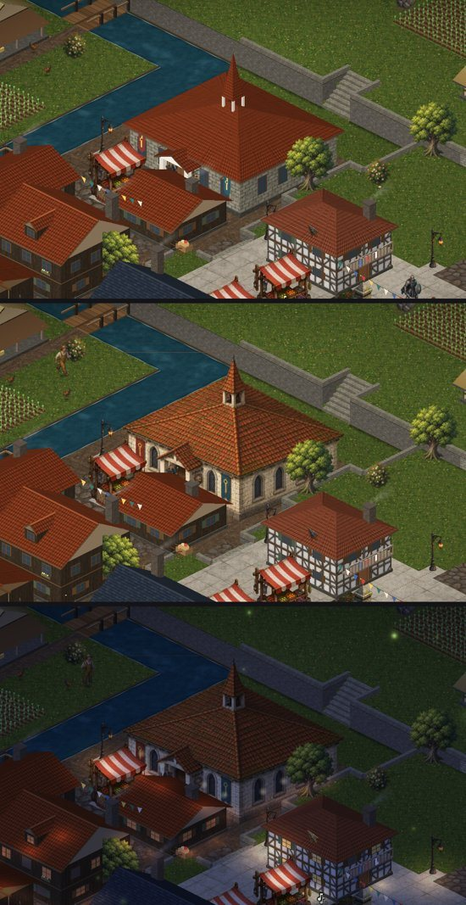
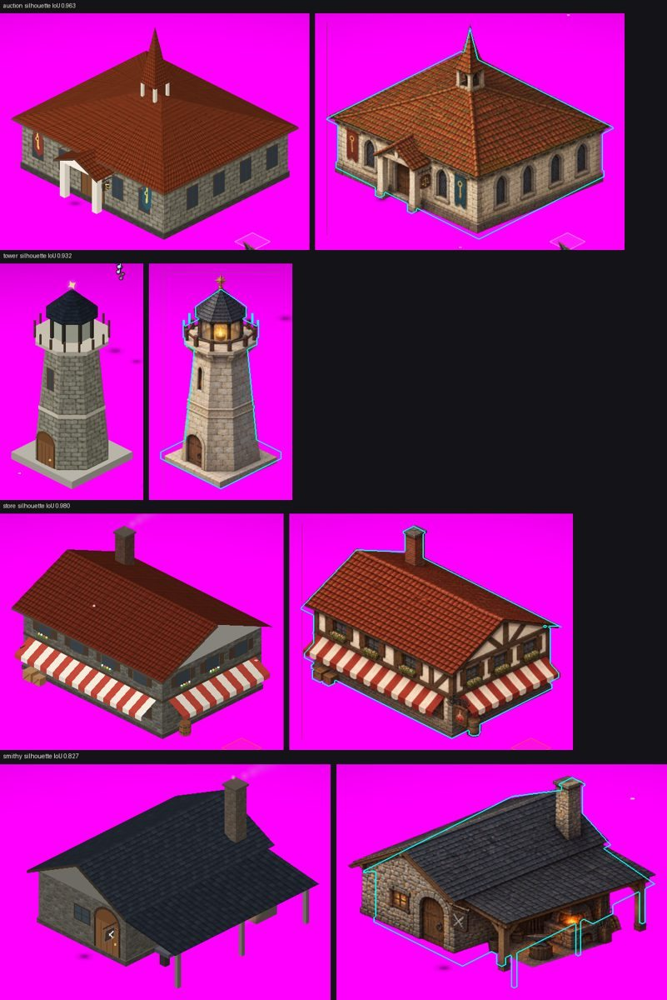
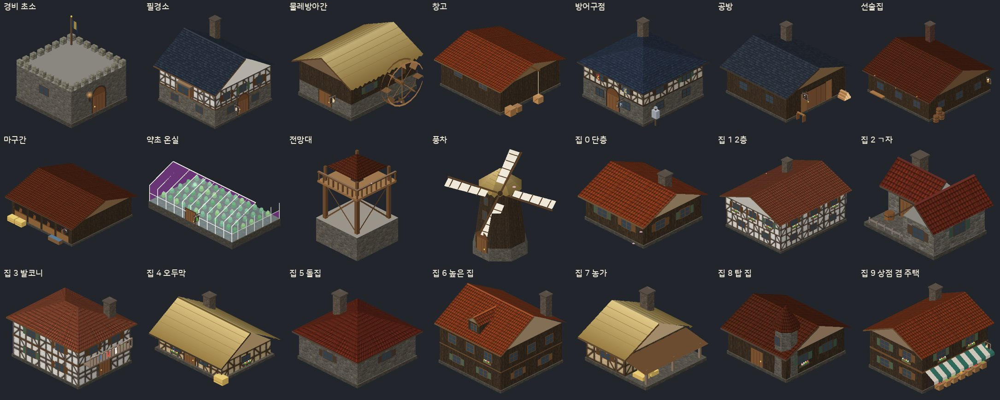
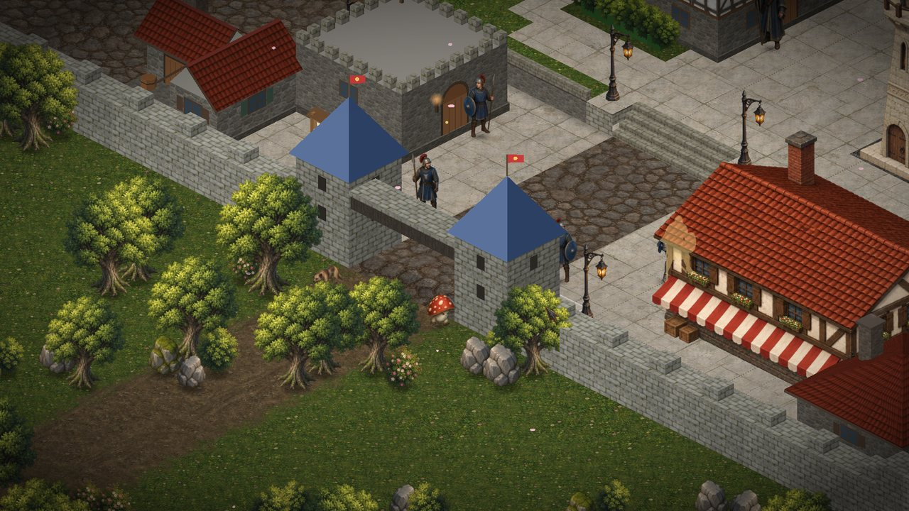
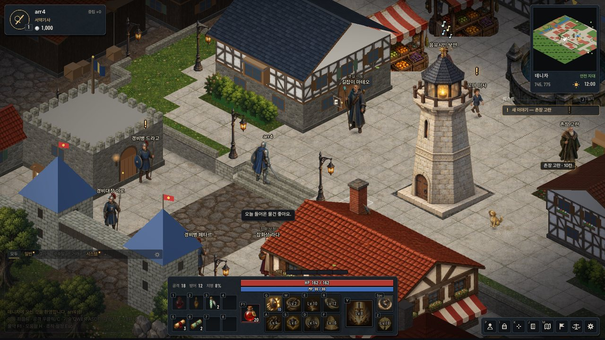

# Phase 4 — 마을 확장 · 높낮이 · 레벨디자인 · 건물 다양화

> 작업 지시: `claude/UPGRADE_PROMPT.md` [Phase 4]. 진단 · 설계 메모이며 하위 단계를 끝낼 때마다 결과를 덧붙인다.
> 코드 기준: `newclient` `8d493f3`(Phase 3 끝). 마을 설계도는 [`docs/LEVEL_DENICA.md`](../LEVEL_DENICA.md).

## 0. 기준 — 지금 코드

| 항목 | 지금 | 문제 |
|---|---|---|
| 마을 데이터 | `Data/WorldData.h` `kTownLayout[44]` 문자 격자 하나(월드 728..771, 44×44). 막힘 `# O B H F T L * S` 512칸 · 걷기 1,424칸. `IsBlocked`가 서버 · 클라 공통 **유일한 충돌 정의** | 높이가 없다. 격자를 손으로 고쳐야 하고 건물(`kBuildings` 8채)은 따로 적는다 |
| 서버 충돌 | `Collision.cpp` `GCollision` 2000×2000 bool 한 장 — `main`에서 `IsBlocked`로 한 번 채운다 | (바꿀 필요 없음 — 막힌 칸만 알면 된다) |
| 대각 이동 | 일반 이동(`SubjectHelper` · `MoveRule::Step`)은 Y 먼저 → X, **두 옆이 다 막히면 못 간다**(한 옆이 열리면 그 칸을 거쳐 가는 것과 같다). 클라 길찾기는 모서리를 아예 못 자른다 | **돌진 · 넉백 · 끌어당김은 도착 칸만 본다** — 막힌 두 칸 사이를 대각으로 빠져나갈 수 있다(높이가 생기면 절벽 모서리 통과) |
| 시야 | `GViewRange` 기본 **9**(전역, `--view-range`). 지시서의 `VIEW_RANGE = 5`는 쓰이지 않는 상수 | — |
| NPC | 20명, 서버 마을 Zone 스레드가 배회. `NPC_LIST_NFY`는 24명(220B)까지 | 30명 이상이면 넘친다 |
| 지형 그리기 | 화면 전체 셰이더 하나(`TerrainShader`)가 픽셀마다 화면 → 칸을 되돌려 재질을 칠한다(z = 0 평면) | 높이를 그릴 수 없다 |
| 건물 | `props::DrawBuilding` — 종류 5개(잡화점 · 무기점 · 예배당 · 여관 · 집) 8채, 모두 같은 박공 상자 | 실루엣이 비슷하다 |
| 스크립트 · 도구 좌표 | 남문 밖 사냥터 `(X0+22, Y0+50)` 등 마을 기준 숫자, 봇 `t` 접두 | 마을을 넓히면 함께 옮겨야 한다 |

**기준선**(바꾸기 전): `--script tour`(이번에 만든 카메라 투어 — HUD 숨김 · 안개 끔 · 구획 이름 자막)로 낮 · 밤 녹화 — `img/phase4_before_tour_day.jpg` · `img/phase4_before_tour_night.jpg`.

## 1. 4-A 높낮이 — 설계

| 결정 | 고른 것 | 대안 | 이유 |
|---|---|---|---|
| 원본 | `tools/mapgen/denica/` 텍스트 층 — `height.txt`(칸마다 층 0~4) · `ground.txt`(바닥 · 막힘 문자) · `buildings.txt` · `props.txt`(목록). 생성기 `tools/mapgen/gen_town.py`가 검사한 뒤 공유 헤더 `Data/TownMap.h`와 미리보기 PNG를 만든다 | 이미지 원본 | 텍스트는 diff로 읽히고 에디터로 고친다. 그림은 생성기가 뽑는다 |
| 절벽 | **가장자리 칸 자동 막기** — 낮은 걷는 칸과 상하좌우로 맞닿은 높은 칸을 생성기가 가장자리(`R`)로 바꿔 막는다. 서버의 불리언 충돌 격자를 그대로 쓴다 | 칸 사이 벽(모서리 충돌) | 서버 충돌 코드 변경 0. 층이 다른 걷는 두 칸 사이에는 반드시 막힌 칸이 있다(생성기 + `static_assert`) |
| 층 오가기 | 계단 · 경사로 칸만(방향 ↑↓←→ — 낮은 쪽 층에서 한 층 오른다). 계단의 옆 칸은 막힘이나 같은 방향 계단 | 연속 높이맵 | 칸 단위 서버 판정과 맞는다 |
| 대각 | 일반 이동은 위 규칙만으로 맞다(층이 다른 대각 이웃은 두 옆이 모두 가장자리라 못 지나간다). **강제 이동은 대각 한 걸음마다 두 옆이 다 열려 있어야** 하게 고친다(`MoveRule::CleanStep` 공용 — 클라 길찾기와 같은 규칙) | 한 옆만 열려도 허용 | 절벽 · 성벽 모서리 통과 0. 지시서 "양옆 중 하나가 막혔는데 대각으로 지나감"을 막는다 |
| 높이 단위 | 1층 = 0.75z(27px). 계단 한 칸 = 한 층 | 1.0z | 4층 = 108px — 성벽(1.55z)보다 조금 높은 언덕 |
| 좌표 약속 | **모든 위치는 지금처럼 바닥 평면(z = 0) 아이소 px.** 지형 높이는 **정점을 낼 때** 올린다 — 세운 것(캐릭터 · 입자 · 소품)은 발밑 칸 높이 하나(`gfx::SetLift`), 바닥 데칼은 정점마다 그 자리 높이(드리우기) | 위치에 높이를 넣기 | 효과 · 데칼 · 그림자를 만드는 수백 곳을 고치지 않는다. 깊이는 바닥 위치의 X+Y라 높이와 무관하게 맞다(`Draw.h` 설명 — 광선 위에서 X+Y가 단조) |
| 지형 그리기 | 들판 · 0층은 지금 셰이더 그대로 + **1층 이상은 같은 셰이더의 "면 모드"**(텍스처 좌표 = 칸 좌표)로 윗면 사각형 + 옹벽 · 절벽 면(돌) + 계단(디딤판) | 새 지형 텍스처 | 마을 재질 · 무늬가 한 곳에서 나와 들판과 이어진다 |
| 가림 | 지형 면이 깊이를 쓴다 → 언덕 뒤 캐릭터는 가려지고(내 캐릭터는 기존 실루엣), 데칼도 깊이 시험으로 언덕 뒤에서 숨는다 | | |
| 마우스 | 화면 → 칸: 높은 층부터 그 층 평면과 만나는 칸이 그 층이면 그 칸(앞의 면이 이긴다) | | 언덕 · 계단 위를 누를 수 있다 |
| 시야 | `GViewRange` 9 그대로(전역 기본값이 이미 9) | 확장 세션만 10 | 3×3 섹터 보장 반경 10 안이고, 바꾸지 않으니 봇 조건도 그대로 |
| NPC 30명 이상 | `NPC_LIST_NFY`(24명)를 두 번 보낸다 — 클라가 항목마다 합치므로(지우지 않는다) 패킷 변경 0 | 새 패킷 | |

## 1-1. 4-A2 결과 — 높이 엔진

| 부분 | 한 것 |
|---|---|
| 그리기 | 0층 · 들판은 바닥 셰이더 그대로, 1층 이상은 같은 셰이더의 면 모드로 윗면 + 남 · 동 옹벽 면(판석 · 길 위면 다듬은 돌, 풀 · 흙이면 거친 돌) + 계단 네 단 + 가장자리 난간. 셰이더 문자열은 두 조각(MSVC 한도 16,380B — 8.7KB · 10.6KB) |
| 몸 높이 | `TownRules::SurfaceLevel` — 화면 위치가 막힌 칸 위에 걸치면(모서리를 스치는 보간 · 칸 경계 반올림) 가장 가까운 **걷는** 칸의 윗면. 데칼 · 입자 · 빛은 그 자리 높이(`GroundLevel`) |
| 새 재질 | 흙길 · 모래 · 개울(흐름 · 반짝임 · 얕은 물가 · 끊긴 거품 · 먼 쪽 기슭 흙벽 — 물이 땅보다 조금 낮아 보인다) · 다리 널 · 묘지 풀 · 밭 이랑 · 계단 돌. 막히는 새 칸: 바위 · 산울타리(덤불을 반 칸마다) · 낮은 돌담 · 작물 · 나무 상자 자리 · 다리 난간 |
| 서버 | 강제 이동 7곳(달 가르기 · 구르기 · 도약 착지 · 돌진/잔상 회피 · 그늘 걸음 착지 · 넉백 · 끌어당김 · 몬스터 돌진)을 `MoveRule::CleanStep`(도착 칸 + 대각이면 **두 옆 모두** 열림)으로. 지시서의 "양옆 중 하나가 막혔는데 대각으로 지나감"을 막는다. 일반 걸음은 그대로(축마다 따로 — 층이 다른 대각은 두 옆이 가장자리라 못 간다) |
| 검사 | `Data/TownRules.h` `Check()` — 모든 걷는 칸 × 8방향, 서버가 받아 주는 걸음(일반 · 강제)을 화면의 곧은 선(1/32칸 간격)과 서버가 거치는 칸으로 따라가며 몸 높이가 끊기면 오르막 = 절벽 통과, 내리막 = 허공 걷기. 서버는 켤 때 한 줄, 클라 `--script terraincheck`는 같은 검사 + 보이지 않는 벽(막힌 칸마다 그림이 있는가) + 탐침(가장자리 하나를 사이에 둔 두 칸을 걸어 계단으로 돌아가는지, 화면 지면이 끊기지 않는지). 서버는 실제 이동마다 같은 검사를 하는 덫(`GuardTownMove` — 한 칸 걸음 · 돌진 끝점 · NPC 걸음, 같은 층 평지 한 칸은 바로 통과)을 둔다 |
| 음성 시험 | 계단 없이 층을 바꾼 칸 하나를 넣은 TownMap으로 `Check()` → 절벽 통과 23 · 허공 걷기 23(검사가 실제로 잡는다) |

시험 마을(북서 1층 단 + 2층 언덕 + 계단 둘 + 산울타리)에서: 서버 `[Town] level rules: walkable=1391 … cliffCross=0 airWalk=0 OK`,
클라 `terraincheck` 탐침 — 곧은 거리 2칸을 계단으로 돌아 8~12칸, 화면 지면 끊김 오름 0.03 · 내림 0.00층(계단 경사) → PASS.

같은 시험에서 찾아 고친 것:
- **걷고 멈춘 뒤 캐릭터가 사라짐**(이름표만 남음) — 멈춤 흔들림 스프링을 프레임 시간 한 번으로 적분해 긴 프레임(샌드박스 170ms)에서
  발산 → NaN 자세. Phase 1부터 있던 것으로, 느린 PC · 로딩 멈칫에서도 난다. 1/120초 조각 적분 + 유한성 검사(`fix(move)` 따로 커밋).
- **계단으로 돌아가는 길에서 두 칸을 오가며 멈춤** — 걸음 계획의 곧은 선 원점이 화면 위치라, 논리 칸과 어긋나면 막다른 쪽으로 기울었다.
  경로를 따라가는 중에는 계획한 걸음이 경로 위이거나 경유점까지 곧게 갈 수 있어야 하고, 아니면 경로의 다음 칸으로.
- **대각 걸음이 한쪽 모서리를 스침** — 클라 `PickMoveDir`가 한 옆이 막힌 대각을 보냈다(서버는 열린 옆을 거쳐 받지만 화면은 대각으로 긋는다).
  서버와 같은 Y 걸음을 먼저 보낸다.
- 빛(가로등 · 창 · 캐릭터 둘레 · 순간 조명)이 높은 칸에서 제자리에 남던 것 — 지금 그리는 것의 높이만큼 올려 담는다(`props::PushLight`).

**서버 부하(STRESS_TEST 150초, 같은 샌드박스 · 같은 시각)**: Phase 3 서버 `peak_active_at_delay<=100ms` 1931 → 4-A2 서버 1989 · 1950.
차이는 샌드박스 흔들림 안(±5%). 덫은 마을 밖 걸음에서 비교 네 번, 마을 안 같은 층 한 칸에서 비교 몇 번으로 끝난다.

## 1-2. 4-B 결과 — 새 데니차

설계도 · 숫자는 [`docs/LEVEL_DENICA.md`](../LEVEL_DENICA.md)(도구 `tools/mapgen/level_report.py`가 센 값).

| 부분 | 한 것 |
|---|---|
| 마을 | 44×44 → **84×72(3.1배)**, 원점 (708, 714). 구획 11(남문 광장 · 분수 광장 · 시장 거리 · 서쪽 들 · 장인 거리 · 훈련장 · 여관 골목 · 결사 회관 단 · 윗마을 · 예배당 언덕 · 풍차 언덕), 층 0~4를 주 동선이 모두 밟는다(0 → 1 → 2 → 3). 비스트라 개울 · 다리 셋 · 성문 셋(남 · 서 · 동) |
| 크기 검증 | 서문 → 동문 45.4초, 남문 → 예배당 37.5초. 광장에서 주요 시설(잡화 · 대장간 · 방어구 · 길잡이 · 경매장 · 결사 회관 · 여관) 모두 15초 안(가장 먼 여관 13.4초) |
| 건물 · 주민 | 건물 45채 · 종류 19(`TownTypes.h` 열거형 끝에 14개 — 그림은 4-C). NPC 20 → **33**(새 13명은 WORLD.md 인명 규칙으로 먼저 등록, 자리는 `anchors.txt`의 `npc id x y` → `TownMap::kNpcHomes` → `WorldData::HomeX/Y`, 역할 줄 `NpcRow::role` 끝에 추가) |
| NPC 목록 | `NPC_LIST_NFY`(24명 · 220B)를 **24명씩 나눠 두 번** 보낸다 — 클라는 항목마다 합치므로 패킷 · 클라 변경 0 |
| 좌표 | 스크립트 · 도구가 숫자 대신 이름 있는 자리(`kTownCenter` · `kPlaza` · `kFountain` · `kPlazaRow` · `kSouthGate(Out)` · `kQuestField` · `kPvpField` · `kBehindStore`)를 쓴다. 투어는 구획 표(`districts.txt`)에서 자리를 만든다 |
| 소리 구역 | `ambient.txt` → `TownMap::kAmbient` → 클라 `audio/Ambience`: 분수 · 강물 · 바람 · 사람 소리(시장 · 남문 · 선술집) · 대장간 불길은 **끊김 없는 고리**(합성 — 끝을 처음에 같은 힘으로 겹쳐 이음)를 오디오 스레드 콜백이 섞는다(샌드박스 170ms 프레임에도 끊기지 않는다). 망치(3~6번 · 숨 고르기)와 예배당 종(낮의 정시마다 세 번)은 박자를 정해 효과음으로. 음량은 구역 안쪽 25% 온전 → 바깥 부드럽게, 소리 쪽으로 좌우. 밤에는 시장이 파장하고 망치가 쉰다 |
| 바람 | `render/Wind` — 방향 하나(서남서 → 동북동, 97초 주기 ±10°) · 세기(느린 부풂 + 가끔 큰 돌풍) · 바람 방향으로 흘러가는 돌풍 결. 나무 · 산울타리가 기울고 결이 지나가면 차례로 흔들리며, 풀밭 위로 밝은 물결(지형 셰이더 `uWind`), 꽃잎 · 잎이 바람을 탄다. 바람 소리 음량도 같은 세기. 시간만의 함수라 녹화 · 회귀가 같다 |
| 들길 | 성문마다 그 가운데 줄로 바깥 들길(`uGates`) — 예전에는 마을 한가운데 열/행이라 새 성문과 어긋났다 |
| 층 음영 | 높은 칸이 서 · 북에 있으면 낮은 칸에 짧은 그늘(빛은 화면 왼쪽 위), 높은 층은 조금 밝게 — 먼 줌에서도 단이 읽힌다 |

**점검**: 생성기 규칙(층 · 계단 · 가장자리 · 건물 발자국 · NPC 집 · 부활 자리 · 소리 구역) 통과 → `terraincheck` PASS(절벽 통과 · 허공 걷기 · 보이지 않는 벽 0) →
투어 `[amb]` 줄(자리마다 소리 구역 음량 — 분수 광장 0.91 · 시장 1.00 · 장인 거리 0.58 · 예배당 언덕 종 0.97 · 풍차 언덕 바람 0.59)과
`CLIENT_AMB_DUMP` 6초 WAV(분수 광장 RMS 0.02~0.04 — 효과음보다 한참 낮은 바탕).

**고친 것**: 물레방아간을 개울 **서쪽 기슭**으로 옮겼다(4-C 그림 확인에서 — 바퀴가 서쪽 면에 붙으면 카메라에서 보이지 않는다. 쿼터뷰는 남 · 동 면만 보인다).
그 자리는 상점 겸 주택. 방앗간지기 밀로의 집도 다리 서쪽 끝으로.

## 1-3. 4-C 결과 — 건물 다양화 · 소품

### ① 모듈 키트 vs ② Higgsfield 그림 — 한 채로 비교한 뒤 정했다

경매장 한 채를 두 방식으로 만들어 같은 자리 · 같은 카메라로 찍었다(위 = 키트, 가운데 = 그림 낮, 아래 = 그림 밤).

| | ① 키트(`render/Buildings.cpp`) | ② 그림(키트 = 설계도) |
|---|---|---|
| 보기 | 형태 · 실루엣은 분명하지만 면이 평평(텍스처 반복) | 돌 · 이끼 · 기와 · 아치 창이 손그림 수준 — 스크린샷 한 장의 인상을 가장 크게 바꾼다 |
| 맞음 | 깊이 · 층 높이 · 가림이 정점마다 정확 | 키트 그림을 설계도 참고 그림으로 넘겨 구도 · 발자국이 같다 — 실루엣 겹침(IoU) 0.93~0.98. 깊이는 두 벽면의 천막꼴(상자꼴이면 정확) |
| 움직임 · 밤 | 간판이 흔들리고 깃발 · 연기 · 바퀴 · 날개가 바람을 탄다, 창에 불 | 그림은 멈춰 있다 → 연기 · 화덕 · 등불 · 밤 창빛을 키트 자리에 덧그린다(키트 배치를 그대로 그렸으니 자리가 맞다) |
| 변형 | 구획 규칙 · 변형 번호로 무한히(주택 20채가 같아 보이지 않는다) | 한 장 = 한 건물. 층 · 구획이 바뀌면 다시 |
| 값 | 0 | 한 채 0.5크레딧, 텍스처 0.4~0.7MB |
| 그림이 없을 때 | — | 키트(`--kit-buildings`로 언제든 비교) |

**결정 — 지시서 권장과 같다**: 랜드마크 · 큰 가게 7채(샛별 탑 · 예배당 · 결사 회관 · 경매장 · 잡화점 · 대장간 · 여관)는 ②, 나머지 12종 · 주택 10변형은 ①.
그림 7채는 한 번에 3.5크레딧(잔액 12.75 → 9.25, 한 번에 24% — 30% 안). 풍차 · 물레방아간은 날개 · 바퀴가 도는 것이 핵심이라 ①로 남겼다.

### ① 키트 — 종류 19 · 주택 변형 10

| 조각 | 한 것 |
|---|---|
| 지붕 | 박공(용마루 방향) · 모임(짧은 쪽 줄임, 0이면 사각뿔) · 뿔(팔각 · 사각) · 평지붕 + 성가퀴 · 초가(짚 다발 줄 · 들쭉날쭉한 처마) · 유리(온실) · 외쪽(헛간) |
| 몸 | 벽 재질 6(회칠 목조 · 거친 돌 · 다듬은 돌 · 흰 돌 · 판자 · 흙벽) · 2층 튀어나온 윗층 · 층 띠 · 팔각 탑 몸통(위로 좁아짐) · 받침 |
| 앞모습 | 문(아치) · 창(틀 · 가운데 살 · 덧문 · 꽃 상자, 밤에 구획 색 창빛 — 다섯에 하나는 꺼진 방) · 차양(줄무늬 · 술) · 발코니 · 간판(아이콘 12가지 — 바람에 흔들린다) · 벽 깃발 · 등불 |
| 움직임 | 굴뚝 연기(바람 쪽으로 눕는다) · 대장간 화덕 · 불똥 · 물레방아 바퀴(동쪽 면 — 개울 쪽) · 풍차 날개(바람 세기로 빨라진다) · 깃발 · 빨래 |
| 구획 규칙 | 건물이 선 구획이 지붕 재질 · 색, 벽 재질, 밤 창빛을 정한다(LEVEL_DENICA 3장) — 같은 종류도 구획이 다르면 다르게, 건물마다 색을 조금씩 흔든다 |
| 문 · 간판 | 문이 보이지 않는 면(북 · 서)이면 간판을 가까운 모서리의 보이는 면에 단다(쿼터뷰는 남 · 동 면만 보인다) |

### 소품 — `props.txt`(15종, 46개)

막히는 소품 13종(묘비 · 게시판 · 벤치 · 조각상 · 깃대 · 우물 · 수레 · 건초 · 통 · 상자 · 이정표 · 과녁 · 무기 걸이)은 `ground.txt`의 `P` 칸 하나에 하나(서버 충돌과 1:1 — 생성기가 검사),
줄 소품 2종(빨랫줄 · 줄깃발)은 두 끝 사이에 매단다(막지 않는다). 결사 회관 앞 깃대 둘은 키트에서 소품으로 옮겼다(깃대가 걷는 칸 위에 서 있었다).

### 첫인상 — 남문 도착 연출

쿼터뷰에서 북쪽은 화면 **오른쪽 위**라, 남문(37, 69)에서 기본 줌(1.45)으로 서면 광장 · 샛별 탑이 화면 오른쪽 밖이다(아래 왼쪽).
마을을 뜯어고치는 대신, 남문 밖에서 남문 칸으로 **들어서는 순간 3.4초 동안 카메라가 샛별 탑 쪽으로 55% 옮겨 가고 1.05배까지 넓게** 본 뒤 돌아온다(아래 오른쪽 — `--script arrive`).
20초 안에 다시 드나들면 되풀이하지 않는다.

| 연출 없이(남문 칸) | 들어서는 순간 |
|---|---|
|  |  |

### 점검

- 생성기: 소품 46 · 건물 45 · 규칙 통과, 서버 `[Town] level rules … cliffCross=0 airWalk=0 OK`, 클라 `terraincheck` PASS.
- `terraincheck` 탐침이 계단 칸을 짝으로 고르면 곧게 올라가도 맞는 길인데 실패로 적던 것을 고쳤다(짝에서 계단 칸을 뺀다 — 무작위 부활 자리에 따라 가끔 났다).
- `--script bldsolo:N`(건물 하나 · 단색 바탕 · 카메라 값 곁 파일) · `bldgallery[:N]`(종류마다 한 채) · `look:x,y,zoom`(카메라만) · `arrive`(남문 드나들기).

## 2. 4-B · 4-C

- 레벨디자인(구획 · 높이 단면 · 동선 · 랜드마크 시선): [`docs/LEVEL_DENICA.md`](../LEVEL_DENICA.md).
- 건물: 모듈 키트(벽 · 지붕 · 창 · 문 · 발코니 · 차양 · 굴뚝)와 Higgsfield 아이소 그림을 **한 건물로 비교**한 뒤 정한다(4-C 절).

## 3. 진행 순서 · 커밋

4-A1 데이터 층 · 생성기(지금 마을을 옮겨 그대로 도는지) → 4-A2 높이 엔진(그리기 · 가림 · 마우스 · 강제 이동 대각) → 4-B 새 데니차(84×72 안팎) · 좌표 · NPC ·
소리 구역 · 바람 · 투어 → 4-C 건물 16종 이상 → 자기 검토 · 부하 · 회귀 · 문서. 하위 단계마다 `feat(world)` 커밋.
