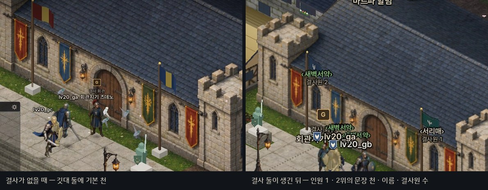
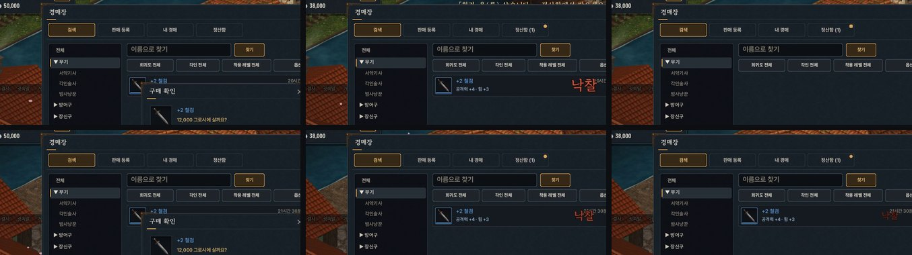
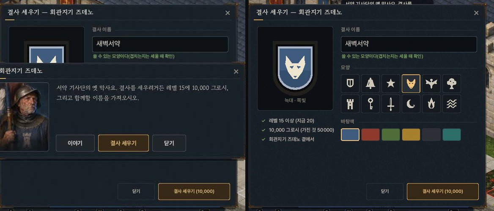
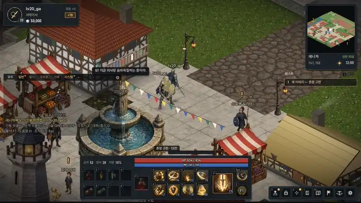

# Phase 5 — 결사(길드) · 경매장 — 서버 + DB + 클라

> 작업 지시: `claude/UPGRADE_PROMPT.md` [Phase 5]. 진단 · 설계 메모이며 하위 단계를 끝낼 때마다 결과를 덧붙인다.
> 코드 기준: Phase 4 끝(`newclient` `2fb78fe` + 문서 커밋). 결정 기록: [`docs/adr/0001-guild-auction-services.md`](../adr/0001-guild-auction-services.md).

## 0. 기준 — 지금 코드

| 항목 | 지금 | Phase 5에 필요한 것 |
|---|---|---|
| 스레드 | Zone(4×4 = 16)마다 `GameLogicThread` 하나(작업 큐). 패킷은 `WorkerThread`가 `EnqueueBySession`으로 **그 세션의 Zone 스레드**에 넘기고 `Route::Dispatch`가 거기서 돈다. 플레이어 상태(그로시 · 소지품)는 소유 Zone 스레드만 바꾼다(`ASSERT_OWNED_BY_CURRENT_ZONE`) | 여러 Zone에 걸친 전역 상태(결사 · 경매 목록)의 주인 |
| DB | `DBThread` 샤드 8개 — 같은 playerId의 쓰기는 한 샤드가 넣은 순서대로. 이벤트는 결과를 돌려주지 않는다(로그인만 Zone 작업으로 되돌림). `ShopTransaction` = 그로시 + 슬롯 하나를 한 트랜잭션 | 결과가 필요한 트랜잭션(경매 구매 · 등록 · 정산 받기 · 결사 세우기) |
| 소지품 슬롯 값 | itemId · count · equipped · enchant · extra(BIGINT — 희귀도 · 옵션 4줄 · 특수 효과, `Data/ItemRules.h`) | 경매 목록 · 정산함 행이 같은 값을 그대로 보존 |
| 이름 → 세션 | `GameSessionManager::FindByName`(Phase 3 귓속말) | 결사 초대 · 결사원 접속 알림 |
| 패킷 | `PacketType` 89개(0~88) — 127까지 38개 | 결사 · 경매 묶음 패킷(요청 + `op`) |
| 클라 자리 | 채팅 결사 채널 · `/길` · `/초대` · 이름 메뉴 "결사 초대" · 메뉴 막대 결사/경매장 칸(지금 "아직 문을 열지 않았다") · 정산함 점 자리 · 결사 회관(즈데노) · 경매장(로렌초) 건물 · 초상화 | 창 · 초대 알림 · 머리 위 문장 |
| 샌드박스 DB | `tools/sandbox/MemDBConnection.cpp` — 메모리 맵, 한 호출 = 한 락 = 한 트랜잭션. **꺼지면 사라진다** | 장애 시험(구매 도중 강제 종료 → 재시작 후 총량 보존)을 하려면 커밋 기록(일지)이 필요 |

**기준선**(바꾸기 전): 메뉴 막대의 결사 · 경매장 칸(아직 열지 않음) · 결사 회관지기 즈데노 · 경매인 로렌초와의 대화 — `img/phase5_before_after_hall.jpg`(왼쪽 Phase 4 끝: 즈데노는 이야기만 / 오른쪽 Phase 5: 대화창에 "결사 세우기").

## 1. 설계 — 전역 서비스(액터) + 정산함

| 결정 | 고른 것 | 대안 | 이유 |
|---|---|---|---|
| 결사 · 경매 상태의 주인 | **전용 단일 스레드 서비스** `GuildService` · `AuctionService` — 각자 `GameLogicThread` 하나(Zone과 같은 작업 큐)로 자기 상태를 소유. Zone ↔ 서비스는 큐 메시지로만 | 전역 뮤텍스 / 경매를 한 Zone에 | 락 없이 순서가 정해진다(한 목록을 두 사람이 동시에 사도 서비스가 한 줄로 받는다). Zone 스레드 모델을 깨지 않는다 |
| 경매 구매 순서 | ① 구매자 Zone → 서비스: 사고 싶다(목록 · 값) ② 서비스: 판매 중이면 **잠금**(거래 중) → Zone에 "잡았다" ③ Zone: 그로시 확인 · 메모리에서 차감 → 구매자 샤드에 **한 트랜잭션**(목록 판매 중 확인 · 구매자 그로시 · 구매자 물건 정산 행 · 판매자 대금 정산 행(수수료 뺀 값) · 시세 기록) ④ DB → 서비스: 확정 → 판매자 · 구매자 알림 | 지시서 권장(Zone이 먼저 예약 차감) | 이미 팔린 목록은 ②에서 걸러져 **진 쪽은 그로시가 한 번도 빠지지 않는다**(되돌림 창이 없다). ③의 트랜잭션은 서비스가 잠근 목록이라 정상 경로에서는 실패하지 않는다 |
| 대금 · 산 물건 | **정산함**(행) — 판매자 지갑에 직접 넣지 않고, 산 물건도 소지품이 아니라 정산함으로 | 판매자 지갑에 바로 | 그로시 · 소지품의 작성자는 소유 Zone 하나뿐 — 판매자가 오프라인이거나 다른 Zone이어도 "메모리 값이 DB를 덮어쓰는 잃어버린 갱신"이 없다. 구매 트랜잭션이 **구매자 샤드 하나**에서 끝난다 |
| 등록 | 판매자 Zone → 서비스: 자리(1인 10개) · 목록 번호 예약 → Zone: 슬롯에서 빼고 보증금 차감 → 판매자 샤드 한 트랜잭션(슬롯 · 그로시 · 목록 행) → 서비스: 목록 공개 | DB가 번호 발급 | 번호를 서비스가 정해(시작할 때 DB 최댓값 + 1) 비동기 경로에서 DB 반환값을 기다리지 않는다 |
| 취소 · 만료 | 서비스가 목록을 잠그고 판매자 샤드 한 트랜잭션(목록 상태 · 정산함 물건 행). 만료는 1분마다 서비스 틱 | | 목록 행과 정산함 행이 함께 바뀐다 |
| 정산함 받기 | 행 하나씩 — Zone이 자리 확인 → 메모리 반영 → 받는 사람 샤드 한 트랜잭션(행 받음 표시 · 그로시 · 슬롯) → 서비스가 행 지움. "모두 받기" = 한 줄씩 이어서 | 여러 행 한 번에(표 값 인자) | ODBC 표 값 인자 없이 프로시저 인자 몇 개로 끝난다. 행마다 원자적 |
| 멱등(`seq`) | 요청마다 순번 — 소유 Zone이 사람마다 마지막 순번을 기억해 같은 순번은 한 번만. 목록 상태 검사(판매 중일 때만)가 DB 쪽 두 번째 문 | DB 멱등 표 | 재접속하면 클라 순번이 다시 1부터라 DB 표는 오히려 막는다. 같은 목록은 두 번 팔릴 수 없다(상태 검사) |
| DB 샤드 | 돈 · 물건이 움직이는 트랜잭션은 **그 돈 · 물건 주인의 샤드**(구매 = 구매자, 등록 · 취소 · 만료 = 판매자, 받기 = 받는 사람). 결사 행은 결사 번호 샤드 | | 한 사람의 그로시 쓰기 순서(절대값 저장)가 트랜잭션과 섞여도 넣은 순서 그대로 |
| 결과 돌려받기 | 새 DB 이벤트에 **완료 콜백**(DB 스레드가 부르고, 콜백은 서비스 큐에 작업을 넣는다) | | 기존 이벤트(결과 없음)는 그대로 |
| 서버 재시작 | 서비스가 켤 때 DB에서 판매 중 목록 · 받지 않은 정산함 · 결사 · 결사원을 읽는다(메인 스레드, 접속을 받기 전) | | |
| 패킷 | 묶음: `GUILD_REQ`(C→S, `op`) · `GUILD_ACK` · `GUILD_INF`(정보 · 구성원 페이지 · 이름) · `GUILD_NFY`(초대 · 드나듦 · 직위 · 머리 위 표시) · `AUCTION_REQ` · `AUCTION_ACK` · `AUCTION_LIST_INF`(검색 · 내 경매 · 정산함 페이지) · `AUCTION_NFY`(팔림 · 정산함 점) — 8개 → 97개(0~96), 127까지 30개 | 기능마다 패킷 | 번호를 아낀다(지시서: 127에 가까워지면 묶음) |
| 장애 시험(샌드박스) | 인메모리 DB에 **커밋 일지**(한 호출 = 한 줄, 쓴 뒤 fsync — 켤 때 다시 적용) + 구매 트랜잭션 안에서 잠깐 멈추는 시험 스위치 → 그 사이 서버를 죽이고 다시 켜서 총량 비교 | | 실제 MSSQL의 원자성은 "실기 확인 필요", 서버 쪽 순서 · 복구 논리는 여기서 시험한다 |

## 2. 규칙(공유 헤더 `Data/GuildAuction.h`)

| 결사 | 값 |
|---|---|
| 세우기 | 레벨 15 이상 · 10,000 그로시 · 이름 2~8자(한글 · 영문 · 숫자, 띄어쓰기 · 금칙어 없음, 대소문자 무시하고 겹치지 않게) · 문장(모양 12 × 색 6) |
| 인원 | 30명 |
| 직위 | **결사장** · **부관** · **정예** · **결사원**(WORLD.md 등록) |
| 권한 | 초대: 정예 이상 / 추방: 부관 이상(자기보다 아래만) / 직위 바꾸기: 부관(정예까지) · 결사장 / 결사장 넘기기 · 해산 · 문장: 결사장 / 공지: 부관 이상 |
| 초대 | 30초 안에 수락 · 거절(받는 사람마다 하나) |

| 경매장 | 값 |
|---|---|
| 1인 동시 등록 | 10개 |
| 기간 | 12 · 24 · 48시간 |
| 보증금 | 가격의 1%(최소 1) — 돌려주지 않는다 |
| 수수료 | 팔리면 5%(최소 1) — 판매자 정산은 가격 − 수수료 |
| 가격 | 10 ~ 100,000,000 그로시 |
| 올릴 수 없는 것 | 착용 중인 장비 · 퀘스트 물건 |
| 검색 | 서비스 메모리 색인(분류 · 이름 · 희귀도 · 강화 · 착용 레벨 · 옵션) — 페이지당 6줄 |

## 3. 진행 순서 · 커밋

5-A 서비스 뼈대 · 패킷 · DB(setup.sql · 인메모리 DB · 일지) · ADR → 5-B 결사(서버 · 창 · 머리 위 문장 · 결사 채팅 · 클라 셋 녹화) →
5-C 경매장(서버 · 창 · 정산함 · 경합 · 멱등 · 장애 시험 · 녹화) → 자기 검토 · 부하 · 회귀 · 문서. 커밋 `feat(guild)` · `feat(auction)`.

## 4. 구현

### 4.1 서버 — 스레드 · 흐름

| 조각 | 파일 | 누가 · 어느 스레드 |
|---|---|---|
| 서비스 공용 | `Content/ServiceCommon.h` | `Service::Ctx`(요청한 사람의 사본 — playerId · ObjID · 세션 약한 참조 · 이름 · 레벨 · 직업) · `PostToOwner(obj, fn)`(그 사람을 소유한 Zone에서 실행 — Zone을 옮기는 중이면 새 Zone 입장 뒤로 다시 넘긴다 · 나갔으면 `nullptr`) · `SendTo`(세션 송신 락만) |
| 결사 | `Content/GuildService.{h,cpp}` | `GuildService`(전용 스레드 — 결사 · 결사원 · 초대 · 이름 겹침) + `GuildHelper`(요청한 사람의 Zone — 검사 · 멱등 · 머리 위 표시 · 결사 채팅 넘기기) |
| 경매 | `Content/AuctionService.{h,cpp}` | `AuctionService`(전용 스레드 — 판매 중 목록 · 분류 색인 · 받지 않은 정산함 · 시세 20건) + `AuctionHelper`(Zone — 검사 · 멱등 · 경매인 거리) |
| 결과 있는 트랜잭션 | `Thread/DBThread` `RequestTx(playerId, …)` · `RequestTxKeyed(key, …)` | 새 이벤트 `DB_TX_EVENT{ work, done }` — DB 스레드가 프로시저 하나를 부르고 `done(ok)`로 서비스 · Zone 큐에 넣기만 한다(기존 이벤트는 그대로) |
| 메모리만 바꾸는 소지품 함수 | `Item/Inventory` `ReserveAdena` · `ReturnAdena` · `CreditAdenaNoSave` · `TakeForListing` · `RestoreTaken` · `FindSlotForIncoming` · `PlaceIncoming` · `UndoIncoming` | 소유 Zone만. 저장은 프로시저 하나가 그로시(절대값) · 슬롯을 함께 커밋 — 실패하면 `Return*` · `Restore*` · `Undo*`가 되돌리고 그때 저장 |
| 켤 때 | `GameServer.cpp` | 워커 스레드(접속)를 띄우기 전 메인 스레드: `AuctionMaxIds` → 두 서비스 `LoadFromDB` → `[Phase5]` · `[Audit]` 한 줄씩 → 서비스 스레드 둘 + 1초 틱 스레드. DB를 못 읽으면 서비스를 끈다(요청에는 Busy) |

**결사 변경은 DB 먼저, 커밋되면 메모리**(메모리와 DB가 어긋나지 않는다). 세우기는 그로시와 한 트랜잭션이라 **만드는 사람 샤드**, 나머지는 **결사 번호 샤드**
(한 결사의 변경이 넣은 순서대로). 샤드가 둘로 갈리므로 **한 사람의 결사 변경(세우기 · 들어옴 · 나감 · 추방 · 해산)은 한 번에 하나**(`_busyPlayers`) —
떠난 행이 지워지기 전에 새 결사 행이 먼저 커밋되는 순서 뒤집힘이 없다. 한 결사의 구조 변경(추방 · 직위 · 넘기기 · 공지 · 문장 · 해산)도 한 번에 하나(`Guild::busy`),
들어옴은 여러 건을 함께(인원 한도에 `pendingJoins`를 센다). 겹치면 `Busy` — 클라는 "잠시 뒤에".

**머리 위 표시**: `User::m_guildId` · `m_guildEmblem`(atomic — 시야 경계의 다른 Zone도 읽는다). 서비스가 바꿀 때는 그 사람의 Zone으로 넘겨(`ApplyTag`) 본인 · 주변 확장 세션에
`GUILD_NFY Tag`. 시야에 들어올 때는 `SUBJECT_ADD` 바로 뒤에 한 번(결사가 있을 때만 — 레거시 · 봇은 받지 않는다). 이름은 **클라 캐시** — 서버가 읽기 전용 이름 표
(`shared_mutex`, 세우기 · 문장 · 해산 때만 씀)에서 찾아 실어 보내고, 없으면 클라가 `GuildOp::Name`으로 결사 번호마다 한 번 묻는다(패킷이 고정 크기라 이름을 실어도 바이트는 같다).

**경매 거래 거리**: 올리기 · 사기 · 내리기 · 받기는 **경매인 로렌초 곁**(`NpcHelper::IsNear` — 상점과 같은 규칙), 검색 · 내 경매 · 정산함 보기는 어디서나.
세우기 · 문장은 **회관지기 즈데노 곁**.

**검색**: 서비스 메모리 — 분류마다 목록 번호 집합(`_byCat`)을 두고 고른 분류만 훑는다(전체면 모두). 거르기: 세부 분류 · 희귀도(`EffectiveRarity`) · 각인 · 착용 레벨 · 옵션 포함 · 이름(표시 이름
UTF-8 부분 문자열). 정렬: 한 개 값 오름 · 내림 · 끝나는 순 · 희귀한 순. 한 페이지 6줄. 검색 · 목록 요청은 사람마다 0.12초에 한 번(넘치면 버린다).

**만료**: 1초 틱이 서비스 큐에 `Tick` — 경매는 1분마다(`kExpireTickMs`), 시험 배율(`HARVEN_AUCTION_HOUR_SEC` — 한 시간을 몇 초로)이면 "게임 1분"마다(최소 1초) 판매 중 · 기한 지난 목록을
잠그고 판매자 샤드 `AuctionClose(3)` → 정산함. 한 번에 64개까지.

### 4.2 DB(`Database/setup.sql` 5 · 6장 — `IF NOT EXISTS`, 기존 표 · 프로시저 그대로)

| 표 | 열(요약) | 비고 |
|---|---|---|
| `Guilds` | guildId(서비스가 정함) · name · nameKey(UNIQUE — 소문자) · emblem · notice · leaderId · createdAt | 이름 겹침의 뒷문 |
| `GuildMembers` | playerId(PK — 한 사람 한 결사) · guildId(FK, ON DELETE CASCADE) · rank(CHECK 0~3) · lastSeen | |
| `AuctionListings` | listingId · sellerId · itemId · count · enchant · extra(희귀도 · 옵션 BIGINT) · price · deposit · createdAt · expiresAt · status(0 판매 중 · 1 팔림 · 2 취소 · 3 만료) · buyerId · closedAt | 인덱스(status, expiresAt) · (sellerId, status) |
| `AuctionSettlements` | settlementId · playerId · kind(1 그로시 · 2 물건) · adena · 물건 값들 · listingId · reason · createdAt · claimedAt | 받지 않은 행 = claimedAt NULL |
| `AuctionPriceHistory` | itemId · 한 개 값 · soldAt | 켤 때 최근 14일 → 품목마다 20건 |

프로시저(모두 한 트랜잭션 · 상태를 다시 확인한 뒤 `ok` 한 줄): 결사 `GuildCreate`(그로시 · 결사 행 · 결사장 행) · `GuildMemberSet` · `GuildMemberRemove` · `GuildTransfer` · `GuildSetInfo` ·
`GuildDisband` · `GuildMemberSeen`, 경매 `AuctionRegister`(슬롯 · 그로시 · 목록 행) · `AuctionBuy`(판매 중 확인 · 판매됨 · 구매자 그로시 · 정산 행 둘 · 시세) · `AuctionClose`(+ 지시서 이름
`AuctionCancel` · `AuctionExpire`) · `SettlementClaim`(받음 표시 · 그로시 · 슬롯), 불러오기 `LoadGuilds` · `LoadGuildMembers` · `LoadAuctionListings` · `LoadAuctionSettlements` · `LoadAuctionPrices` ·
`AuctionMaxIds`, 장애 시험 `AuctionAudit`. ODBC 쪽은 결사 이름 · 공지를 UTF-8 ↔ UTF-16(NVARCHAR)으로 바꿔 넘긴다.

### 4.3 클라

| 조각 | 파일 |
|---|---|
| 결사 창(Alt+U · 메뉴 막대): 정보(공지 · 할 수 있는 것 · 탈퇴) / 구성원(8명씩 · 머리글 눌러 정렬 · 줄을 누르면 직위 ▲▼ · 결사장 넘기기 · 추방 — 권한 있는 것만, 두 번 누르기 확인) / 관리(초대 · 공지 · 문장 · 해산) | `game/GameGuild.cpp` |
| 세우기 · 문장 창(즈데노 대화 → "결사 세우기" · "문장 바꾸기"): 이름(서버와 같은 `GuildRule::CheckName`으로 입력 중 안내) · 모양 12 · 바탕색 6 · 조건(레벨 · 그로시 · 거리) | 〃 |
| 받은 초대 카드(화면 위 가운데 · 30초 띠 · 수락 / 거절, Esc = 거절) · 세움 · 들어옴 축하(깃대에서 깃발이 펼쳐지고 문장 · 이름) · 인장 소리 | 〃 · `audio/Sfx`(Seal) |
| 머리 위: 이름 왼쪽 문장(15px) · 이름 위 `‹결사 이름›`(같은 결사는 풀빛) | `game/GameDraw.cpp` · `DrawGuildTag` |
| 문장 그리기(그림 파일 없이 도형 — 방패 바탕 · 모양 12) | `render/Emblem.{h,cpp}` |
| 경매장 창(Alt+Y · 로렌초 대화 "경매장" · "정산함"): 검색(분류 트리 · 이름 · 정렬 · 희귀도 · 각인 · 착용 레벨 · 옵션 · 6줄 · 줄에 올리면 착용 장비와 비교 툴팁) / 판매 등록(가방에서 고르기 · 끌어 놓기 · 수량 · 값 · 시세 힌트 · 기간 · 보증금 · 받을 돈) / 내 경매(내리기) / 정산함(받기 · 모두 받기) · 구매 확인 · 낙찰 도장 | `game/GameAuction.cpp` |
| 알림: 팔림(아이콘 토스트 · 동전 소리 · 채팅 한 줄) · 만료 · 메뉴 막대 점(정산함 · 받은 초대) | 〃 · `game/GameHud.cpp` · `audio/Sfx`(Gavel · CoinPour) |
| 채팅: `/초대 이름` · 이름 메뉴 "결사 초대" · `/길`(결사 채널 — 서버가 결사원에게) | `game/GameChat.cpp` |
| 여러 클라 녹화: 녹화하는 클라만 공유 시계를 올리고 나머지는 따라간다(`--sandbox-clock-follow`) | `core/Clock.cpp` · `main.cpp` |
| 시험 시나리오 | `game/GameScriptP5.cpp` · `tools/sandbox/phase5.sh` · `phase5_check.py` |

## 5. 결과 — 완료 기준

| 기준 | 결과 | 증거 |
|---|---|---|
| 클라 3개: 결사 세우기 → 초대 · 수락 → 결사 채팅 → 직위 변경 → 추방(녹화) | 됨 — 세우기(축하 깃발) · 같은 순번 초대 두 번(Duplicate) · b 수락 · c 거절 뒤 수락 · 결사 채팅 · b 정예 · c 추방 → 구성원 2 | `phase5.sh guild3` 19 · 녹화 `img/phase5_guild.webp` |
| 경매: 등록 → 다른 클라에서 검색 · 구매 → 판매자 정산 → 만료 반환(녹화) | 됨 — 판매자 셋 올림(보증금 426) → 구매자 무기 분류에서 철검 +2 찾아 사기(50,000 → 38,000) → 정산함에서 받음 → 판매자 대금 +11,400(수수료 5%) · 물약 12시간 목록이 만료되어 정산함으로 | `auction` 7 · `expire` 4 · 녹화 `img/phase5_auction_buyer.webp` · `img/phase5_auction_seller.webp` |
| 경합: 두 클라가 같은 물건을 같은 순간 구매 → 한 명만 · 나머지 그로시 복구 | 됨 — 두 요청 147ms 차: 한 명만 산다, 진 쪽 그로시 그대로(NotFound). 구매 트랜잭션을 1.5초 멈추게 해 다시 돌려 **잠금 경로(Busy)** 도 지났다 | `race` 5 |
| 같은 `seq` 재전송은 한 번만 | 됨 — 같은 순번 구매 둘 → Ok · Duplicate(13), 팔림 한 번 · 결사 초대도 같은 순번 두 번째는 Duplicate(15) | `dup` 3 · `guild3` |
| 장애: 구매 트랜잭션 도중 서버 강제 종료 → 재시작 뒤 총량 보존 | 됨 — 인메모리 DB 일지 + 구매 트랜잭션 안 8초 멈춤 중 강제 종료 → 다시 켜니 그로시 총량(지갑 + 정산함 + 보증금 · 수수료) 100,000 → 100,000 · 물건(소지품 + 판매 중 + 정산함) 24 → 24, 목록은 판매 중 → 다시 사서 팔림 → 다시 켜도 100,000 · 24 | `crash` 12 |
| 새 패킷 모두 ≤255B `static_assert` · STRESS 전/후 | 됨 — 9개 구조체(묶음 패킷 8개 번호) `static_assert` · STRESS는 7장 | `ProtocolV2.h` |

시험 모음 `tools/sandbox/phase5.sh <클라> <서버> <출력> guild3 auction race dup expire crash` → `phase5_check.py` **50/50 통과**(guild3 19 · auction 7 · race 5 · dup 3 · expire 4 · crash 12 — 마지막 클라 · 서버로 한 번에, 시험마다 서버를 새로 띄운다 — 인메모리 DB가 비어 있게, crash만 일지를 이어 쓴다).

## 6. 자기 검토 — 상용 게임 대비 부족한 점 5가지

결사 3인 녹화(세우기 → 추방)와 경매 녹화(구매자 · 판매자 화면)를 다시 보고 적었다. 효과가 큰 것부터 고쳤다.

| # | 부족한 점(녹화에서 본 것) | 한 것 |
|---|---|---|
| 1 | **결사가 마을에 보이지 않는다** — 결사는 창 · 채팅 · 머리 위 표시에만 있고, 결사 회관 앞 깃발 뜰은 결사가 몇 개 생겨도 그대로였다. 리니지(혈맹 마크가 걸리는 성)처럼 세계에 흔적이 남지 않았다 | **고침.** 깃발 뜰: 회관 앞 깃대 둘(서 → 동)에 결사원이 많은 결사 1 · 2위의 **문장 천**이 걸린다 — 128×72 렌더 텍스처 한 장을 바람에 흔들리는 천 여덟 조각에 이어 입혔다(`gfx::FaceTexUV`). 가까이 오면 천 아래 `‹결사 이름›` · 결사원 수. 서버 `GuildOp::Top` → `GUILD_INF Top`(98B — 서비스 메모리만, DB 없음, 사람마다 2초에 한 번). 시험: 추방된 c가 「서리매」를 세우면 a의 깃발 뜰이 새벽서약(2) · 서리매(1) |
| 2 | **산 순간이 보이지 않는다** — "낙찰" 도장이 0.3초 만에 사라졌다(사자마자 다시 찾아, 팔린 줄이 목록에서 빠졌다) | **고침.** 산 줄을 1.35초 남겨(단추 자리에 불씨색 "낙찰") 도장을 다 찍은 뒤 다시 찾는다 |
| 3 | **창이 겹치고 빈 말이 번쩍인다** — 즈데노 대화창이 세우기 창의 문장 고르기를 가렸고, 정산함 탭을 열면 답이 오기 전 "정산함이 비어 있다"가 먼저 보였다 | **고침.** 대화창 단추로 창을 열면 대화창을 닫는다(로렌초와 같게) · 목록 답이 오기 전 2초는 "불러오는 중…" · 창을 연 채 내 물건이 팔리거나 기간이 끝나면(`AUCTION_NFY`) 보던 탭을 다시 불러온다 |
| 4 | **결사 이름 금칙어가 없었다** — 지시서 요구(길이 · 겹침 · 금칙어)인데 설계 메모에만 적고 코드에 없었다 | **고침.** 공유 `GuildRule::CheckName`에 금칙어(운영 사칭 · 욕설 — 숫자를 끼워 넣어도 걸린다). 서버 판정과 클라 입력 중 안내가 같은 함수, `static_assert`로 예시 검사. 시험: c의 「운영자모임」 → NameInvalid |
| 5 | **시세 · 거래 방식이 단순하다** — 시세는 숫자 한 줄(로스트아크 거래소의 가격 흐름 그래프가 없다), 값을 정해 바로 사는 방식뿐(입찰 없음), 정산함 받기는 토스트 · 소리뿐(아이콘이 가방으로 날아드는 손맛이 없다) | **미완.** 입찰 없는 방식은 리니지 거래소 규칙을 따른 선택이다. 시세 그래프(서비스가 품목마다 최근 20건을 이미 기억한다) · 받기 연출은 Phase 6 폴리싱 후보 |

**전 / 후**

| 1 깃발 뜰 — 같은 깃대(녹화 `rec_guild3` 5초 · 70초): 결사가 없을 때 기본 천 → 결사 둘이 생긴 뒤 인원 1 · 2위의 문장 천(새벽서약 늑대 · 쪽빛 / 서리매 매 · 청록) · 이름 · 결사원 수 |
|---|
|  |

| 2 낙찰 도장 — 위: 고치기 전(20.6 · 20.8 · 21.2초 — 도장이 찍히자마자 줄이 빠진다) / 아래: 고친 뒤(19.5 · 20.0 · 20.5초 — 줄이 남아 도장을 다 찍는다) |
|---|
|  |

| 3 창 겹침 — 왼쪽: 고치기 전(즈데노 대화창이 문장 고르기를 가린다) / 오른쪽: 고친 뒤(대화창 단추로 열면 대화창이 닫힌다) |
|---|
|  |

**녹화**(공유 시계 · 15fps를 줄여 WebP로): 결사 3인 `img/phase5_guild.webp`(세우기 → 초대 · 거절 · 수락 → 결사 채팅 → 정예 → 추방 → 서리매 → 깃발 뜰, ×1.6) ·
경매 구매자 `img/phase5_auction_buyer.webp`(분류 → 사기 → 낙찰 → 정산함) · 판매자 `img/phase5_auction_seller.webp`(올리기 셋 → 팔림 알림 → 모두 받기).

## 7. 부하 · 회귀

**부하** — STRESS_TEST 봇 150초, 같은 시각 · 같은 조건(샌드박스 2코어 · Wine)에서 Phase 4 끝 서버(`server_p4c`)와 Phase 5 끝 서버를 번갈아 두 번씩:

| 서버 | 100ms 안 최대 동시 접속 | 후반 평균 지연 |
|---|---|---|
| Phase 4 끝 — 1회 | 2,020 | 161ms |
| Phase 5 끝 — 1회 | 2,128 | 121ms |
| Phase 4 끝 — 2회 | 1,978 | 113ms |
| Phase 5 끝 — 2회 | 2,068 | 108ms |

같은 수준(Phase 5가 조금 높게 나왔지만 같은 서버 두 번의 흔들림 42 · 48 안이다) — 봇 · 레거시 세션은 결사 · 경매 코드를 지나지 않고(확장 세션 전용 패킷),
두 서비스 스레드는 요청이 없으면 1초 틱에 깨어 할 일 없이 돌아간다. 새 스레드 셋(서비스 둘 + 틱)이 Zone 스레드와 CPU를 나눠 쓰는 영향은 이 부하에서 보이지 않았다.
Phase 4 측정(1,750 ~ 1,820)과 절대값이 다른 것은 측정한 날의 샌드박스 상태 차이 — 같은 시각에 잰 둘끼리만 비교한다. Windows 실서버 수치는 **실기 확인 필요**.

**회귀** — 전체 회귀 58개(`tools/sandbox/regress.py` — Phase 5 끝 클라 · 서버, 1280×720, 12:44 → 14:09): **58개 모두 통과**(종료 코드 0 · 스크린샷 58장). 판정 줄: growcheck 15/0 · wmcheck 다섯 묶음 모두 통과(hotfeel 5/0 포함) · hudcheck 겹침 0 · 화면 밖 0 · terraincheck PASS · arrive 7.2초 · birds PASS. Phase 4 끝에서 soup가 부하 탓에 시간 초과로 한 번 떨어졌던 것은 이번에는 그대로 통과했다.

## 8. 새 패킷 · DB 한눈에

| 새 패킷(묶음 + `op`) | 번호 | 크기 |
|---|---|---|
| `GUILD_REQ` C→S (op 14가지 — 정보 · 구성원 · 세우기 · 초대 · 답 · 탈퇴 · 추방 · 직위 · 넘기기 · 공지 · 해산 · 이름 · 문장 · 깃발 뜰 순위) | 89 | 125B |
| `GUILD_ACK` S→C | 90 | 13B |
| `GUILD_INF` S→C (정보 · 구성원 8명 · 이름 · 깃발 뜰 3줄) | 91 | 149 · 231 · 34 · 98B |
| `GUILD_NFY` S→C (초대 · 드나듦 · 직위 · 접속 · 해산 · 세워짐 · 머리 위 표시 · 공지 · 거절 · 문장) | 92 | 91B |
| `AUCTION_REQ` C→S (op 8가지 — 검색 · 올리기 · 사기 · 내리기 · 내 경매 · 정산함 · 받기 · 시세) | 93 | 59B |
| `AUCTION_ACK` S→C | 94 | 25B |
| `AUCTION_LIST_INF` S→C (검색 · 내 경매 · 정산함 6줄) | 95 | 157B |
| `AUCTION_NFY` S→C (팔림 · 만료 · 정산함 수 · 시세) | 96 | 30B |

- `PacketType` 89개 → **97개(0~96)**, 127까지 30개. 기존 패킷 · 구조체 · 값 변경 없음(열거형은 끝에만 — `AdenaReason` 다섯 개).
- DB(`Database/setup.sql` 5 · 6장, `IF NOT EXISTS`): 표 `Guilds` · `GuildMembers` · `AuctionListings` · `AuctionSettlements` · `AuctionPriceHistory`,
  프로시저 20개(4.2절 — 불러오기 · 시험 총량 포함) — 돈 · 물건이 움직이는 것은 모두 한 트랜잭션(`XACT_ABORT`) + 상태 재확인. 기존 표 · 프로시저는 그대로.

## 9. 알려진 한계 · 실기 확인 필요

- **실제 MSSQL**: 프로시저는 인메모리 DB(`tools/sandbox/MemDBConnection.cpp`)에 같은 의미로 구현해 시험했다 — SQL Server의 트랜잭션 원자성 · 잠금 · ODBC NVARCHAR 변환(결사 이름 · 공지)은 **실기 확인 필요**.
  ADR의 남는 위험(구매 트랜잭션이 DB 오류로 실패 + 그 사이 같은 사람의 다른 그로시 저장 + 서버 종료가 겹치는 경우)도 실제 DB에서 볼 것.
- **MSVC 빌드**: 새 파일(`Content/ServiceCommon.h` · `GuildService` · `AuctionService` · `Data/GuildAuction.h` — vcxproj · filters에 등록, 클라는 CMake GLOB) · Windows 실서버 STRESS 수치 — **실기 확인 필요**.
- 경매는 값을 정해 바로 사는 방식뿐(입찰 없음 — 리니지 거래소 규칙), 쌓이는 물건을 일부만 사기 · 시세 그래프 · 받기 연출은 없다(6장 5번).
- 결사 전쟁(지시서의 선택 항목)은 하지 않았다. 결사 창고 · 결사 레벨도 범위 밖.
- 깃발 뜰은 결사 회관 앞 깃대 둘뿐(1 · 2위) — 3위는 순위 패킷에만 있다. 순위는 인원 수(같으면 먼저 세운 순)라 인원이 같으면 오래된 결사가 앞이다.
- 경매 서비스는 스레드 하나가 모든 검색을 처리한다(메모리 색인) — 목록이 수십만이면 검색 전용 읽기 사본이 필요하다(ADR).
