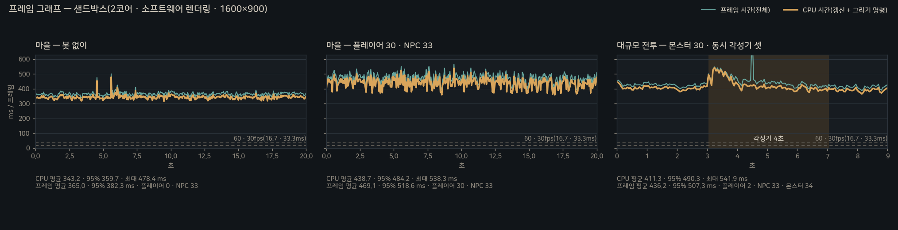
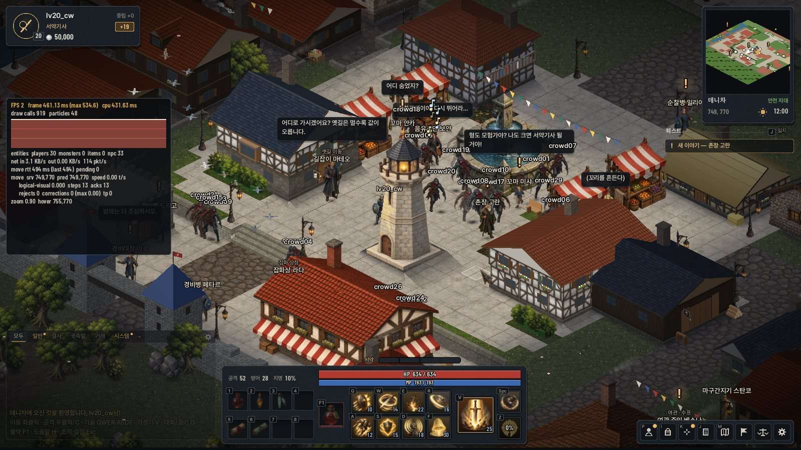
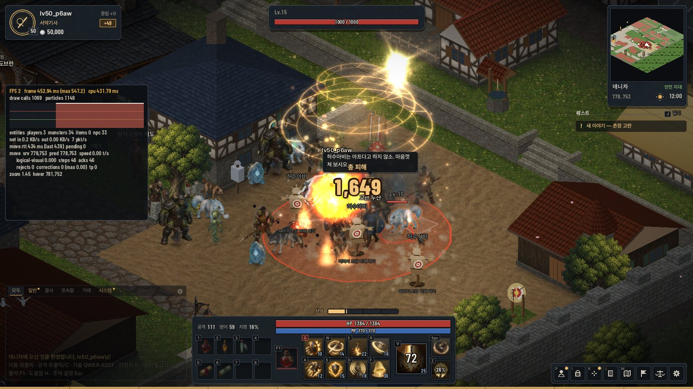
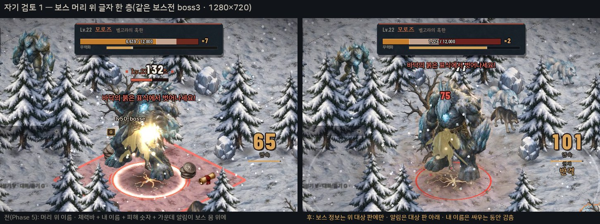
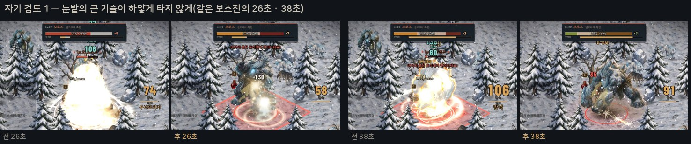
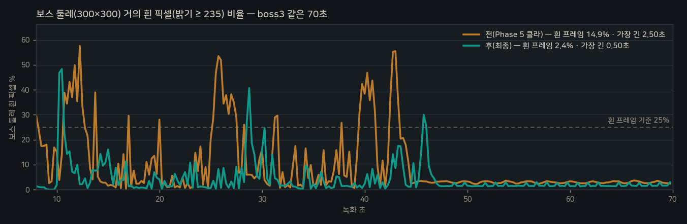
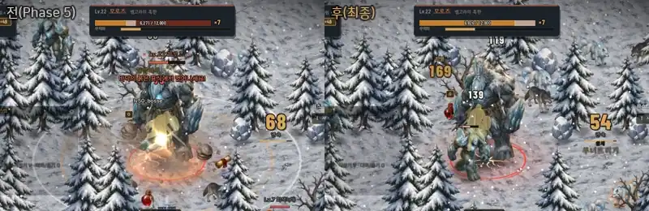

# Phase 6 — 통합 QA · 폴리싱

> 작업 지시: `claude/UPGRADE_PROMPT.md` [Phase 6]. 진단 · 설계 메모이며 하위 단계를 끝낼 때마다 결과를 덧붙인다.
> 코드 기준: Phase 5 끝(`newclient` — Phase 5 문서 커밋까지).

## 0. 기준 — 지금 코드

| 항목 | 지금(Phase 5 끝) | Phase 6에 필요한 것 |
|---|---|---|
| 한 세션으로 이어 도는 플레이 | 기능마다 시나리오(`tour` · `training` · `skills` · `boss3` · `chat3` · `guild3` · `auction:*`)는 있지만 따로따로 — 캐릭터 · 서버도 따로 | 접속부터 경매까지 한 캐릭터 한 세션 녹화(README 대표 영상) |
| 성능 기록 | F3 프레임 그래프 · 종료 때 `[perf]` 요약 · `awaken3`(몬스터 30 · 동시 각성기 셋) `[bench]` | 붐비는 마을(플레이어 30 · NPC 30) 시나리오 · 프레임마다 CSV · 메모리 · 에셋 용량 |
| 일관성 점검 | 사람이 문서를 보고 맞춘다 | 이름(용어집) · 쓰지 않는 말 · 색(토큰 · 보라 · 네온) · 말투를 자동으로 |

**일관성 기준선**(점검 도구를 처음 돌린 결과 — 고치기 전): 용어집에 없는 고유명 **31**(세트 조각 9 · 퀘스트 22) · 쓰지 않는 말 **3**(쿨다운 · 인벤토리 · 스킬) ·
영어 음차 아이템 이름 **4**(각인사의 로브 · 철 건틀릿 · 서약의 건틀릿 · 이레린 로브) · 시스템 문구 느낌표 **3** · 보라 **58**곳 · UI 코드의 토큰 밖 색 값 **281**.

## 1. 하위 단계 · 커밋

6-A 일관성 자동 점검(`tools/consistency/check.py`) + 걸린 것 고치기 → 6-B 성능(붐비는 마을 · 대규모 전투 · 메모리 · 에셋) →
6-C 전체 플레이 녹화(`--script fullplay` + 도우미) → 6-D 문서 → 6-E 마지막 자기 검토(로스트아크 · 던전앤파이터 전투 대비) · 전체 회귀.

## 2. 일관성 자동 점검 — `tools/consistency/check.py` (6-A)

`python3 tools/consistency/check.py [--list]` — 표준 라이브러리만, 저장소 뿌리에서 2초. FAIL이 하나라도 있으면 종료 코드 1. 예외는 `tools/consistency/allow.txt`에
"종류 | 값 | 이유" 한 줄씩 — **이유가 없는 줄은 읽지 않는다**(지금 다섯 줄: 영웅 희귀도 색 · 개발 도구의 키잉 자홍 · 위험 경고 느낌표 한 문구 · 하게체/기원문 인사 둘).

| 검사 | 기준 문서 | 보는 곳 | 판정 |
|---|---|---|---|
| **이름** — 데이터 표의 고유명이 용어집에 있는가 | WORLD.md 7장 | 공유 헤더 표 8개(지역 · NPC · 구획 · 몬스터 · 아이템 · 기술 · 퀘스트 · 장)의 첫 한글 문자열 | 없으면 FAIL |
| **쓰지 않는 말** | WORLD.md 4장(클리셰 · 다른 게임 고유명) · 6장(대신 쓰는 말이 정해진 음차) · 3.5(영어 음차) | 클라 소스 · 화면에 나가는 공유 표의 한글 문자열 | 들어 있으면 FAIL(짧은 말은 낱말 머리에서만) |
| **보라 · 네온** | DESIGN_SYSTEM 원칙 | 클라 · 공유 표의 **모든** 색 값(`Rgb(0x…)` · `Color{…}` · 색 자리의 `0x……`) | 색상 255~320° · 채도 30%↑ · 밝기 30%↑ = 보라, 순색에 가까운 밝은 녹 · 청록 · 자홍 = 네온 → FAIL |
| **토큰 흉내** | DESIGN_SYSTEM 1장 "그림 · 연출 색" | UI 코드(창 · HUD · 채팅 · 결사 · 경매 · 소지품 · 퀘스트 · 기술)에 적힌 색 값 | 토큰과 RGB 거리 12.5 안이면 FAIL(토큰으로), 뚜렷이 다르면 그림 · 연출 색(수만 알림) |
| **말투** | WORLD.md 5장 | 시스템 문구(`AddCenter` · `AddBanner` · `AddChat` …) · NPC 인사(`kNpcs`) | 시스템 문구의 느낌표 · 물결 = FAIL, NPC 말투가 그 직함의 체(하게 · 하오 · 해요 …)와 다르면 FAIL |

**전 → 후**

| 항목 | 처음 돌렸을 때 | 고친 뒤 | 한 일 |
|---|---|---|---|
| 용어집에 없는 고유명 | 31 | **0** | 세트 조각 9개를 줄여 쓰지 않고 이름대로 적고(서약의 흉갑 …), 퀘스트 표(29줄 — 본편 16 · 곁 6 · 날마다 4 · 직업 3)를 7장에 새로 |
| 쓰지 않는 말 | 3 | **0** | 쿨다운 → 재사용 대기(툴팁) · 인벤토리 → 가방 · 스킬 → 기술(`static_assert` 문구) |
| 영어 음차 아이템 이름 | 4 | **0** | 각인사의 로브 → **각인사의 법복** · 철 건틀릿 → **철 장갑** · 서약의 건틀릿 → **서약의 장갑** · 이레린 로브 → **이레린 법복**(번호는 그대로 — DB · 패킷 영향 없음) |
| 시스템 문구 느낌표 | 3 | **0**(+ 예외 1) | "수프 한 그릇!" · "무력화!"는 느낌표를 뺐고, "바닥의 붉은 표식에서 벗어나세요!"는 DESIGN_SYSTEM 2장이 허락한 **위험 경고**라 예외로 남겼다 |
| 보라 · 네온 | 58곳 | **0**(+ 예외 2) | 아이콘 빛(영웅 이상 · 마법 계열) → 청록 · 새벽빛, 몬스터 둘(떠도는 망령 · 그늘거미) · 옵션 메아리 · 강화 실패 연기 · 로브 색 · 수정 소품 → 청록 · 먹 · 불씨 계열. 남긴 둘: 영웅 희귀도 `#A985D8`(DESIGN_SYSTEM이 명시한 관례 색) · 개발 도구의 키잉 자홍(화면에 나가지 않음) |
| UI 코드의 토큰 밖 색 값 | 281 | **토큰 흉내 0** · 그림 · 연출 색 96 | 토큰 흉내 56곳을 토큰으로(`util::A8(토큰, 알파)` 새 도우미), 그림자 · 글자 테의 순검정 65곳 → `kShadow`, 윗면 빛 · 호버의 순백 → `kSheen`, 비슷한 갈색 다섯 → `kDawnWash`, 위험 단추 · 경고 판 → `kEmberWash`, 화면 경고 글자 → `kBadHi`, 체력 막대 바탕 → `kHpBack`, 옵션 글자 → `kOption`, 남의 결사 이름 → `kParchment`. 남은 96은 창 안의 **그림**(코드로 그린 아이콘 · 강아지 얼굴 · 장 카드 · 결말 연출 · 큰 지도 기호 · 기술 시연) — 보라 · 네온 검사는 받는다 |

지금 결과: `RESULT fail=0 warn=0` — 이름 223개 · 화면 문자열 2,325개 · 시스템 문구 47개 · NPC 인사 33개 · UI 색 값 104개(토큰 흉내 0).

## 3. 성능 — 붐비는 마을 · 대규모 전투 · 메모리 · 에셋 (6-B)

**재는 법**: `tools/sandbox/phase6.sh <클라> <서버> <출력> crowd0 crowd fight` — 품질 기준과 같은 **1600×900**, 클라는 `--perf-csv`로 프레임마다 한 줄
(전체 프레임 시간 · CPU 시간 · 드로우콜 · 입자 · 주변 플레이어 · 몬스터 · NPC 수 · 구간), 끝에 `[crowd]` / `[bench]` 요약과 `[mem]`(RSS · 최고 RSS, `/proc/self/status`).
그래프는 `tools/perf/plot_frames.py <출력>`.

| 장면 | 조건 |
|---|---|
| 마을 — 봇 없이(`crowd0`) | 분수 광장 남쪽(749, 770)에 서서 20초 — 마을 NPC 33이 배회(서버가 확장 세션에 모두 보낸다) |
| 마을 — 플레이어 30 · NPC 33(`crowd`) | 같은 자리 · 같은 20초, 시험 봇 30(`harven_bot --crowd 30` — 한 프로세스에서 확장 세션 30개, 분수 둘레 세 겹 원을 걷는다)이 모두 보일 때부터 |
| 대규모 전투(`fight`) | `awaken3` — 훈련장에 몬스터 30 · 모험가 셋이 **각성기를 같은 프레임에** 시작: 전 3초 · 각성 4초 · 뒤 2초 |

| 장면(1600×900 · 샌드박스) | CPU 시간 평균 / 95% / 최대 | 프레임 시간 평균 / 95% | 드로우콜 평균 / 최대 | 입자 최대 | 메모리(RSS · 끝) |
|---|---|---|---|---|---|
| 마을 — 봇 없이(NPC 33, 화면 안 평균 16.6) | 343.2 / 359.7 / 478.4ms | 365.0 / 382.3ms | 884 / 897 | 40 | 408.8MB |
| 마을 — 플레이어 30 · NPC 33(화면 안 평균 29.1 · 16.3, 최대 48) | 438.7 / 484.2 / 538.3ms(**+28%**) | 469.1 / 518.6ms | 925 / 943(+5%) | 70 | 409.4MB(+0.6) |
| 대규모 전투 — 전 3초(몬스터 30 · 모험가 셋) | 406.1 / — / 448.5ms | — | 777 / 794 | 36 | — |
| 대규모 전투 — **동시 각성기 4초** | 425.6 / — / 541.9ms(**+5%**) | — | 919 / 1,128 | **1,525** | 446.7MB |
| 대규모 전투 — 뒤 2초 | 390.4 / — / 409.3ms | — | 813 / 825 | 20 | — |

| 붐비는 마을 — 봇 30 · NPC 33, F3(프레임 그래프 · 드로우콜 · 입자) | 대규모 전투 — 동시 각성기 셋 절정 |
|---|---|
|  |  |

- 샌드박스는 **그리기까지 CPU**(Mesa llvmpipe, 2코어)라 절대값은 실제 GPU의 수십 배다 — 늘어난 **비율**과 드로우콜 · 입자 · 메모리를 본다. 60fps(16.7ms)는 **실기 확인 필요**.
- **사람 30명**: CPU +28%(한 사람당 샌드박스 약 +3.2ms)인데 드로우콜은 +5%뿐 — 늘어난 몫은 그림 픽셀(몸 · 옷 · 무기 · 그림자 · 이름표 · 결사 문장)이지 드로우콜이 아니다. 실제 GPU에서는 싼 쪽이다.
  메모리는 +0.6MB — 같은 직업 그림 · 문장 텍스처를 모두 나눠 쓴다. 봇 30은 240초 동안 거절 0 · 걸음 2만 3천(`bots.log`).
- **동시 각성기 셋**: +5%(Phase 2 같은 시험은 +31%). 효과 자체의 값(평균 +20ms · 최대 +93ms, 입자 1,525 — 등급 예산 T4 600~1,500 × 셋이 풀 상한 안)은 Phase 2와 비슷한데,
  바탕이 무거워졌다 — 훈련장이 Phase 4의 새 데니차(건물 19종 · 소품 · 높낮이) 안으로 들어가 **전 3초가 170 → 406ms, 드로우콜 314 → 777**. 마을 한 화면의 드로우콜 약 900이 이번 측정에서 가장 큰 항목이다.
- 실제 GPU에서 드로우콜 900은 그리기 자체보다 **CPU 제출 비용**(드라이버마다 호출당 수 µs → 수 ms)이 문제다 — 건물 · 소품을 텍스처 아틀라스 단위로 더 묶는 일(그리기 순서 · 깊이를 지키면서)이
  다음 최적화 후보다. 1,600×900 · 중급 GPU에서 16.7ms 안인지는 **실기 확인 필요**.
- 메모리: 마을 408MB(대부분 텍스처 — 아래 에셋 표의 "늘 올라 있는 것" 약 137MB + 글꼴 아틀라스 · 렌더 텍스처 · 오디오), 각성기 시험 447MB(효과 그림 · 입자 풀 · 전투 소리). 35분 동안 뜬 전체 플레이 녹화에서도 늘어나기만 하는 값은 없었다(456 → 473MB에서 멈춤 — 4장).

**에셋 용량**(`Client2D/assets`, 159파일 · 52MB — 실행 파일 5.4MB는 따로):

| 폴더 | 디스크 | 텍스처로 올렸을 때(RGBA) | 무엇 |
|---|---|---|---|
| sprites | 22MB | 74MB | 캐릭터 · 몬스터 · NPC 동작판 2048² 넷 · 동작 한 주기 · 소품 |
| fonts | 12MB | — | Pretendard 셋 · 고운바탕 둘 · NanumSquareRound · Barlow · Marcellus |
| art | 4.3MB | 83MB | 대표 그림 · 장 그림 5 · 초상화 23 — **처음 쓸 때 읽는다**(로그인 · 장 카드 · 대화창) |
| buildings | 4.3MB | 12MB | 그린 건물 7채 · 키트 |
| fx · icons · terrain · ui · voice | 3.1 · 3.0 · 2.9 · 0.3 · 0.9MB | 11 · 8 · 31 · 1MB | 효과 · 아이콘 아틀라스 · 바닥 아틀라스(2880×2304) · UI 장식 · 음성 35줄 |
| 합 | **52MB** | **221MB**(게임 화면에서 늘 올라 있는 것은 약 137MB — art는 쓸 때만) | |

## 4. 전체 플레이 녹화 — `--script fullplay` (6-C)

한 캐릭터(`lv50_fp` — 서약기사 레벨 50, 샌드박스 꾸러미 `_fp`: 은 목걸이(영웅) · 귀환 두루마리 · 물약) · 한 세션 · 한 서버로 처음부터 끝까지 뜬다.
도우미 `lv30_fq`(`fullplay:helper`)가 같은 서버에 붙어 따라간다 — 전체 채팅에 "결사"가 나오면 귓속말로 답하고, 초대를 받고, 경매장에서 은 목걸이를 산다.
녹화는 공유 시계(lockstep, 1280×720 · 20fps — 느린 소프트웨어 렌더링에서도 영상의 시간 간격이 실제와 같다), 도우미는 그 시계를 따라간다.

| 장면 | 한 일(스크립트) | 빌려 쓴 시나리오 |
|---|---|---|
| 접속 | 로그인 화면에서 이름을 한 자씩 치고 "접속하기" — 녹화는 로그인 화면부터 | — |
| 마을 투어 | 카메라가 데니차 → 분수 광장 → 시장 거리 → 결사 회관 단 → 장인 거리 → 훈련장을 돈다(구획 이름 자막). 그 사이 캐릭터는 훈련장으로 걷는다 | 4장 투어의 모양 |
| 훈련장 | 허수아비에게 콤보 → 기술 여덟 → 이동기 → 각성기 → 고유 기술 한 바퀴(옆에 훈련 계측) | `training` |
| 데니차 들녘 | 남문 밖으로 → 들판 몬스터에게 기술 여덟을 유형대로(모으기 완벽 구간 · 누르고 있기 · 이어 쓰기 끝 단) | `skills` |
| 모로즈 | 길잡이 마테오 → 벨고라 설원 → 모로즈(12줄 · 무력화)에게 기술을 돌려 쓴다 | `boss3` |
| 채팅 | 귀환 두루마리 → `/전 모로즈를 쓰러뜨렸소…`(한 자씩 쳐서) → 도우미의 귓속말 → `/귓`으로 답 | — |
| 결사 | 회관지기 즈데노 → 세우기 창(이름 「첫새벽」을 치고 · 문장 모양과 바탕색을 바꿔 본다) → 축하 → `/초대` → 도우미가 들어옴 → `/길` → 카메라를 물려 깃발 뜰(우리 문장 천) | — |
| 경매장 | 경매인 로렌초 → 판매 등록(시세 힌트 → 30000 입력 → 올리기) → 내 경매 → 도우미가 사면 팔림 알림 → 정산함 → 받기 | — |
| 끝 | HUD를 걷고 카메라가 마을 한가운데로 물러나며 "하르벤" | — |

장면 · 이동이 바뀔 때마다 `[fp] seg/mark <이름> rec=<녹화 초>`를 찍고, `tools/record/fullplay_cut.py`가 그 표로 걷는 구간만 ×4(도우미가 사러 오는 동안 ×3)로 감아 한 편으로 붙인다 —
잘라 낸 곳은 없다. 미리 보기 WebP(장면마다 몇 초)는 README 첫 화면용.

**이번 녹화**(최종 클라 · 서버, 녹화 246.1초 → 영상 3분 20초):

| 장면 | 녹화 초 | 영상 | 배속 |
|---|---|---|---|
| 접속 — 로그인 화면에서 이름을 한 자씩 치고 "접속하기" | 0.0 ~ 5.5 | 0:00 ~ 0:06 | ×1 |
| 마을 투어 — 데니차 · 분수 광장 · 시장 거리 · 결사 회관 단 · 장인 거리 · 훈련장(구획 자막) | 5.5 ~ 25.9 | 0:06 ~ 0:26 | ×1 |
| 훈련장 — 허수아비에게 콤보 · 기술 여덟 · 이동기 · 각성기 · 고유 기술(훈련 계측) | 25.9 ~ 55.4 | 0:26 ~ 0:55 | ×1 |
| 남문 밖 데니차 들녘으로 | 55.4 ~ 85.4 | 0:55 ~ 1:03 | ×4 |
| 데니차 들녘 — 몬스터에게 기술을 유형대로 | 85.4 ~ 109.5 | 1:03 ~ 1:27 | ×1 |
| 길잡이 마테오 → 옛길 → 벨고라 설원 | 109.5 ~ 121.2 | 1:27 ~ 1:30 | ×4 |
| 모로즈(12줄 체력 · 무력화) — 162.0초에 쓰러짐 | 121.2 ~ 166.6 | 1:30 ~ 2:15 | ×1 |
| 귀환 두루마리 → `/전` 한 자씩 → 도우미 귓속말 → `/귓` 답 | 166.6 ~ 181.6 | 2:15 ~ 2:30 | ×1 |
| 결사 회관으로 | 181.6 ~ 191.9 | 2:30 ~ 2:33 | ×4 |
| 즈데노 → 「첫새벽」 세우기(문장 · 바탕색) → 축하 → `/초대` → 도우미 가입 → `/길` → 깃발 뜰 | 191.9 ~ 217.8 | 2:33 ~ 2:59 | ×1 |
| 경매장으로 | 217.8 ~ 225.4 | 2:59 ~ 3:01 | ×4 |
| 로렌초 → 판매 등록(시세 힌트 · 30000 입력 · 올리기) | 225.4 ~ 229.3 | 3:01 ~ 3:04 | ×1 |
| 도우미가 찾아 사는 동안 | 229.3 ~ 231.6 | 3:04 ~ 3:05 | ×3 |
| 팔림 알림 → 정산함 → 받기 | 231.6 ~ 239.6 | 3:05 ~ 3:13 | ×1 |
| 끝 — HUD를 걷고 카메라가 마을 위로 물러나며 "하르벤" | 239.6 ~ 246.4 | 3:13 ~ 3:20 | ×1 |

결과 줄: `[fp] done rec=246.10 bossDown=1 guild=1 members=2 adena=67400` — 그로시 50,000 → 67,400(옛길 −800 · 결사 세우기 −10,000 · 경매 보증금 −300 · 대금 +28,500 = 30,000 − 수수료 5%),
도우미는 50,000 → 20,000(은 목걸이 30,000). 녹화 35분(샌드박스 실제 시간) 동안 클라 RSS 456 → 469MB에서 멈췄다가 경매 창 · 마지막 마을 전경에서 473MB(도우미 369 → 380MB) — 늘어나기만 하는 값은 없다.

**영상 파일**: `Client2D/docs/fullplay.mp4`(854×480 · 15fps · 10.9MB — 저장소용) · 미리 보기 `Client2D/docs/fullplay_preview.webp`(장면 일곱에서 3초씩, 560px · 2.7MB).
1280×720 · 20fps 판(43.6MB)은 저장소에 넣지 않고 따로 전달했다. 다시 뜨기: `tools/sandbox/phase6.sh <클라> <서버> <출력> fullplay` →
`python3 tools/record/fullplay_cut.py <출력>/lv50_fp.log <출력>/rec_fullplay/capture.mp4 fullplay.mp4 --width 854 --fps 15 --crf 31 --preview preview.webp`.

## 5. 완료 기준

| 지시서 | 결과 | 어디 |
|---|---|---|
| 전체 플레이 녹화 한 편: 접속 → 마을 투어 → 훈련장 기술 시연 → 들녘 사냥 → 보스 → 채팅 → 길드 → 경매(README 대표 영상) | 됨 — 한 캐릭터 · 한 세션 · 잘라 낸 곳 없이(걷는 구간만 빨리 감기) — 녹화 246초 → 영상 3분 20초, 보스 처치 · 결사원 2 · 판매 · 정산까지 `[fp] done` | 4장 · README |
| 성능: 붐비는 마을(플레이어 30 · NPC 30) · 대규모 전투의 프레임 그래프 · 메모리 · 에셋 용량 | 됨 — 봇 30(확장 세션) + NPC 33 · 몬스터 30 + 동시 각성기 셋, 프레임마다 CSV → 세 칸 그래프 · `[mem]` · 에셋 표 | 3장 |
| 일관성 자동 점검: 새 이름이 모두 용어집에 · 색이 모두 토큰 · 문구가 WORLD.md 말투 | 됨 — `tools/consistency/check.py` FAIL 0(기준선 이름 31 · 말 3 · 음차 4 · 느낌표 3 · 보라 58 · 토큰 흉내 56) | 2장 |
| 문서: README(조작표 · 스크린샷 · GIF) · DESIGN_SYSTEM(10장 · HUD · 채팅 색) · WORLD(새 용어) · LINEAGE_CONTENT(길드 · 경매 · 채팅 프로토콜 · DB) · handoff | 됨 — README 대표 영상 · 미리 보기 · 조작표 · 새 스크린샷, DESIGN_SYSTEM 1장 새 토큰 · 5장 가운데 알림 · 10.8 읽히는 싸움 · 12장 영상 자막, WORLD 7장 퀘스트 표 · 아이템 이름, LINEAGE 패킷 번호 한눈에 · Phase 6 절 | 각 문서 |
| 마지막 자기 검토: 5가지 → 가장 큰 것 하나 더 고치기 | 됨 — "싸움 한가운데가 안 읽힌다" 고침(흰 프레임 14.9% → 2.4%), 나머지 넷은 미완으로 적음 | 6장 |
| (공통) 회귀 없음 · STRESS 전/후 · 새 패킷 ≤255B | 회귀 59/59 + 마지막 고침 뒤 관련 8개 다시 통과 · Phase 5 시험 50개(서버 시작 충돌로 `dup`만 한 번 더) · STRESS 같은 수준 · 새 패킷 없음 | 7 · 8장 |

## 6. 마지막 자기 검토 — 로스트아크 · 던전앤파이터 전투와 견주어 "가장 먼저 눈에 띄는 차이 5가지"

상용 게임 영상은 샌드박스에서 내려받아 나란히 틀 수 없어, 두 게임 전투 화면의 알려진 문법(화면 가운데를 비워 두는 HUD · 짧은 섬광 · 기술마다 몸 동작 · 맞는 쪽의 몸 반응 · 층이 많은 소리 · 여러 겹의 보스 예고)과
우리 녹화(보스전 `boss3` 70초 · 전체 플레이의 모로즈 장면 · 동시 각성기 `awaken3`)를 나란히 두고 적었다. 눈에 띄는 순서대로.

| # | 가장 먼저 눈에 띈 차이 | 우리 녹화에서 본 것 | 한 것 |
|---|---|---|---|
| 1 | **싸움 한가운데가 안 읽힌다** | 모로즈 머리 위에 이름 · 체력바(화면 위 대상 판과 두 번) · 내 이름 · 피해 숫자 · 연계 이름 · 가운데 알림(화면 높이 27% = 보스 가슴)이 한 자리에 겹쳤다. 밝은 눈밭에서는 철벽 태세 막 · 심판의 종 · 각성 절정이 가운데를 하얗게 태워 보스와 기사가 한 번에 최대 2.5초 사라졌다(보스 둘레 흰 프레임 14.9%). 로스트아크는 보스 정보를 화면 위 한 줄에, 알림을 위쪽에 두고 가운데는 캐릭터 · 적 · 바닥 예고에게 준다. 던전앤파이터의 섬광은 몇 프레임 번쩍이고 곧 형태로 돌아온다 | **고침(가장 큼)** — 아래 |
| 2 | **기술에 몸 동작이 없다** | 새 기술 18개는 기본 자세 + 모이는 빛 · 궤적. 던전앤파이터는 기술마다 고유 동작 프레임이 타격감의 절반이다 | **미완** — 1-D 동작 그림 일괄 생성(약 357크레딧 — Higgsfield 잔액의 30%를 넘어 사용자 승인 대기). 지금은 모이는 빛 · 궤적 · 히트스톱으로 박자를 만든다 |
| 3 | **맞는 쪽의 몸 반응이 얇다** | 몬스터는 흰 번쩍 · 움찔 · 넉백 미끄러짐 · 띄우기(몸만) · 넘어뜨리기까지. 던전앤파이터의 공중 콤보 · 벽 튕김 · 다운 추가타, 로스트아크의 부위 파괴 · 무력화 그로기(큰 적이 무너지는 동작)가 없다 — 모로즈 무력화는 게이지 · 글자뿐 | **미완** — 몬스터 반응 그림(쓰러짐 · 그로기 동작)과 서버 상태(공중 · 다운 판정)가 함께 필요 |
| 4 | **소리가 얇다** | 효과음은 `audio/Sfx.cpp` 합성(층 2~5) — 녹음한 타격음 · 쇳소리 · 목소리(기합 · 비명)가 없고 보스 목소리도 없다(음성 35줄은 NPC 인사) | **미완** — 녹음 소리 에셋이 필요. 실제 스피커에서의 믹스는 실기 확인 필요 |
| 5 | **보스 예고가 한 가지** | 모로즈의 예고는 붉은 바닥 표식(+ 가운데 알림) 하나. 로스트아크 보스는 몸 빛(피할 것 · 반격할 것) · 소리 · 카메라로 여러 신호를 겹친다 — 우리는 반격 기회 같은 두 번째 신호가 없다 | **미완** — 서버 보스 패턴(반격 창)과 클라의 몸 빛 · 소리를 함께 늘려야 한다(다음 단계 후보) |

**1번 고침 — 싸움 한가운데를 싸움에게**(`71749e2 fix(skill)`, DESIGN_SYSTEM 10.8)

- **글자 한 층**: 대상으로 잡은 보스는 이름 · 체력을 화면 위 대상 판(여러 줄 체력바 · 무력화)에만 — 머리 위에 겹쳐 그리지 않는다. 보통 몬스터는 맞으면 체력바만(이름은 가리키거나 · 대상이거나 · Alt일 때 —
  예전에는 맞은 적마다 이름이 떴다). **내 이름표는 싸우는 동안**(내가 때리거나 맞은 지 5초 안) 감춘다. **내 연계 이름**은 오른쪽 연속 타격 판(이름 · 소리 · 번쩍임)에서만 — 적 머리 위에는 남의 연계만.
  **가운데 알림**은 화면 높이 27% → 16%와 대상 판 아래 중 낮은 쪽으로.
- **흰빛은 테두리에만**: 심판의 종 몸통(더하기 금빛 28~45%)을 보통 혼합의 옅은 먹금빛 껍데기(16%)로 — 종 모양은 빛나는 테두리가 말한다. 철벽 태세 막을 크림빛 · 알파 200에서 금빛 · 150으로.
  규칙: 넓은 면은 제 색 + 알파 60% 이하, 크림 · 흰빛은 테두리 · 획 · 작은 중심 섬광에만.
- **밝은 바닥 섞기**(`gfx::SetBrightGround(k)`): 8비트 화면에서 눈밭(바닥 밝기 약 0.87 — 여유 0.1~0.15)에 빛을 **더하면** 무엇이든 곧장 흰색이 된다. k > 0이면 월드 셰이더(`render/Sprites`)와 셰이더 효과(`fx/Vfx`)가
  더하기 연출을 **미리 곱한 알파 + 바닥 덮기 k**로 내보낸다(혼합 ONE · ONE_MINUS_SRC_ALPHA): 결과 = 색 × a + 바닥 × (1 − a·k). k = 0이면 예전 더하기와 똑같고, k가 클수록 빛이 **제 색(금빛 · 청록)으로** 바닥을 덮는다.
  블룸은 합성할 때 × (1 − k × 바닥 밝기), 순간 조명은 곱하는 몫 × (1 − 0.6k). k는 바이옴 바닥색(팔레트 a · b) 밝기로 정한다 — 눈밭 0.75 · 바닷가 약 0.67 · 사막 약 0.49 · 풀밭 · 숲 · 협곡 · 마을 0,
  밤에는 × (1 − 0.85 × 밤), 지역을 넘으면 0.5초에 걸쳐. 풀밭 · 숲 · 마을의 연출은 한 픽셀도 바뀌지 않는다.

**전 / 후**(같은 시나리오 `boss3` — 1280×720 · 공유 시계, 전 = Phase 5 끝 클라 · 후 = 최종 클라, 같은 서버):

| 보스 둘레 300×300, 밝기 235 이상 픽셀이 25%를 넘는 프레임(초당 4장 · 8~70초) | 흰 프레임 | 가장 긴 흰 구간 | 평균 흰 픽셀 |
|---|---|---|---|
| 전 — Phase 5 끝 클라 | 37 / 248(**14.9%**) | **2.50초** | 10.0% |
| 글자 한 층만(흰빛은 그대로) | 38 / 248(15.3%) | 2.75초 | 11.0% |
| + 종 껍데기 | 28 / 248(11.3%) | 1.50초 | 9.7% |
| + 철벽 태세 막 색 · 밝은 바닥 섞기 = **후** | 6 / 248(**2.4%**) | **0.50초** | 4.3% |

재는 법: `python3 tools/record/whiteout.py <전 capture.mp4> <후 capture.mp4> --names 전,후 --plot out.png` — 녹화는 `boss3`를 `--record`로(영상 자체는 커밋하지 않는다).
남은 흰 순간은 각성 절정 · 무력화 · 마지막 종소리의 0.25~0.5초 섬광이다 — 짧은 번쩍임은 타격감이라 남겼다(던전앤파이터 문법).

## 7. 부하 · 회귀

**부하** — STRESS_TEST 봇 150초, 같은 조건(샌드박스 2코어 · Wine)에서 Phase 5 끝 서버와 Phase 6 서버를 번갈아 두 번씩:

| 서버 | 100ms 안 최대 동시 접속 | 후반 평균 지연 |
|---|---|---|
| Phase 5 끝 — 1회 | 2,018 | 139ms |
| Phase 6 — 1회 | 2,072 | 105ms |
| Phase 5 끝 — 2회 | 2,037 | 140ms |
| Phase 6 — 2회 | 2,041 | 139ms |

같은 수준 — Phase 6의 서버 변경은 데이터 표의 글자 · 색 값뿐이다.

**회귀** — 전체 회귀 59개(`tools/sandbox/regress.py` — 58 + 새 `boss3`, 1280×720, 자기 검토 고침까지 들어간 클라 · Phase 6 서버, 17:04 → 18:36): **59개 모두 통과**(종료 코드 0 · 스크린샷 59장).
판정 줄: growcheck 15/0 · wmcheck 다섯 묶음 모두 통과(hotfeel 5/0 포함) · hudcheck 겹침 0 · 화면 밖 0 · terraincheck PASS · arrive 7.15초 · birds PASS — Phase 5 끝과 같다.
시나리오마다 CPU 시간 · 드로우콜도 Phase 5 끝 회귀와 같은 수준이다(장면이 같으면 ±10% 안팎 — 걸음 수는 NPC 자리 · 시각에 따라 원래 크게 흔들린다).

회귀 스크린샷을 README 사진으로 쓰려고 훑다가 둘을 더 찾아 고쳤다(`4735d1a`):
**1280×720에서 훈련 계측 판 가운데를 채팅창 탭 줄이 가로질렀다**(Phase 3부터 — 채팅창이 전투 판 위 왼쪽으로 올라오는 해상도) → 겹치면 판을 채팅창 위로 올리고 기술별 몫 줄을 줄인다.
**장 카드 시험 스크린샷이 카드가 지나간 뒤에 찍혔다**(카드는 실제 시계로 5.2초인데 느린 샌드박스는 프레임 dt 상한 때문에 달린 시간이 실제보다 느리게 간다) → `chapter1`은 달린 시간 1.3초에.
마지막 두 고침(`f41fcb9` · `4735d1a`) 뒤 관련 시나리오를 다시 돌렸다 — combat · chapter1 · uiedit · hudres · boss3 · hotfeel · training · skills:2 모두 통과(hudcheck 겹침 0 · wmcheck 3/0 · 5/0).
training은 한 번 시간 초과가 났는데(같은 때 README 사진을 찍는 클라 넷을 겹쳐 돌렸다) 혼자 다시 돌려 통과했다.

결사 · 경매는 전체 플레이 녹화가 한 번에 지나가고(세우기 · 초대 · 가입 · 결사 채팅 · 깃발 뜰 · 등록 · 구매 · 정산 — `[fp] done … members=2 adena=67400`),
Phase 5 시험 모음(`phase5.sh guild3 auction race dup expire crash` → `phase5_check.py`)도 최종 클라 · 서버로 다시 돌렸다: **47/50** — 떨어진 셋은 모두 `dup`인데,
시험 쪽이 아니라 **그 시험을 위해 새로 켠 서버가 Zone 초기화 중 충돌**해 클라가 붙지 못해서였다(9장). 서버를 다시 켜 `dup`만 돌리니 **3/3** — 합쳐 50개 모두 통과.

## 8. 새 패킷 · DB

**없음.** `PacketType` 97개(0~96) 그대로, `setup.sql` 그대로. 서버 쪽 변경은 공유 데이터 표의 글자 · 색 값뿐(아이템 이름 넷 · 몬스터 둘의 그리기 색 · 옵션 메아리 색 · `static_assert` 문구 하나 — 아이템은 번호로 저장 · 전송하므로 DB · 패킷 값은 그대로).
샌드박스에만: 인메모리 DB의 `_fp` 꾸러미(전체 플레이 녹화용) · 시험 봇 `--crowd`. 정리는 LINEAGE_CONTENT "Phase 6" 절 · "확장 패킷 번호 한눈에".

## 9. 알려진 한계 · 실기 확인 필요

- **60fps(1600×900)** — 샌드박스는 소프트웨어 렌더링이라 비율만 쟀다. 마을 한 화면 드로우콜 약 900이 실제 GPU에서 CPU 제출 비용으로 얼마인지 **실기 확인 필요**(3장).
- **MSVC 빌드** — 새 파일(`game/GameScriptP6.cpp` — 클라는 CMake GLOB) · 바뀐 파일을 MSVC로 빌드하지 못했다. 로컬에서 고친 흔적(`KeyBinds.cpp`의 `<algorithm>` · `pch.h`의 `_CRT_SECURE_NO_WARNINGS`)이 보여,
  새 파일은 쓰는 표준 헤더를 모두 직접 넣었다. **실기 확인 필요**.
- **서버가 켜질 때 드물게 죽는다(Phase 6 이전부터 있던 경합으로 보인다)**: 샌드박스에 남은 서버 기록 74개(9월 25일부터) 중 한 번(Phase 5 시험 모음의 `dup` 서버), Zone 스레드 16개가
  동시에 몬스터를 만드는 `MonsterHelper::InitForZone` → `GetGameObject`(`unordered_map::find` — shared_lock 아래)에서 널 읽기(`0x28`)로 죽었다. 이 길(몬스터 초기화 · `GameObjectManager`)은
  Phase 6에서 바꾸지 않았고, 쓰기(Insert · Delete)는 모두 unique_lock이라 표가 깨질 길이 코드에서 보이지 않는다 — MinGW(winpthreads 읽기-쓰기 잠금은 처음 쓸 때 늦게 만든다) · Wine에서만
  나는 것일 수 있다. MSVC(SRWLOCK) 실서버에서도 나는지 **실기 확인 필요** — 나면 `GameObjectManager`를 만들 때 잠금을 한 번 잡아 두거나 `InitForZone`을 차례로 돌려 막는다.
- **자기 검토 2~5번**(몸 동작 · 맞는 쪽 몸 반응 · 소리 · 보스 예고 한 가지)은 **미완**이다. 2번은 1-D 동작 그림 일괄 생성(약 357크레딧)의 승인을 기다린다.
- 밝은 바닥 섞기는 바이옴 단위(화면 전체 k 하나)다 — 눈밭 안의 어두운 바위 · 나무 위 연출도 같은 k로 섞인다(어두운 곳에서는 더하기와 거의 같아 차이가 작다). 무기 궤적 리본(`fx/Trail`, 기본 셰이더)은 섞기 밖.
  8비트 화면에 바로 그리는 구조 자체(HDR · 톤 매핑 — Phase 2 미완)는 그대로다.
- 큰 보스가 화면 위쪽에 서면 솟는 피해 숫자가 대상 판 아래 알림 줄에 닿는다(글자 외곽선으로 읽히지만 겹친다).
- 붐비는 마을에서 이름표끼리 겹친다(봇 30이 분수 둘레에 모이면 "crowd08crowd17"처럼) — 이름표 겹침 피하기(가까운 것부터 · 겹치면 흐리게)는 하지 않았다.
- 전체 플레이 녹화는 샌드박스(느린 소프트웨어 렌더링)에서 공유 시계로 떠, 영상 속 움직임은 실제 시간과 같지만 **실제 프레임률을 보여 주지 않는다**. 도우미(lv30_fq)는 스크립트다.
- 일관성 점검의 말투 검사는 시스템 문구 · NPC 인사만 본다(퀘스트 본문 · 대화 선택지는 사람이 본다). 이름 검사는 공유 헤더 표 8개의 고유명만.
- 조작 설정의 "고유 기술 2(X)" 줄은 아직 쓰는 기술이 없다(Phase 1-A에서 자리만 잡아 둠) — 직업마다 두 번째 고유 기술을 넣을 때 쓴다.

## 10. 커밋

| 커밋 | 내용 |
|---|---|
| `97c0ecc fix(items)` | (로컬에서 다른 세션이 먼저 올림) 로브 → 법복 · 건틀릿 → 장갑 + 점검 도구 초안 — 6-A가 이 위에 다시 쌓였다 |
| `307f275 fix(ui)` | 6-A 일관성 자동 점검(`tools/consistency/check.py` + `allow.txt`) · 새 토큰 여덟 · `util::A8` · 보라 · 음차 · 느낌표 · 용어집 |
| `f441311 feat(world)` | 6-B 성능 계측(`--perf-csv` · `[mem]` · `crowd` · `harven_bot --crowd` · 프레임 그래프) · 6-C 전체 플레이(`--script fullplay` · 도우미 · 로그인 화면 타자 · 장면 자막 · `fullplay_cut.py`) |
| `71749e2 fix(skill)` | 6-E 자기 검토 1 — 글자 한 층 · 흰빛은 테두리에만 · 밝은 바닥 섞기 |
| `f41fcb9 fix(ui)` | 가운데 알림이 아래로 옮긴 대상 판을 따라가지 않게 · 새 파일의 표준 헤더(MSVC) |
| `4735d1a fix(ui)` | 훈련 계측 판이 1280×720에서 채팅창과 겹치던 것(회귀 스크린샷에서 찾음) · 회귀에 `boss3` · 장 카드 찍는 시각 |
| `98d4eca assets(video)` | README 대표 영상 `Client2D/docs/fullplay.mp4`(854×480 · 10.9MB) · 미리 보기 WebP(2.7MB) |
| `docs(world)` | Phase 6 마무리 — 이 문서 · README(대표 영상 · 새 사진 16장 · 조작표) · DESIGN_SYSTEM 10.8 · LINEAGE · `tools/record/whiteout.py` |

